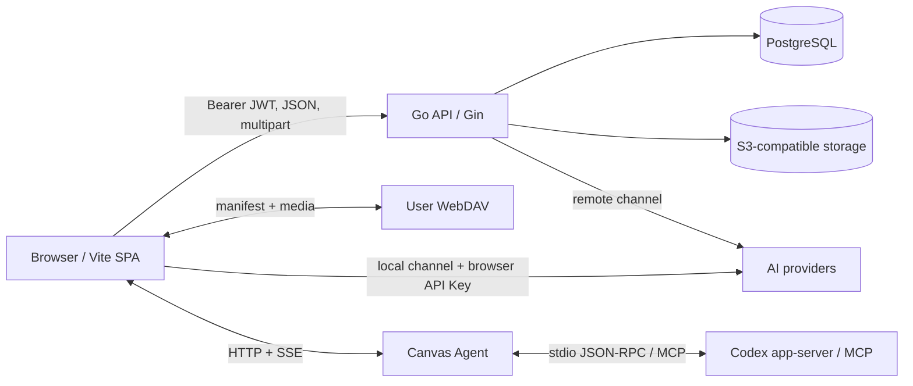
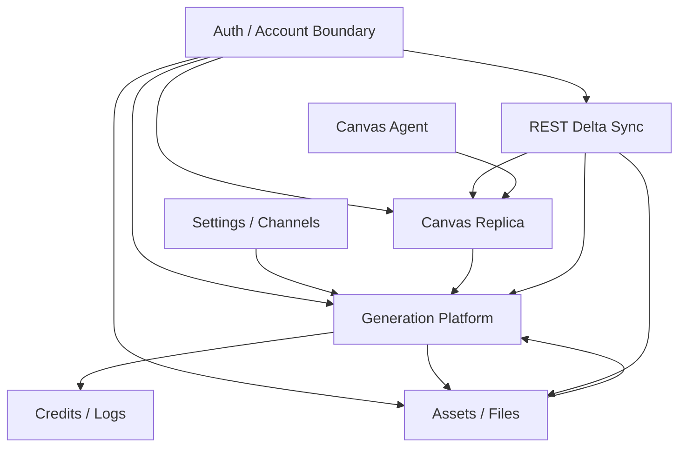

# 整体架构

## 系统定位

Infinite Canvas 是一个 AI 创作工作台。Canvas 将文本、图片、视频、音频和配置节点编排成图；生成链路把图输入转换为兼容请求或第一方 `GenerationCommand`，最终把可用媒体保存为平台文件并回写节点、素材和任务历史。

## 仓库组成

| 子系统 | 职责 | 输入 | 输出 | 核心入口 |
| --- | --- | --- | --- | --- |
| Go API | 认证、企业、积分、模型渠道、AI 代理、生成任务、Canvas/素材同步、文件和管理后台 | HTTP、环境变量、PostgreSQL、上游 AI、S3 | JSON API、流式/文件响应、后台任务 | `main.go`、`router/router.go` |
| Web SPA | 用户和管理员 UI、Canvas、工作台、本地缓存、WebDAV、在线/本地助手 | 用户操作、API、IndexedDB、本地 Agent | 页面状态、API 请求、Canvas Replica、下载文件 | `web/src/main.tsx`、`web/src/router.tsx` |
| Docs | 用户与开发文档、搜索、LLM 文本出口 | MDX、根 CHANGELOG、静态资源 | 文档站、搜索索引、`llms.txt` | `docs/src/app/` |
| Canvas Agent | 将网页 Canvas、Codex app-server 和 MCP 工具连接起来 | HTTP/SSE、stdio、画布快照、Agent prompt | SSE 事件、工具调用、Canvas 操作 | `canvas-agent/src/index.ts` |
| Codex 插件 | 向 Codex 注册技能和 Infinite Canvas MCP | 插件安装、自然语言请求 | skills、MCP 配置 | `plugins/infinite-canvas/` |
| 部署 | 本地 Compose、生产镜像、蓝绿切换 | 镜像、环境变量、Git SHA | Web/API/PostgreSQL/Caddy 服务 | `docker-compose*.yml`、`deploy/` |

## 运行拓扑



## 后端启动顺序

`main.go` 使用包级静态依赖，没有 DI 容器：

1. `config.Load()` 读取 `.env` 和环境变量。
2. `service.EnsureDefaultAdmin()` 触发数据库初始化并确保管理员存在。
3. 校验代码内 Generation Profile 和数据库中的绑定。
4. 启动提示词 cron、生成 payload 清理任务和 generation worker。
5. 创建 Gin Router，监听端口。
6. 收到 SIGINT/SIGTERM 后按 `SHUTDOWN_TIMEOUT` 优雅关闭 HTTP。

数据库在 `repository.DB()` 中按需初始化，使用 `sync.Once`。它会尝试创建目标数据库、执行 GORM `AutoMigrate`，再执行手写的序列、部分唯一索引、延迟外键和约束触发器 SQL。

## 后端分层

```text
router/middleware
        |
      handler       HTTP 输入、响应信封、状态码
        |
      service       权限、默认值、校验、ID、时间、事务决策、上游编排
        |
    repository      GORM/SQL、锁、CAS、查询和事务执行
        |
       model        持久化结构、DTO、枚举和简单模型方法
```

分层不是绝对纯净：

- `handler/media_reference.go` 直接操作本地文件系统。
- `handler/task_callback.go` 有直接 repository 调用。
- generation 的事务决策在 service，事务原子执行在 repository。

## 前端启动与状态层

```text
main.tsx
  -> AppProviders
     -> Ant Design / ProConfigProvider
     -> QueryClientProvider
     -> RouterProvider
        -> ClientRootInit
           -> public settings
           -> auth hydration
           -> session / credit monitor
           -> REST delta sync scheduler
           -> account-bound store refresh
```

前端不是文件系统 App Router。所有路由集中在 `web/src/router.tsx`，页面静态导入，目前没有路由级代码分割。

状态职责：

- Zustand：认证、主题、AI 配置、个人素材、Canvas Replica、Canvas UI/Agent。
- TanStack Query：管理后台和部分按需服务端列表。
- 页面本地 state：工作台输入、Canvas 交互、弹窗和短生命周期状态。
- localforage：账户隔离的 Canvas/素材缓存、工作台日志、媒体 Blob。

## 持久化边界

| 数据 | 主要持久化 | 浏览器状态 | 同步/恢复语义 |
| --- | --- | --- | --- |
| 用户、企业、积分 | PostgreSQL | 当前用户快照 | `/api/auth/me` 和余额刷新 |
| 服务端模型渠道、价格、OAuth Secret | PostgreSQL `settings` | 只接收公开投影 | 管理员保存；普通用户不见密钥 |
| 本地模型渠道、用户 API Key | 浏览器配置 store | `localStorage` | 不上传服务端 |
| Canvas 项目 | PostgreSQL + Canvas Project Replica | 账户隔离 IndexedDB | 本地先写、4 秒防抖、revision CAS、dirty 保护 |
| 个人素材元数据 | PostgreSQL | 账户隔离 IndexedDB 缓存 | API 成功后写缓存，cursor delta 刷新 |
| 企业素材 | PostgreSQL | 页面查询缓存 | 不进入个人 store、REST 个人同步或 WebDAV |
| 平台媒体文件 | S3 + `user_files` | 临时预签名 URL | 通过 `fileId` 刷新 URL |
| 本地媒体 Blob | IndexedDB `image_files/media_files` | `blob:` URL 内存缓存 | ZIP/WebDAV 可携带；未按账户物理分库 |
| 生成任务与积分流水 | PostgreSQL | 页面/Query cache、部分工作台本地历史 | `/generation-tasks` 和 `/sync` |
| 提示词 | PostgreSQL | 页面查询状态 | cron 或管理员整分类替换 |
| 本地 Agent thread | `~/.infinite-canvas/` 工作区 | Agent 面板内存状态 | Canvas Agent 管理 |

Canvas 的准确描述不是“PostgreSQL 永远覆盖客户端”，而是：

- PostgreSQL 持久化已同步项目和全局 `revision`。
- 浏览器接受的本地修改在确认前是 `Offline Dirty`。
- 远端 update/delete 不能覆盖 dirty 项目。
- 明确删除使用本地 tombstone，服务端使用 `deleted_records`。

## 两条 AI 调用路径

### 本地渠道

浏览器保存 `Base URL/API Key/protocol/models`，直接请求用户的上游。平台 API 不参与渠道密钥、积分扣费或完整审计；生成结果若要成为平台文件，仍需调用文件上传 API。

### 远程渠道

浏览器只发送平台 JWT。Go API 从 private settings 选择渠道、附加真实 API Key、计算积分并记录任务/审计。第一方视频还会进入持久队列和 Adapter 生命周期。

## 外部依赖

- PostgreSQL：结构化事实、任务队列、积分事务和同步游标。
- S3-compatible storage：个人/企业上传文件和 Materialized Result。
- OpenAI/Gemini/XvanAI/Seedance/Vidu 等上游：由渠道协议和 Adapter 隔离。
- GitHub 原始内容：提示词分类同步。
- Linux.do：可选 OAuth。
- WebDAV：用户触发的全快照合并，不是服务端 REST sync 的替代品。
- Codex app-server / MCP：本地 Agent。

## 跨模块依赖



## 当前高风险集中点

- `web/src/pages/canvas/project/index.tsx` 同时编排交互、生成、恢复和多个弹窗，修改前必须追踪真实调用链。
- `service/ai_proxy.go` 同时处理多协议上游、兼容计费和审计，新增协议应先判断是否属于 compatibility path 或第一方 Adapter。
- `repository/db.go` 同时承担连接、AutoMigrate 和手写 DDL；schema 修改不能只改 model。
- 多数时间字段是字符串，增量同步依赖其可排序性。
- 除企业/用户关系外，大部分逻辑引用没有外键。
- 用户文档中仍有 Next.js 主 Web、纯本地数据和较少节点类型的旧描述。
