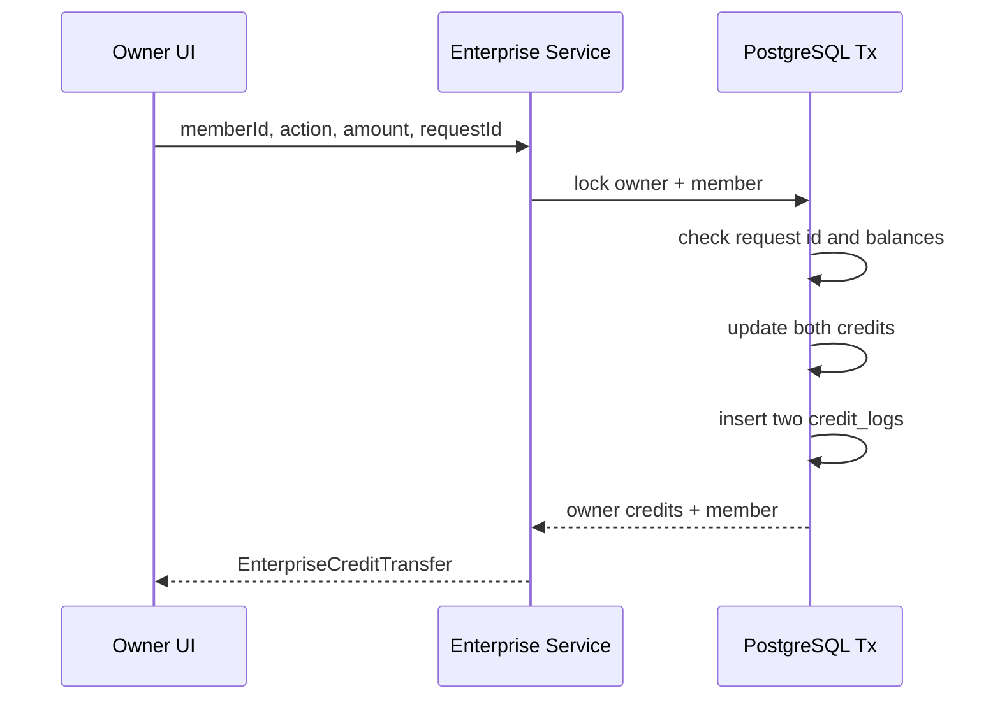

# 关键业务流程

## 冷启动与账号边界

**触发**：打开任意非登录页面。

```text
Zustand token rehydrate
-> /api/auth/me
-> user.id ready
-> Query cache/account stores switch
-> REST syncAll
-> asset full refresh
-> session + credit monitors
```

- **输入**：浏览器持久化 token/user snapshot。
- **前端状态**：`useUserStore.isReady/isLoading`；旧账号 stores 暂停写入。
- **持久化**：token 在 localStorage；Canvas/素材/cache key 带 user ID。
- **后端**：`CurrentAuthUser` 每次从 DB 读取用户、session version 和企业状态。
- **输出**：当前账号 UI 和数据。
- **失败**：无 token 进入登录；无效会话清空；网络失败可能暂时显示本地缓存。
- **核心文件**：`client-root-init.tsx`、`use-user-store.ts`、`account-storage.ts`、`app-providers.tsx`。
- **依赖**：auth API、sync client、asset/Canvas stores。
- **常见修改位置**：账号切换清理和异步 session guard，不要只改页面 route guard。

## 注册、登录和鉴权

```text
Login page
-> useUserStore.login/register
-> /api/auth/*
-> service auth validation
-> users
-> bcrypt/JWT
-> AuthSession
-> persist token + user
```

- **输入**：用户名/密码，或 Linux.do OAuth code/state。
- **输出**：JWT 和 `AuthUser`。
- **副作用**：更新 `last_login_at`；新用户生成 ID/aff code；OAuth 可能创建用户。
- **失败**：注册关闭、用户名重复、密码错误、用户/企业禁用、session version 不匹配。
- **核心文件**：`web/src/pages/login/`、`web/src/stores/use-user-store.ts`、`handler/auth.go`、`service/auth.go`、`repository/user.go`。
- **依赖**：settings 的注册/OAuth 开关，users/enterprises。
- **常见修改位置**：认证业务在 service，JWT/余额/锁在 repository/model，页面只处理交互。

## 账户资料、密码和企业信息

```text
Account page
-> auth.ts typed API
-> account/enterprise service
-> users / enterprises
-> refreshed AuthUser or summary
```

- **输入**：
  - profile `{displayName,email}`
  - password `{currentPassword,newPassword}`
  - enterprise rename `{name}`
- **输出**：更新后的当前用户或企业 summary。
- **副作用**：修改密码递增 `session_version`，旧 JWT 失效。
- **失败**：旧密码错误、非 owner 改企业名、企业无效。
- **核心文件**：`web/src/pages/account/`、`web/src/services/api/auth.ts`、`handler/auth.go`、`service/auth.go`。
- **依赖**：user store、enterprise service。
- **常见修改位置**：公开用户字段必须同步 Go `AuthUser`、TS type、store 和账户页。

## 企业创建和成员管理

### 平台管理员创建企业

```text
Admin form
-> POST /api/admin/enterprises
-> service.CreateEnterprise
-> DB transaction creates enterprise + owner user
-> deferred FK/trigger validates identity
```

### Owner 管理成员

```text
Account enterprise tab
-> /api/v1/enterprise/members*
-> derive enterprise from current user
-> validate owner
-> user repository
```

- **输入**：企业名、owner 账号；成员账号、状态、密码。
- **输出**：`EnterpriseView`、`EnterpriseMember`。
- **副作用**：禁用/重置密码立即影响会话。
- **失败**：跨企业、非 owner、目标不是 member、重复用户名。
- **核心文件**：`pages/admin/enterprises/`、`pages/account/`、`service/enterprise.go`、`repository/enterprise.go`。
- **依赖**：auth、users、enterprises。
- **常见修改位置**：企业范围永远在 service 从当前用户推导，不接受客户端 `enterpriseId`。

## 企业积分划拨



- **输入**：`allocate/reclaim`、正整数 amount、最长受限 request ID。
- **输出**：双方最新余额。
- **失败**：余额不足、重复 request ID 参数冲突、并发竞争、越权。
- **核心文件**：`service/enterprise.go`、`repository/enterprise.go`、`model/enterprise.go`。
- **依赖**：users、credit_logs。
- **常见修改位置**：任何原子性或幂等变化都应在 repository transaction，不要在 handler 做读后写。

## Canvas 项目创建、保存和同步

```text
Create/import in browser
-> local Replica dirty=true, revision=0
-> async POST with frontend ID
-> acknowledge revision
-> local edits increment localVersion
-> 4s debounce PUT expectedRevision
-> server CAS + new revision
-> acknowledge if localVersion unchanged
```

- **输入**：项目 JSON、项目 ID/name、后续编辑 patch。
- **输出**：浏览器 Replica 和 PostgreSQL `canvas_projects`。
- **副作用**：IndexedDB 持久化、sync activity、服务端 revision。
- **失败**：
  - create POST 失败：本地项目保留，但当前无可靠自动重试。
  - update 409：本地 dirty 保留，不自动 merge。
  - 网络失败：下次修改或 unload 可能再尝试。
- **核心文件**：Canvas Store、`canvas-sync.ts`、canvas API、canvas service/repository。
- **依赖**：account boundary、sync scheduler。
- **常见修改位置**：Replica 语义见 [canvas.md](canvas.md)，不要用“服务端空列表覆盖本地”。

## Canvas 删除

```text
Local remove + local tombstone
-> DELETE API
-> DB transaction deletes project + writes revision tombstone
-> local acknowledge removes tombstone
-> other devices receive /sync delete
```

- **输入**：项目 IDs。
- **输出**：本地列表更新、服务端删除事实。
- **失败**：API 失败时本地 tombstone 保留并在水合后重试；404 视为已完成。
- **核心文件**：`use-canvas-store.ts`、`canvas-sync.ts`、`repository/canvas_project.go`。
- **依赖**：`deleted_records`、Canvas cursor。
- **常见修改位置**：删除和 tombstone 必须保持同一服务端事务。

## Canvas 导入和导出

### 导出

```text
Selected projects
-> recursively collect storageKey
-> read image_files/media_files
-> projects.json + media
-> ZIP download
```

### 导入

读取导出结构，恢复项目并把媒体写回 Blob store，再作为新本地项目创建并同步。

- **输入**：项目集合或 ZIP。
- **输出**：格式版本 3 ZIP、新 Canvas Replica。
- **核心文件**：`canvas-export.ts`、`export-types.ts`、Canvas 列表页导入入口。
- **依赖**：blob storage、Canvas Store。
- **常见修改位置**：格式变化必须同时改 export/import/WebDAV，并保留明确 version。

## 个人素材创建和编辑

### 文本素材

```text
UI -> useAssetStore.add/update
-> POST /api/v1/assets
-> asset service/repository
-> response
-> Zustand + account IndexedDB cache
```

### 媒体素材

```text
Blob or generated result
-> POST /api/v1/files
-> S3 + user_files
-> POST /api/v1/assets with fileId
-> cache Asset
```

- **输入**：文本或媒体、标题/tags/metadata。
- **输出**：个人 Asset 和可刷新 file URL。
- **失败**：创建/编辑网络失败不会只在本地成功；409 触发 assets delta refresh。
- **核心文件**：`use-asset-store.ts`、`upload-blob.ts`、assets/file handlers/services。
- **依赖**：auth、S3、sync client。
- **常见修改位置**：本地 Asset 与后端 Asset 的转换在 store；不要在页面重复。

## 个人素材删除

```text
Optional file delete
-> asset DELETE
-> local cache remove
-> server asset tombstone
```

- **输入**：asset ID，可选 file ID。
- **输出**：素材移除。
- **失败**：`removeAssetWithFile` 对文件/素材删除较宽松，下次 sync 可能纠正元数据。
- **限制**：本地 Blob `cleanupImages` 当前为空，不保证回收。
- **常见修改位置**：若实现清理，必须按 Canvas、素材、助手和工作台的全局引用集合判断，不能节点删除即删 Blob。

## 企业素材创建、读取和复制

### 创建/更新

```text
Owner page
-> optional enterprise file upload
-> enterprise Asset API
-> derive enterprise scope
-> validate owner and file ownership
```

### 复制到个人

```text
owner/member selects copy
-> validate enterprise scope
-> text: create personal asset
-> media: S3 server copy
-> transaction create personal user_file + asset
-> return independent personal Asset
```

- **输入**：企业素材和企业 file ID。
- **输出**：企业 Asset 或独立个人副本。
- **失败**：跨企业、个人账号、member 写入、对象复制失败、事务失败。
- **核心文件**：enterprise assets page/API、`service/assets.go`、`service/user_file.go`。
- **依赖**：enterprise auth、S3、personal assets/files。
- **常见修改位置**：企业素材绝不能进入个人 sync/WebDAV；复制必须生成新 ID。

## Local AI 生成

```text
AiConfig.channelMode=local
-> resolve browser channel/model
-> browser Authorization with user API Key
-> direct provider request
-> browser parses result
-> optional platform file upload/history record
```

- **输入**：浏览器保存的 Base URL/API Key/protocol/model、prompt/references/settings。
- **输出**：图片/视频/音频/文本结果。
- **持久化**：平台不保存用户 Key；结果要成为可同步文件时再上传。
- **失败**：浏览器直接接收上游网络/CORS/协议错误；没有平台自动扣费/退款。
- **核心文件**：config store、`services/api/image.ts`、`video.ts`、`audio.ts`。
- **依赖**：用户上游、浏览器网络。
- **常见修改位置**：local 和 remote 分支共享 UI，但安全/计费语义不同，不能合并描述。

## Remote 图片、文本和音频生成

```text
Workbench/Canvas
-> /api/v1 compatibility endpoint
-> read model + request count
-> select server channel
-> create generation task/payload
-> deduct credits
-> provider request
-> record response or refund
-> browser stores/uploads result
```

- **输入**：供应商/OpenAI 兼容 body。
- **输出**：上游形态响应和平台 generation task ID header。
- **失败**：余额不足不请求上游；上游失败记录并退款；流式中途失败按代理逻辑处理。
- **核心文件**：frontend compatibility clients、`service/ai_proxy.go`、task/billing services。
- **依赖**：settings/channels、credits、generation tasks。
- **常见修改位置**：新供应商兼容字段放 request builder，不放 Canvas。

## 第一方视频 Generation Run

```text
Canvas compiler
-> GenerationCommand with fileIds
-> POST /api/v1/generations
-> profile/intent/file validation
-> idempotent task + payload + billing
-> worker claim/lease
-> Adapter create
-> callback + poll
-> result download and S3 materialization
-> terminal arbitration
-> Canvas resumes/presents result by fileId
```

- **输入**：稳定 Profile ID、普通视频或短剧 intent、平台 media references。
- **输出**：durable task 和 Materialized Result。
- **失败**：结构化字段/资源错误、余额不足、上游失败、保存结果失败、取消 pending。
- **核心文件**：generation contract、orchestrator、worker、adapter、lifecycle。
- **依赖**：user files/S3、settings, credits, Canvas metadata。
- **常见修改位置**：详见 [generation.md](generation.md)。

## Compatibility 视频任务

```text
Video workbench or local-compatible Canvas
-> Seedance-shaped payload
-> /contents/generations/tasks or direct upstream
-> upstream task ID
-> ownership mapping + generation task
-> poll/cancel/remix
-> upload result
```

- **输入**：prompt content、reference URLs、ratio/resolution/duration/audio/watermark。
- **输出**：upstream task 和结果视频。
- **失败**：任务所有权失败、上游终态、缺失 URL、超时。
- **核心文件**：`web/src/services/api/video.ts`、video task handler/service、compatibility lifecycle。
- **依赖**：channel config、`video_tasks`、generation tasks。
- **常见修改位置**：不要把 compatibility task ID 和 first-party task ID 混为同一合同。

## Stop、Resume、Cancel 和 Retry

| 操作 | 行为 |
| --- | --- |
| Stop Observing | abort 前端等待；任务继续 |
| Resume Observing | 从 metadata 中 task ID 继续查询 |
| Cancel Run | 调 cancel endpoint；等待上游和终态仲裁 |
| Retry Run | 复制旧输入，创建新的 request ID 和 task |

核心文件：Canvas generation resume helper、generation API、项目页 metadata 更新。

## 用量、积分和日志

```text
Generation path
-> generation_tasks
-> credit_logs
-> generation_payloads
-> user account/admin logs
-> frontend credit refresh
```

- **输入**：任务、模型价格、企业折扣、上游 credits。
- **输出**：余额、消费/退款流水、任务历史和审计。
- **失败**：幂等唯一索引防重复；事务失败整体回滚。
- **核心文件**：generation billing、user/enterprise repositories、generation mapper、account logs。
- **依赖**：settings、users、enterprises。
- **常见修改位置**：价格 UI 与数据库配置只是输入；最终余额原子性在 repository。

## 提示词同步

```text
cron or admin action
-> select hard-coded category
-> fetch GitHub JSON/Markdown
-> repository-specific parser
-> transaction delete category + insert parsed prompts
```

- **输入**：分类 code、远端仓库结构、cron。
- **输出**：PostgreSQL prompts。
- **失败**：网络/解析失败时不进入替换；单个分类失败不停止其他 cron 分类。
- **核心文件**：`prompt_sync_scheduler.go`、`prompt_fetch.go`、`repository/prompt.go`。
- **依赖**：settings、GitHub。
- **常见修改位置**：新增来源必须同时加分类 metadata 和 parser。

## WebDAV 同步

```text
User clicks sync
-> wait Canvas/assets hydration
-> read four local domains
-> download remote manifests
-> merge by ID + time
-> download missing media
-> apply merged local data
-> upload missing media + manifests
```

- **输入**：WebDAV config，Canvas、个人素材、图片/视频工作台日志。
- **输出**：本地/远端合并结果和进度。
- **失败**：认证、CORS、证书、超时、空文件；已有本地数据保留。
- **核心文件**：`app-sync.ts`、`webdav-sync.ts`、配置弹窗。
- **依赖**：Blob storage、account-bound stores。
- **常见修改位置**：企业数据不能加入；Vite 环境下不要依赖不存在的 Next.js proxy route。

## 在线助手与本地 Agent

### 在线助手

```text
Canvas snapshot + prompt
-> current text model
-> tool calls
-> validate CanvasAgentOp
-> optional confirm
-> apply to project
```

### 本地 Agent

```text
Browser snapshot/prompt/attachments
-> Canvas Agent HTTP/SSE
-> Codex app-server
-> MCP/tool request
-> browser confirmation and apply
-> result back to Agent
```

- **输入**：Canvas snapshot、自然语言、附件。
- **输出**：节点/连线/viewport/generation 操作。
- **失败**：连接/token/origin、thread cwd、工具超时、用户拒绝。
- **核心文件**：两个 Canvas panel、`canvas-agent-ops.ts`、`canvas-agent/src/`。
- **依赖**：Canvas state、local Agent、Codex。
- **常见修改位置**：工具合同必须同步网页校验、操作执行、Agent schema 和插件 skill。
