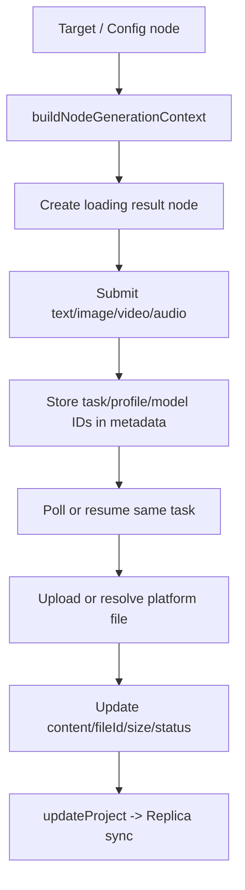

# Canvas 模块

## 模块边界

- **职责**：管理无限画布项目、节点/连线、交互历史、生成输入编译、助手会话、导入导出和本地 Agent 操作。
- **输入**：用户鼠标/键盘操作、素材、prompt、模型配置、生成任务状态、Agent operations、远端项目 delta。
- **输出**：`CanvasProject Replica`、节点和连线、Generation Run、项目 JSON、ZIP、Canvas 快照。
- **核心文件**：
  - 编排：`web/src/pages/canvas/project/index.tsx`
  - 类型：`web/src/pages/canvas/types.ts`
  - 项目 Store：`web/src/pages/canvas/stores/use-canvas-store.ts`
  - 同步：`web/src/pages/canvas/stores/canvas-sync.ts`
  - 视频结果 durable commit：`web/src/pages/canvas/stores/canvas-video-result.ts`
  - Replica 归一化与 transition：`web/src/pages/canvas/stores/canvas-replica.ts`
  - 图编辑不变量：`web/src/pages/canvas/utils/canvas-graph-edit.ts`
  - 渲染：`web/src/pages/canvas/components/infinite-canvas.tsx`、`canvas-node.tsx`、`canvas-connections.tsx`
  - 生成输入：`web/src/pages/canvas/components/canvas-node-generation.ts`
  - 导入导出：`web/src/pages/canvas/utils/canvas-export.ts`、`export-types.ts`
  - Agent：`canvas-assistant-panel.tsx`、`canvas-local-agent-panel.tsx`、`utils/canvas-agent-ops.ts`
- **数据流**：页面本地 state -> `useCanvasStore.updateProject` -> 账号隔离、串行且可等待的 IndexedDB Replica/dirty outbox -> 本地 durable 后按项目串行 REST CAS -> PostgreSQL；失败任务指数退避并在联网、页面恢复或重新水合时继续，远端 delta 反向合并非 dirty 项目。
- **依赖关系**：依赖用户边界、AI 配置、素材/文件、生成 API、sync client、WebDAV、Canvas Agent。
- **常见修改位置**：
  - 项目持久结构：`types.ts` + Store normalize + 导入导出。
  - 交互行为：`project/index.tsx` 和具体 component。
  - 生成输入语义：`canvas-node-generation.ts`。
  - 同步冲突：`canvas-sync.ts` + 后端 canvas repository。
  - Agent 操作：`canvas-agent-ops.ts` + 两个 panel + `canvas-agent/` 契约。

## 项目结构

当前 `CanvasProject` 由本地同步元数据和业务数据组成：

```ts
type CanvasProject = {
  id: string;
  title: string;
  createdAt: string;
  updatedAt: string;
  revision: number;
  localVersion: number;
  dirty: boolean;
  nodes: CanvasNodeData[];
  connections: CanvasConnection[];
  chatSessions: CanvasAssistantSession[];
  activeChatId: string | null;
  backgroundMode: "lines" | "dots" | "blank";
  showImageInfo: boolean;
  viewport: { x: number; y: number; k: number };
};
```

字段语义：

- `revision`：服务端全局序列分配的 CAS 版本。
- `localVersion`：浏览器每次接受项目修改后递增，用于判断一次异步保存期间是否又发生修改。
- `dirty`：本地已接受但服务端尚未确认。
- `tombstones`：Store 级待确认删除 ID，不写入单个项目。
- `project_json`：服务端对内部结构不做字段级理解，保存完整项目 JSON。

## 节点和连线

实际节点类型是五种：

| 类型 | 主要内容 | 常见 metadata |
| --- | --- | --- |
| `text` | 用户文本或文本生成结果 | `content/prompt/fontSize/status/errorDetails` |
| `image` | 图片、批量根或批量子图 | `content/storageKey/fileId/naturalWidth/naturalHeight/batch*` |
| `config` | 生成模式、模型和输出设置 | `generationMode/model/size/count/inputOrder`、视频/音频设置 |
| `video` | 视频引用或结果 | `content/storageKey/fileId/task IDs/status` |
| `audio` | 音频引用或结果 | `content/storageKey/fileId/duration/status` |

`CanvasConnection` 只保存：

```ts
{ id, fromNodeId, toNodeId }
```

连接不保存端口坐标、供应商字段或意图 metadata。渲染时根据节点位置计算 SVG 路径。

连接和删除节点规则集中在 `canvas-graph-edit.ts`，项目页交互与 Agent operations 共享同一 transition：

- 同一节点不能自连。
- Config 节点之间不能直接连接。
- Config 节点可作为输入汇总点或生成目标的配置来源。
- 删除节点必须同时删除相关连线；批量根节点还要处理子节点。

## 状态所有权

| 状态 | 所有者 | 原因 |
| --- | --- | --- |
| 项目列表、项目业务 JSON、dirty/revision | `useCanvasStore` | 需要账户隔离、持久化和跨页面同步 |
| 节点/连线当前编辑副本 | `project/index.tsx` | 高频交互，避免每个 pointer event 写全局 store |
| 选择、框选、拖拽、连线预览、弹窗 | 项目页本地 state | 短生命周期 UI |
| 项目列表选择/重命名/删除对话框 | `use-canvas-ui-store` | 列表页跨组件 UI 状态 |
| 在线/本地 Agent 面板状态 | `use-canvas-agent-store` | 面板跨组件共享，但不属于项目业务 JSON |
| 在线助手会话 | `CanvasProject.chatSessions` | 需要随项目同步和导出 |
| 本地 Codex thread 历史 | Canvas Agent 工作区 | 不应塞入 Canvas 项目 |

项目页是核心编排器，体积很大。修改时先查对应 helper/component 和调用链；只有出现真实复用或独立状态机时才继续拆分。

## 渲染与交互

Canvas 未使用 React Flow：

- `infinite-canvas.tsx`：世界坐标、viewport、滚轮缩放、平移和 pointer 入口。
- `canvas-node.tsx`：节点内容、编辑、resize 和媒体状态。
- `canvas-connections.tsx`：SVG 贝塞尔连线。
- `canvas-toolbar.tsx`：命令入口，不拥有业务状态。
- `canvas-mini-map.tsx`、`canvas-overview-sidebar.tsx`：项目导航投影。

固定格式元素需要稳定尺寸，避免工具栏、节点状态或动态文本改变布局。Canvas UI 必须使用 `canvasThemes/useThemeStore`，不要硬编码只适合单一主题的颜色。

## 生成输入编译

`canvas-node-generation.ts` 将节点图转换为 `NodeGenerationContext`。核心步骤：

1. 读取目标节点和关联 Config 节点。
2. 按连接关系收集上游文本、图片、视频和音频。
3. 解析 Config Composer 中的 `@[node:id]` 精确引用和 `inputOrder`。
4. 读取节点级模型、尺寸、数量、视频/音频设置。
5. 为第一方视频准备 `fileId` 引用；为兼容路径准备供应商形态输入。
6. 返回项目页执行具体生成。

普通节点默认合并所有有效上游资源；Config Composer 可以精确选择和排序资源。新增一种资源角色或工作流语义时，优先修改这里和 Canvas 类型，不要在 HTTP client 中反推图结构。

## 节点生成流程



关键语义：

- 图片数量大于 1 时，根节点和子节点通过 `batchRootId/batchChildIds/primaryImageId` 组织。
- 工作流没有独立实体；它就是项目中的节点和连线。
- `Stop Observing` 只停止本地等待，不取消任务。
- 刷新后兼容任务通过 `upstreamTaskId` 恢复；尚未物化成功的 first-party 视频通过 `generationTaskId` 或 `generationClientRequestId` 重新向后端证实，已有平台 `fileId` 的成功视频不再查询任务。
- first-party 视频连续 20 次可重试查询错误只暂停当前本地观察周期，不把任务写为失败；刷新或 Resume Observing 可继续观察同一 Generation Run。
- 旧 loading 节点如果没有可恢复任务 ID，会被标记为中断错误。
- `Retry Run` 必须创建新任务，不能伪装成 resume。

## Canvas Project Replica

### 创建和导入

1. 浏览器生成项目 ID。
2. 本地立即插入 `revision=0/localVersion=1/dirty=true` 的 Replica。
3. 账号隔离 storage 队列先完成该 Replica 的 durable write。
4. 持久 outbox 执行 `POST /api/v1/canvas/projects`。
5. 成功后写入服务端 revision；若期间又有修改，仍保持 dirty 并安排 update。
6. 网络或服务端失败会指数退避重试；若 POST 已成功但响应丢失，会通过 GET 恢复服务端 revision，再提交本地最新项目。

### 更新

1. 项目页调用 `updateProject`。
2. Store 递增 `localVersion`，设置 `dirty=true`。
3. Zustand persist 写入按账号 storage key 串行；`updateProject` 返回可等待的 durable Promise。
4. subscription 将项目加入按项目串行的后台队列；worker 等待当前账号 Canvas 写队列 drain 后重新读取项目。
5. PUT 只发送已本地 durable 的完整项目和 `expectedRevision`；进行中产生的新修改会继续排队，旧异步快照不能覆盖新快照。
6. 本地 durable write 失败时后端 retry 继续停在本地边界，直到后续真实写成功。
7. 网络、HTTP 200 业务失败、408、425、429 和 5xx 使用 500ms 起步、最长 30 秒的指数退避，并在联网或页面重新可见时立即唤醒。
8. 服务端 CAS 成功后返回新 revision；`acknowledgeProject` 只有在 `localVersion` 未变化时清除 dirty。
9. 队列本身由持久化的 `dirty` Replica 表达，刷新、崩溃恢复或重新登录后会自动扫描继续。

### 删除

1. 本地立刻移除项目并加入 Store tombstone。
2. tombstone 先进入账号隔离 storage 队列 durable write，再由同一后台队列执行 DELETE。
3. 成功或服务端 404 后确认本地 tombstone。
4. 服务端删除和 `deleted_records` Canvas tombstone 同事务。
5. 网络或服务端失败时 tombstone 持久保留并持续重试。

### 拉取和冲突

- 启动时先水合 IndexedDB，再执行全量项目拉取和 cursor delta。
- 非 dirty 项目只有在远端 revision 更高时才替换。
- dirty 项目拒绝远端 update/delete。
- 409 持久标记 `syncConflict` 并暂停该项目上传，不更换 revision 重传旧内容；刷新、online、visibilitychange 与 beforeunload 均不能绕过冲突。
- 用户显式选择“保留本地副本并加载云端”时，同一账号 storage 快照同时保留新 ID 的本地副本与最新远端原项目，再同步副本；当前不做字段级多人 merge。
- `remoteRevision` 标识最近接纳的远端内容版本；本设备保存确认只递增 `revision`，不改变 `remoteRevision`。页面私有 `useCanvasEditorReplica` 绑定显示快照，远端替换时重新还原，旧绑定写入由 Store 拒绝；视频结果提交同样携带绑定版本。
- `canvas-replica.ts` 集中本地 edit/ack、Replica state、远端 merge、pending work 和 `{projectId,remoteRevision,token,userId}` binding；Store、sync、editor 和视频结果不再分别实现这些判定。视频结果每轮基于 Store 当前节点重放，并在持久化等待前后重新验证完整 binding，旧账号或旧远端快照不能写入当前 Replica。
- 无业务变化的保存不产生 dirty；初始化 URL 还原由编辑器显示层处理，不作为业务修改。创建响应丢失只在远端业务内容等于原提交快照时恢复 revision，否则暂停为冲突。
- 当 delta 中存在比 dirty 项目更新的 revision 时，Canvas cursor 不前进，避免永久跳过冲突事实。

## 账户隔离

Canvas store key 实际为：

```text
infinite-canvas:canvas_store:<userId>
```

切换用户时：

- storage 调用捕获当时的账号 key，同账号写串行，不会把旧账号快照写入新账号。
- 切换过程禁止内存清空动作写入 scoped storage。
- 清理内存项目和同步 timer。
- 水合新账号缓存。
- 所有异步 server response 在应用前检查 `{token,userId}` 未变化。

媒体 Blob store 没有按账号物理分库，因此业务引用必须通过项目/素材边界隔离，不能用遍历 Blob store 作为账号数据列表。

## 媒体引用

Canvas 节点可能同时有：

- `storageKey`：浏览器 IndexedDB Blob 的长期引用。
- `fileId`：平台 S3 文件的长期引用。
- `content`：当前会话可展示的 `blob:` 或预签名 URL。

读取优先级取决于场景：

- 本地展示：通过 `storageKey` 还原 object URL。
- 第一方生成：必须使用可授权的 `fileId`。
- 兼容上游：可使用上传后的平台 URL、data URI 或协议允许的引用。
- 导出/WebDAV：收集所有 `storageKey` 并携带 Blob。

## 在线助手

`canvas-assistant-panel.tsx` 只使用管理员公开且具有有效协议映射的文本模型，强制通过平台 remote compatibility path 调用：

- 提供画布快照和选中/上游节点上下文。
- 最多执行有限轮工具调用。
- 将 tool call 校验并转换为 `CanvasAgentOp`。
- 写操作可先进入确认卡片。
- 会话保存到项目 `chatSessions`。

修改工具 schema 时需要同步：

1. 助手提示和 tool definition。
2. `toCanvasAgentOp` 输入验证。
3. `CanvasAgentOp` union。
4. 项目页应用操作的实现。

## 本地 Canvas Agent

`canvas-local-agent-panel.tsx` 通过 HTTP/SSE 连接 `canvas-agent`：

该入口默认隐藏，只有管理员在“站点管理 > 品牌配置”开启 `navigation.canvasLocalAgent` 后才显示和连接；关闭时 URL bootstrap 凭据仍会被清除，但不会发起本地连接。

- 上报当前 Canvas snapshot。
- 发送 prompt 和本地图片附件。
- 接收 Codex 事件和待执行工具。
- 用户确认后应用 ops，再回传工具结果。

网页侧 Store 只保存面板临时状态；thread、workspace 和历史由本地 Agent 管理。详细通信见 [runtime-supporting-systems.md](runtime-supporting-systems.md)。

Agent HTTP/SSE session 以 Canvas Project Replica ID 隔离 state、pending tool result、事件和 thread。多画布连接时，MCP 必须携带明确 Replica identity；缺少 identity 只在恰好一个画布连接时兼容，不能使用最近状态或广播猜测目标。

## 导入、导出与 WebDAV

ZIP 导出：

- `projects.json` 当前格式版本为 3。
- 每个项目携带业务 JSON。
- 递归收集 `storageKey`，把对应 Blob 放在 `projects/<id>/files/`。

WebDAV：

- Canvas 与个人素材、工作台日志一起做用户触发的全快照 merge。
- merge 主要按 ID 和 `updatedAt/createdAt`。
- WebDAV 是同步参与者，不应凭空删除本地 `Offline Dirty`。
- 企业素材不参与。

## 常见修改地图

| 需求 | 优先修改 |
| --- | --- |
| 新节点类型 | `types.ts`、`constants.ts`、`canvas-node.tsx`、项目创建/复制/导出逻辑 |
| 新节点 metadata | `types.ts`、normalize、生成输入、导入导出、相关 UI |
| 新连线规则 | 项目页 `normalizeConnection` 和输入编译 |
| 新生成参数 | Config UI + node metadata + `canvas-node-generation.ts` + API contract |
| 新批量展示 | batch metadata、节点渲染、overview、删除/复制逻辑 |
| 修改项目同步 | Store、`canvas-sync.ts`、后端 canvas/sync repository |
| 新 Agent 工具 | `canvas-agent-ops.ts`、在线/本地 panel、`canvas-agent/src/schemas.ts` |
| 修改导出格式 | `export-types.ts`、`canvas-export.ts`、导入入口、WebDAV |
| 修改主题 | `canvas-theme.ts`、Theme Store、Canvas 组件 token |

## 已知限制

- 核心项目页承担过多编排职责。
- `cleanupImages` 是空实现，Blob 可能累积。
- Undo/Redo 快照不包含 viewport；视口单独持久化。
- 旧文档只列图片/文本/config 等较少节点类型，不能作为当前类型来源。
- 本地 Agent 的多 Canvas Project Replica 隔离已有自动化覆盖；真实浏览器同时连接多个画布及 Codex app-server/MCP 端到端仍待用户验证。
