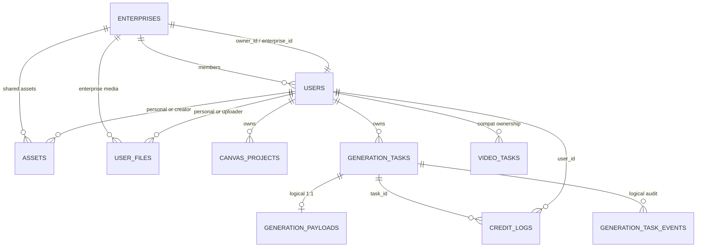

# 数据库设计

## 边界

- **职责**：保存账号、企业、积分、设置、提示词、素材、平台文件、Canvas 项目、生成任务和删除事实。
- **输入**：service 层的业务模型、事务命令、查询和 CAS 条件。
- **输出**：持久化实体、分页列表、锁/冲突结果、同步 delta。
- **核心文件**：`repository/db.go`、`model/*.go`、`repository/*.go`、`docs/content/docs/backend/backend-database.mdx`。
- **数据流**：service -> repository -> GORM/SQL -> PostgreSQL。
- **依赖关系**：所有后端业务；浏览器通过 API 和 cursor sync 间接消费。
- **常见修改位置**：model、`repository/db.go` 手写 DDL、具体 repository、service DTO/默认值、handler、前端类型和数据库文档。

## 初始化与迁移策略

`repository.DB()`：

1. 使用 `sync.Once` 建立全局 GORM 连接。
2. 若目标数据库不存在，连接 `postgres` 或 `template1` 并执行 `CREATE DATABASE`。
3. 创建 `canvas_revision_seq`。
4. 对 13 个模型执行 `AutoMigrate`。
5. 清理会破坏新唯一索引的历史重复数据。
6. 创建部分唯一索引。
7. 创建企业/用户延迟外键和 enterprise owner 一致性触发器。

`EnsureDefaultAdmin()` 在服务启动时触发数据库访问，因此 schema 通常在 HTTP 监听前完成。

当前没有版本化 migration 表或独立迁移文件。`AutoMigrate` 适合新增列和基础索引，但不能安全表达：

- 字段重命名或删除。
- 类型收窄/转换。
- 复杂数据回填。
- 已有部分索引定义变化。
- 触发器和约束替换。

这些变更必须在 `repository/db.go` 增加明确 SQL，并考虑重复执行。

## 关系概览



图中大多数关系只是逻辑关系。数据库只显式创建：

- `enterprises.owner_id -> users.id`
- `users.enterprise_id -> enterprises.id`

其他引用没有外键和级联。

## 表目录

### `enterprises`

**职责**：企业身份、状态、唯一 owner 和折扣。

| 字段 | 语义/约束 |
| --- | --- |
| `id` | 主键 |
| `name` | 企业名 |
| `status` | CHECK `active/disabled` |
| `owner_id` | 非空、唯一、延迟外键到 users |
| `discount_rate` | 默认 1，CHECK `0.1 <= value <= 1` |
| `created_at/updated_at` | 字符串时间 |

额外约束触发器在事务提交时保证 owner 用户属于该企业且 `enterprise_role='owner'`。

### `users`

**职责**：平台账号、认证、余额和企业身份。

核心字段：

- `id` 主键。
- `username`、`aff_code` 唯一。
- `password/email/display_name/avatar_url`。
- `role`: `guest/user/admin`。
- `status`: `active/ban`。
- `credits` 非负 CHECK。
- `enterprise_id` 可空，普通索引。
- `enterprise_role` 可空，`owner/member` CHECK。
- `session_version` 默认 1。
- OAuth/邀请字段、`extra`、登录/创建/更新时间。

约束：

- `enterprise_id` 与 `enterprise_role` 必须同时为空或同时存在。
- `enterprise_id` 在 `enterprise_role='owner'` 条件下部分唯一。
- `enterprise_name` 是查询投影，不入库。
- `role/status` 目前没有 DB CHECK，依赖 service。

### `credit_logs`

**职责**：余额变动账本。

| 字段 | 语义 |
| --- | --- |
| `user_id` | 流水所属账号 |
| `task_id` | 生成任务；可空字符串 |
| `type` | `admin_adjust/ai_consume/ai_refund/enterprise_allocate/enterprise_reclaim` |
| `amount` | 当前账号视角的正负变动 |
| `balance` | 变动后余额 |
| `related_id` | 管理员 ID 或企业 request ID |
| `counterparty_id` | 划拨对方账号 |
| `remark/extra` | 说明和扩展数据 |

手写部分唯一索引：

- 非空 `(task_id, type)` 唯一，防止任务重复消费/退款。
- 对 enterprise allocate/reclaim，非空 `(user_id, type, related_id)` 唯一。

没有到 users/generation_tasks 的外键。

### `prompts`

**职责**：系统和第三方提示词内容。

- `id` 主键。
- `title/cover_url/prompt/preview`。
- `tags` 使用 JSON serializer，查询时转 `jsonb`。
- `category` 索引。
- `created_at/updated_at`。
- `github_url` 不入库，由硬编码 `PromptCategory` 投影补齐。

`PromptCategory` 不是表；分类定义在 `repository/db.go`。

### `assets`

**职责**：个人素材和企业共享素材的统一元数据表。

| 字段 | 语义 |
| --- | --- |
| `user_id` | 个人 owner 或企业素材创建者 |
| `enterprise_id` | 空表示个人素材，非空表示企业素材 |
| `type` | `text/image/video`，service 校验 |
| `tags` | JSON |
| `content` | 文本正文 |
| `file_id` | 逻辑引用 `user_files.id` |
| `width/height/bytes/mime_type` | 媒体元数据 |
| `cover_url/url` | 展示字段 |
| `created_at/updated_at` | 字符串时间 |

注意：

- `creator_name` 是查询投影，不入库。
- `URL` 注释称读取时计算，但缺少 `gorm:"-"`，当前会被 AutoMigrate 成真实列。
- `file_id` 没有索引或外键。
- 个人查询必须显式限定 `enterprise_id IS NULL`。

### `settings`

**职责**：系统公开/私有 JSON 配置。

| 字段 | 语义 |
| --- | --- |
| `key` | 主键，约定 `public/private` |
| `value` | JSON serializer |
| `created_at/updated_at` | 字符串时间 |

private value 包含：

- Model Channel API Key。
- Generation Profile binding。
- Linux.do OAuth Client Secret。
- 文件大小限制。
- prompt sync 设置。

这些 secret 以明文 JSON 存在数据库；API 层负责隐藏，不是数据库加密。

### `generation_tasks`

**职责**：所有生成路径的统一任务事实、持久队列和长期摘要。

字段组：

- 身份：`id/user_id/task_type/source/provider/model`。
- 状态：`status/latency_ms/error_*`。
- 计费：`credits/upstream_credits/billing_mode/billing_rate`。
- 上游：`upstream_task_id/callback_token/trace_id`。
- 幂等：`client_request_id/command_hash/command_version`。
- 第一方快照：`intent_kind/model_profile_id/profile_version/adapter_key/channel_id/upstream_model`。
- 结果/摘要：`metadata/result_json`。
- 队列：`queue_available_at/worker_lease_owner/worker_lease_expires_at`。
- 时间：`created_at/updated_at`。

索引：

- user、task type、source、upstream task ID、callback token、client request ID、intent/Profile。
- 非空 `(user_id, client_request_id)` 部分唯一。

状态集合包含：

```text
queued, pending, running, succeeded, success, failed, cancelled
```

没有 DB CHECK。`pending` 是第一方结果物化内部状态；`success` 是历史兼容值。

### `generation_payloads`

**职责**：任务的详细 command、脱敏请求/响应和原始错误。

- `id` 主键。
- `task_id` 唯一，逻辑一对一。
- `command_body/request_headers/request_body/response_headers/response_body/raw_error`。
- `created_at`。

没有外键。后台任务会清理超过保留期的 payload，任务摘要继续存在。

### `generation_task_events`

**职责**：append-only 生命周期审计。

- `id` 主键。
- `task_id/type/created_at` 索引。
- `detail` 小型文本。

它不是 event source。当前 task 状态永远以 `generation_tasks` 为准。

### `canvas_projects`

**职责**：服务端 Canvas 项目副本和全局 revision。

| 字段 | 语义 |
| --- | --- |
| `id` | 前端生成的项目 ID，主键 |
| `user_id` | owner；与 revision 组成复合索引 |
| `name` | 列表名称 |
| `project_json` | 完整项目 JSON |
| `version` | 每次成功更新递增 |
| `revision` | `canvas_revision_seq` 分配的全局单调值 |
| `created_at/updated_at` | 字符串时间 |

更新使用 `id + user_id + expectedRevision` CAS。删除与 Canvas tombstone 同事务。

### `video_tasks`

**职责**：兼容视频接口的 upstream task 所有权映射。

- `id` 主键。
- `user_id` 索引。
- `task_id` 上游 ID，唯一。
- `model/created_at`。

没有外键或明确 TTL/删除入口。第一方任务不依赖它作为主事实。

### `user_files`

**职责**：个人和企业 S3 对象元数据。

| 字段 | 语义 |
| --- | --- |
| `id` | 平台 file ID |
| `user_id` | 个人 owner 或企业上传者 |
| `enterprise_id` | 空为个人文件，非空为企业文件 |
| `file_type` | images/videos/audios/prompts 及 `results/*` |
| `s3_key` | 仅服务端返回/使用 |
| `original_name/mime_type/bytes` | 元数据 |
| `created_at` | 创建时间 |

`url` 明确为 `gorm:"-"`，每次读取按权限生成短期预签名 URL。

### `deleted_records`

**职责**：为物理删除提供 REST delta tombstone。

字段：

- 自增 `id`。
- `table_name/record_id/user_id`。
- `revision`，Canvas 使用。
- `deleted_at`，assets/tasks 使用。

索引：

- `(user_id, table_name, record_id, deleted_at)`。
- `(user_id, table_name, revision)`。

`PruneDeletedRecords` 已有 repository 实现，但当前没有明确调度调用，表可能持续增长。

## 查询与分页

### 通用 Query

`model.Query`：

- 默认 `page=1/pageSize=20`。
- 最大 `pageSize=500`。
- 支持 `keyword/tag/category/type`。

素材和提示词的 tags 查询是“任意一个匹配”，通过多个 `jsonb_exists` OR 组合。获取可选 tags 时会移除当前 tag 过滤。

### 文件

文件列表单独把 pageSize 上限设为 100；非法值回退 20。

### 生成任务

支持：

- user。
- task type。
- source。
- status。
- start/end time。
- page/pageSize。

用户任务查询把 `success/succeeded` 视为等价；管理员 JOIN 查询的状态过滤目前更接近精确匹配。

### 增量同步

- 每个更新域最多返回 200 条。
- Canvas update/delete 依据 revision 合并和分页。
- assets/tasks 使用字符串时间 cursor。

## 关键事务边界

| 业务 | 同一事务内必须完成 |
| --- | --- |
| 创建企业 | enterprise + owner user + 延迟约束验证 |
| 管理员调整企业积分 | 锁 owner、更新余额、写 `admin_adjust` |
| 企业划拨 | 锁 owner/member、更新两边余额、写两条流水 |
| AI 消费/退款 | 锁 user、更新余额、写唯一流水 |
| first-party 创建 | generation task + payload + 必要预扣 |
| per-credit 结算 | 实际 task credits/upstream credits + 扣费 + consume log |
| 生成终态 | task CAS + refund + terminal event |
| 复制企业媒体 | 新个人 user_file + asset；对象失败/事务失败要补偿 |
| Canvas 删除 | 删除 project + 写 revision tombstone |

## 浏览器和数据库边界

PostgreSQL 保存结构化事实，但不是浏览器所有数据的完整镜像：

- Canvas IndexedDB 可能有尚未提交的 `Offline Dirty`。
- `image_files/media_files` 保存本地 Blob，数据库没有正文。
- 工作台本地历史和 WebDAV manifest 不完全等同于 `generation_tasks`。
- 用户本地 AI API Key 不进入数据库。
- 企业素材只存在服务端链路，不进入个人缓存。

## Schema 修改检查清单

1. 修改对应 `model/*.go`。
2. 检查 `repository/db.go` 的 AutoMigrate 顺序和手写 SQL。
3. 搜索 repository 中的字符串列名、`Select/Updates/JOIN/Where`。
4. 检查 service 默认值、事务、权限和 DTO 投影。
5. 检查 handler request/response。
6. 更新前端 API type、store 转换、表单和展示。
7. 若进入 sync，更新 cursor/delta/tombstone。
8. 若是文件/素材，检查个人与企业 `enterprise_id` 边界。
9. 更新 `docs/content/docs/backend/backend-database.mdx`。
10. 更新相关 repository/service/router 测试。

项目尚未上线且不要求旧数据兼容时，可以直接按新结构调整；但 PostgreSQL 已有开发数据时，仍要保证启动 SQL 可重复执行且不会静默损坏数据。

## 已知风险

- 大量时间字段使用字符串，并混用 RFC3339/RFC3339Nano；sync 直接比较字符串。
- 多数逻辑关系没有外键，删除用户/任务/文件可能留下孤儿。
- `assets.url` 的模型注释和 GORM 实际行为不一致。
- private settings 的 secret 明文存储。
- AutoMigrate 没有版本记录。
- assets/tasks 的删除与 tombstone 在部分路径不是同一事务，且可能忽略 tombstone 错误。
- 管理员删除任务使用的用户范围可能无法让个人 sync 收到删除。
- `deleted_records` 没有已接线的 TTL 调度。
