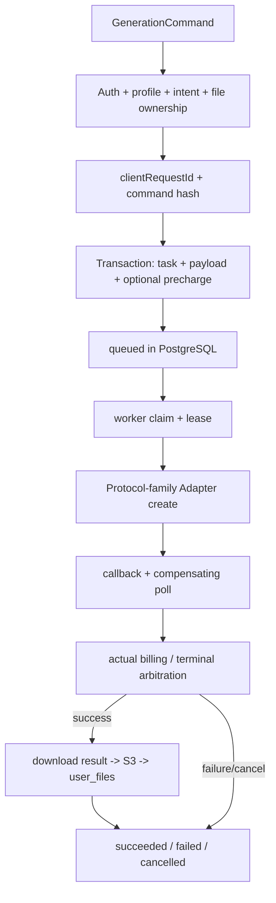

# 生成平台

## 模块边界

- **职责**：模型能力投影、生成命令校验、兼容 AI 代理、持久队列、上游 Adapter、计费、结果物化、任务历史、取消/回调/轮询和终态仲裁。
- **输入**：浏览器 AI 配置、兼容供应商 body、第一方 `GenerationCommand`、平台 `fileId`、Model Profile binding、上游状态。
- **输出**：兼容上游响应、`FirstPartyGenerationTask`、Materialized Result、积分流水、审计和 Canvas 节点更新。
- **核心文件**：
  - 前端合同：`web/src/services/api/generation-contract.ts`、`generations.ts`
  - 兼容前端：`web/src/services/api/image.ts`、`video.ts`、`audio.ts`
  - Profile：`service/generation_profiles.go`
  - Orchestrator：`service/generation_orchestrator.go`
  - Adapter：`service/generation_adapter.go`
  - Worker：`service/generation_worker.go`
  - 生命周期：`service/generation_lifecycle.go`
  - 兼容代理：`service/ai_proxy.go`、`service/compatibility_lifecycle.go`
  - 计费：`service/generation_billing.go`、`repository/generation_billing.go`
  - 持久化：`repository/generation_task.go`、`generation_queue.go`、`generation_lifecycle.go`
  - 模型：`model/generation_command.go`、`generation_profile.go`、`generation_task.go`
- **数据流**：客户端选择路径 -> 校验/渠道/计费 -> `generation_tasks` -> 上游 -> 平台文件 -> 终态。
- **依赖关系**：依赖 auth、settings/channels、credits、user files/S3、Canvas、sync。
- **常见修改位置**：Profile/合同/Adapter/生命周期要按责任分开，避免在 Canvas 或通用 HTTP client 增加供应商分支。

## 路径选择

| 场景 | 提交位置 | 平台积分/审计 | 持久任务 | 主要用途 |
| --- | --- | --- | --- | --- |
| local channel | 浏览器直接请求用户 Base URL | 无平台渠道扣费；结果可后续上传 | 取决于上游和前端本地历史 | 用户自带 API Key |
| remote compatibility | 浏览器请求 `/api/v1/images/*`、`chat/completions`、`audio/speech`、`contents/generations/tasks` 等 | Go 代理选渠道、扣费、记录任务/payload | 使用统一 `generation_tasks`，异步视频另有兼容生命周期 | 图片、文本、音频、旧视频协议 |
| remote first-party | `POST /api/v1/generations` | 完整平台校验、幂等、计费、事件和结果物化 | PostgreSQL 队列 + worker lease | 当前 Canvas 视频和短剧 |

第一方和兼容入口共享任务、积分和审计基础设施，但不能把未知供应商扩展字段强制转换为第一方意图。

## 第一方合同

```ts
type GenerationCommand = {
  commandVersion: 1;
  clientRequestId: string;
  modelProfileId: string;
  source: "canvas" | "image_workbench" | "video_workbench";
  intent:
    | {
        kind: "video.generate";
        prompt: string;
        negativePrompt?: string;
        references: {
          images: PlatformMediaReference[];
          videos: PlatformMediaReference[];
          audios: PlatformMediaReference[];
        };
        settings?: VideoGenerationSettings;
      }
    | {
        kind: "video.short-drama";
        title: string;
        script: string;
        assets: ShortDramaAsset[];
        settings?: ShortDramaGenerationSettings;
      };
};
```

当前只实现两个 first-party intent。架构文档中提到的 text/image/image-edit/audio intent 是长期方向，不是当前 API 能力。

关键输入约束：

- `clientRequestId` 在网络重试时必须复用。
- `(userId, clientRequestId)` 唯一。
- 同一 ID + 同一 command hash 返回已有任务。
- 同一 ID + 不同 command 返回冲突。
- first-party 媒体只能使用当前用户可读取的平台 `fileId`。
- 客户端提交稳定 `modelProfileId`，不提交渠道 ID 或上游模型拼接值。

## Model Profile

Profile 是前端和后端共享的稳定能力投影：

```text
stable id
+ display name
+ supported intent
+ typed settings
+ cancellation/completion capabilities
+ adapter key
+ bound upstream model/channel
+ public billing projection
```

当前代码模板：

| Adapter Key | Intent | 上游协议族 | 完成方式 |
| --- | --- | --- | --- |
| `seedance-contents-v1` | `video.generate` | Seedance contents/task | poll，按配置可 callback |
| `vidu-short-drama-v1` | `video.short-drama` | Vidu Drama | poll，按配置可 callback |

Profile 模板随代码发布；数据库 private settings 负责 binding、上游模型、渠道、启用和限制覆盖；public settings 负责价格和可见模型。

新增 Profile 时需要同步：

1. Go template/capabilities。
2. Adapter registry 和 validation。
3. private binding 配置。
4. public model cost。
5. 前端 Profile type、设置 UI 和 Canvas 编译。
6. 相关 adapter/lifecycle 测试。

## 第一方 Generation Run 生命周期



### 创建

`service.CreateGeneration`：

1. 验证 command version、source 和 request ID。
2. 解析可用 Profile。
3. 归一化 settings。
4. 验证普通引用或短剧资产角色、数量、MIME 和所有权。
5. 计算命令摘要。
6. 处理幂等。
7. 计算计费计划。
8. 事务写 `generation_tasks + generation_payloads`，必要时预扣并写 `credit_logs`。
9. 返回 `queued`，不在请求 goroutine 内执行上游生成。

### Worker

`StartGenerationWorker` 每秒扫描：

- 原子 claim queued 或租约过期任务。
- 租约默认一分钟，半程续租。
- 同一任务只有 lease owner 可推进。
- 兼容 accepted task 转入 compatibility observer。
- first-party task 解析 Profile/Channel 后执行 Adapter。

当前 worker 为单进程内无限循环，每个 claim 启动 goroutine，没有独立并发上限配置。

### Adapter

Adapter 负责：

- 把业务 intent 映射为供应商 body。
- 选择 URL/auth 所需信息。
- create、poll、parse callback、cancel。
- 将供应商状态、结果、错误和 upstream credits 归一化。

Adapter 不负责：

- 修改用户余额。
- 决定 UI。
- 读取 Canvas 图。
- 直接决定最终任务状态覆盖规则。

## 结果物化

上游 `succeeded` 不等于平台成功：

1. 上游必须返回可用结果 URL。
2. 任务 CAS 到内部 `pending`，占用结果持久化阶段。
3. 后端下载视频并上传 S3。
4. 创建个人 `user_files` 记录。
5. `ResultJSON` 保存带 `fileId/mimeType/bytes` 的判别结果。
6. 终态从 `pending` 仲裁为 `succeeded`。

如果结果下载/上传暂时失败：

- 任务可回到 running，并记录 `RESULT_PERSIST_FAILED`。
- 不应把空文件或裸供应商 URL当作 Materialized Result。

短剧结果使用 `kind: "short-drama"`，可包含 shots；当前主要物化总视频文件。

## 终态仲裁

callback、poll、cancel、timeout 和 materialization 可能并发。规则：

- 只有允许的来源状态可以 CAS 到下一状态。
- 已终态任务不能被后到事件覆盖。
- 终态 task update、退款流水和 terminal event 在同一事务。
- 上游成功但没有视频 URL 会转换为稳定失败。
- 取消只有在上游确认且终态仲裁获胜时才成为 `cancelled`。

公开状态是：

```text
queued -> running -> succeeded | failed | cancelled
```

`pending` 只用于内部结果持久化；历史兼容状态 `success` 与 `succeeded` 在部分查询中视为等价。

## 计费

### 兼容代理

通常在上游调用前按 model cost 和请求数量扣费：

1. `LogTaskStart`。
2. `ConsumeUserCreditsWithTask`。
3. 调上游。
4. 上游失败时 refund。
5. 记录响应、耗时和 upstream task ID。

### 第一方任务

支持三种模式：

| 模式 | 扣费时机 | 任务快照 |
| --- | --- | --- |
| `per_call` | 创建时预扣 | `credits` 为本次折后实际值，`billing_rate` 为原始每次价格 |
| `per_second` | 创建时按时长预扣 | `billing_rate` 为分辨率每秒价 |
| `per_credit` | 成功后按上游 credits 结算 | `upstream_credits` 可空，`billing_rate` 为每 upstream credit 价格 |

企业 owner/member 使用：

```text
original credits * enterprise.discount_rate
```

结果保留完整小数精度，不向上取整；退款按任务实际已扣积分，不按后来修改的折扣重新计算。

数据库幂等：

- 非空 `task_id + credit_log.type` 唯一，防重复消费/退款。
- first-party 创建和预扣同事务。
- `per_credit` 的任务更新、余额扣减和消费流水同事务。

## 兼容代理

`service.ProxyAIRequest` 的责任：

1. 读取 JSON 或 multipart，并提取 model。
2. 读取 model cost。
3. 选择后台 Model Channel。
4. 按 `openai/gemini/xvanai` 构造上游 URL/auth/body。
5. 建立 generation task 和 payload 审计。
6. 扣积分。
7. 转发上游响应，设置 `X-Generation-Task-Id`。
8. 成功记录或失败退款。

兼容 body 基本透明转发，这允许供应商扩展字段继续工作。新增兼容协议时优先在 channel/request builder 中集中处理，不要在每个前端页面复制 URL 和鉴权分支。

## 兼容视频生命周期

`/api/v1/contents/generations/tasks` 使用供应商形态：

- `video_tasks` 保存 upstream task ID -> user/model 所有权。
- `generation_tasks` 保存统一任务、计费和历史。
- 查询/取消/remix 必须校验当前用户拥有 upstream task。
- 对绑定了 first-party Profile 的兼容模型，可由共享 worker 观察后续状态。

兼容入口保留是为了协议接受，不应被描述为 first-party Generation Command。

## 两个回调入口

| 路径 | 用途 | 校验强度 |
| --- | --- | --- |
| `/api/v1/generations/callback` | 第一方 Adapter callback | token 查任务、常量时间比较、Profile callback 能力、Adapter parse、upstream task ID 匹配、终态 CAS |
| `/api/v1/generation-tasks/callback` | 兼容通用 callback | token 查任务，解析通用状态 body，进入旧 task lifecycle |

不要把两个入口的安全和语义等同。

## 前端观察与恢复

`web/src/services/api/generations.ts`：

- `createGeneration` 创建 first-party task。
- `waitForGeneration` 每 5 秒轮询；连续 20 次可重试的浏览器查询错误只暂停本地观察，收到有效任务响应会清零错误计数。
- `getGenerationByClientRequestId` 在创建响应丢失时找回当前用户的同一 first-party task。
- `cancelGeneration` 请求取消。
- `readGenerationError` 读取信封中的稳定错误。

Canvas metadata 持久化：

- `generationTaskId`
- `generationClientRequestId`
- 兼容 `upstreamTaskId`
- `generationProfileId`
- `taskModel`
- 当前 status/error

视频 Materialized Result 通过 `commitCanvasVideoResult` 写回节点；页面只有在账号隔离 Canvas Replica durable commit 完成后才发布成功状态。等待期间若有更晚的节点编辑，结果会重新应用到最新 accepted nodes；服务端 Canvas PUT 也只消费已本地持久化的项目快照。

刷新页面后 `canvasGenerationResume` 决定：

- image compatibility
- video compatibility
- first-party video

停止轮询不清除任务 ID；刷新会重新证实所有尚未物化成功的 first-party 视频节点，只有 client request ID 时先找回原任务。已有平台 `fileId` 的成功视频保持展示且不再查询任务。重试必须生成新的 client request ID。

## 任务历史与审计

| 数据 | 用途 |
| --- | --- |
| `generation_tasks` | 长期任务摘要、状态、计费、route/profile 快照、结果 |
| `generation_payloads` | 完整 command、脱敏后的请求/响应和原始错误；按 TTL 清理 |
| `generation_task_events` | append-only 生命周期审计 |
| `credit_logs` | 消费、退款和余额事实 |
| `video_tasks` | 兼容视频 upstream task 所有权 |

用户 API 默认只读自己的任务；管理员详情可带 payload。payload/event 不是任务状态的来源，`generation_tasks.status` 才是。

## 结构化错误

第一方错误投影：

```json
{
  "code": "INVALID_SETTING",
  "retryable": false,
  "fieldPath": "intent.settings.durationSeconds",
  "resourceId": "canvas-node-id"
}
```

规则：

- 平台稳定错误码，不暴露供应商私有码作为合同。
- `fieldPath` 定位命令字段。
- `resourceId` 定位 Canvas/文件资源。
- 异步失败写入 task error；同步创建失败写入响应信封 `data`。
- 内部错误未显式标记安全时，外部消息为“操作失败”。

## 常见修改地图

| 需求 | 优先修改 |
| --- | --- |
| 新第一方 intent | Go/TS contract、validation、Profile、Adapter、Canvas compiler、结果模型 |
| 新供应商协议族 | `generation_adapter.go` 和 registry；不要改 Orchestrator 业务语义 |
| 新兼容协议 | `ai_proxy.go` request builder/channel；前端对应 compatibility client |
| 新 setting | Profile capability + normalizer + Canvas/工作台 UI |
| 修改计费 | public cost/private binding、billing plan、repository transaction、日志 DTO |
| 修改任务状态 | model status、queue/lifecycle CAS、frontend status projection、sync |
| 修改结果形态 | materialization、`FirstPartyGenerationResult`、frontend reader、Canvas metadata |
| 修改取消/回调 | Profile capabilities、Adapter、lifecycle arbitration、API error |
| 修改历史展示 | generation mapper、handler、frontend `generation-tasks.ts` 和页面 |
| 修改审计脱敏 | proxy/lifecycle audit sanitizer、payload repository、管理员详情 |

## 关键不变量和限制

- first-party success 必须有平台 `fileId`。
- Adapter 不修改余额；Orchestrator 不解析供应商私有字段。
- client request 幂等和 credit log 幂等不能移除。
- API Key、callback secret、data URI 正文和签名 URL 值不能写入事件详情。
- 第一方当前只覆盖视频/短剧；图片、音频和文本主要仍是 compatibility path。
- worker 没有外部队列和显式并发上限。
- 普通任务查询把 `success/succeeded` 视为等价，管理员过滤目前更接近精确匹配。
- 大量 task 时间字段是字符串，调整格式会影响 queue、排序和 sync。
