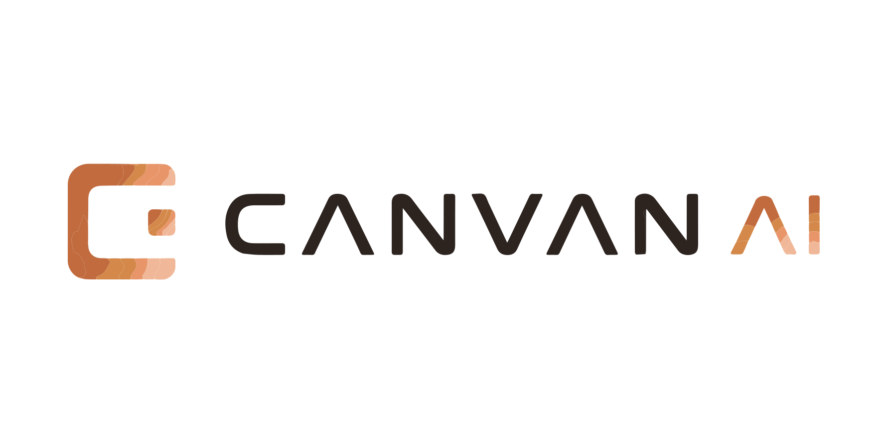

<p align="center">
  
</p>

<h1 align="center">Infinite Canvas</h1>

<p align="center">面向多模态 AI 创作的开源无限画布工作台</p>

<p align="center">
  <a href="https://github.com/EldenPdx/canvan-oversea"></a>
  <a href="LICENSE"></a>
</p>

Infinite Canvas 将文本、图片、视频、音频和生成配置组织成可连接的节点图，并把 AI 生成、素材管理、提示词、任务历史和 Agent 操作放在同一个创作环境中。

项目由 Vite + React Web SPA、Go + Gin API、PostgreSQL、S3 兼容对象存储、独立文档站和本地 Canvas Agent 组成。AI 调用分为两类：

- **本地渠道**：API Key 保存在浏览器，由前端直接请求用户配置的 OpenAI 兼容服务。
- **平台远程渠道**：渠道密钥保存在服务端，由平台完成路由、积分计费、任务记录和结果存储。

> [!CAUTION]
> 项目仍处于快速开发阶段，不保证历史数据和存储格式兼容。当前画布项目和“我的素材”仍以浏览器本地数据为主，WebDAV 是用户自行配置的可选同步方式，不应将普通部署理解为完整云同步。
>
> 请勿在公网环境使用示例管理员密码、数据库密码或 JWT 密钥。

## 核心功能

- **无限画布**：多项目管理，文本、图片、视频、音频和配置节点，节点连线、缩放拖拽、小地图、撤销重做、导入导出。
- **多模态生成**：支持图片、文本、音频和视频的兼容 API 调用；第一方持久化生成当前支持 `video.generate` 和 `video.short-drama`。
- **生成任务**：远程任务支持状态观察、取消、重试、积分结算、审计和平台文件结果。
- **素材与提示词**：个人素材、企业共享素材、平台文件和可同步的提示词目录。
- **账号与管理**：用户、企业、成员、积分、模型渠道、价格配置和管理后台。
- **Canvas 助手**：围绕画布节点对话、生成内容并将结果插回项目。
- **本地 Agent 与 Codex 插件**：通过 Canvas Agent、SSE 和 MCP 让 Codex 读取并操作当前画布。

## 快速开始

### Docker Compose

完整启动 Web、API 和 PostgreSQL：

```bash
git clone https://github.com/EldenPdx/canvan-oversea.git
cd canvan-oversea
cp .env.example .env
```

编辑 `.env`，至少设置安全的 `ADMIN_PASSWORD`、`JWT_SECRET` 和 `POSTGRES_PASSWORD`，然后启动：

```bash
docker compose up -d --build
```

访问 `http://localhost:3000`，使用 `.env` 中的管理员账号登录。

- 使用平台远程渠道时，在管理后台配置模型渠道和价格。
- 使用自己的 API Key 时，在前端配置中添加本地渠道。

### 本地开发

准备 PostgreSQL，并在 `.env` 中设置正确的 `DATABASE_DSN`：

```bash
# 终端 1：Go API，默认端口 8088
go run main.go

# 终端 2：Web SPA，默认端口 3000
cd web
npm install
npm run dev
```

技术要求：Go 1.25、Node.js、PostgreSQL 16。更完整的配置和部署说明见 [快速开始](docs/content/docs/overview/quick-start.mdx) 与 [Docker 部署](docs/content/docs/overview/docker.mdx)。

## 文档入口

用户与部署文档：

- [文档索引](docs/index.md)
- [功能介绍](docs/content/docs/overview/features.mdx)
- [画布节点操作手册](docs/content/docs/canvas/canvas-node-manual.mdx)
- [画布快捷键](docs/content/docs/canvas/canvas-shortcuts.mdx)
- [Docker 部署](docs/content/docs/overview/docker.mdx)

开发与 AI Agent 上下文：

- [项目知识入口](.knowledge/index.md)
- [领域上下文](CONTEXT.md)
- [API 响应约定](docs/content/docs/backend/api-response.mdx)
- [数据库结构](docs/content/docs/backend/backend-database.mdx)
- [本地 Canvas Agent](canvas-agent/README.md)
- [Codex 插件](plugins/infinite-canvas/README.md)
- [待办事项](docs/content/docs/progress/todo.mdx)
- [待测试事项](docs/content/docs/progress/pending-test.mdx)
