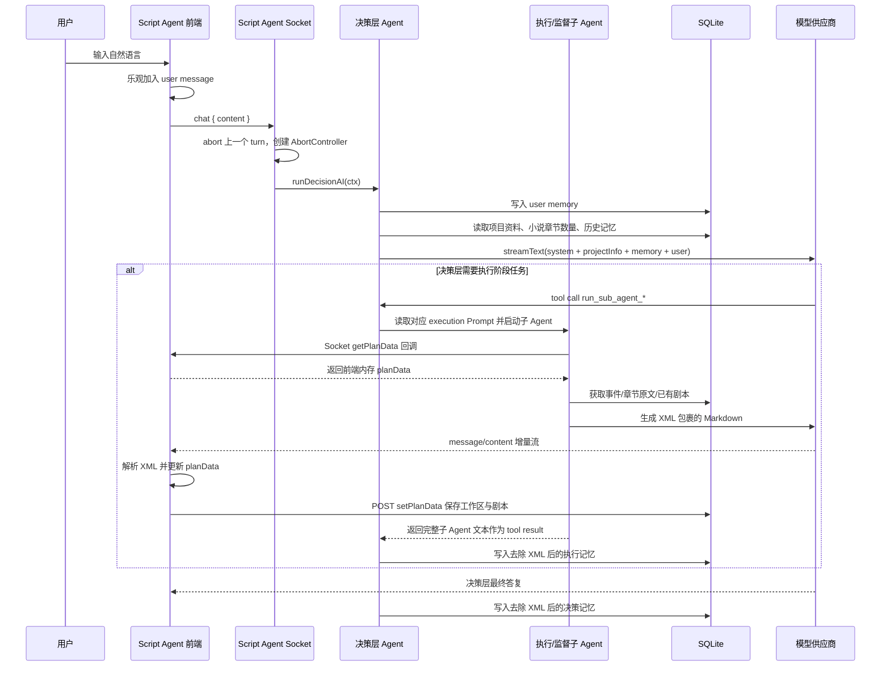

# Toonflow 剧本 Agent：现有实现梳理与 React + Go + PostgreSQL 实现细节规划

> 状态：实现前设计稿
> 编写日期：2026-08-29
> 文档绝对路径：`/Users/eldenpdx/git-project/Toonflow-app/docs/ai-script-agent-implementation-plan.md`
> Toonflow 源码绝对根目录：`/Users/eldenpdx/git-project/Toonflow-app`
> 现有实现基线：Toonflow `1.1.8` 当前工作区代码
> 目标项目技术栈（已确认）：React + Go + PostgreSQL
> 目标：在已经完成 `/Users/eldenpdx/git-project/Toonflow-app/docs/ai-storyboard-generation-implementation-plan.md` 所述分镜能力的另一个项目中，继续实现与 Toonflow 现有剧本 Agent 语义一致的自然语言剧本创作能力。
> 核心产物：用户自然语言 → 项目配置确认 → 故事骨架 → 审核与用户确认 → 改编策略 → 审核与用户确认 → 逐集剧本。

---

## 0. 结论摘要

Toonflow 当前剧本 Agent 已经具备一套较完整的**产品语义和 Prompt 工作流**：

```text
自然语言对话
  ↓
决策层 Agent 收集并确认项目参数
  ↓
故事骨架执行 Agent
  ↓
监督层审核 + 用户确认
  ↓
改编策略执行 Agent
  ↓
监督层审核 + 用户确认
  ↓
剧本执行 Agent 按集串行生成（单批最多 5 集）
  ↓
保存为项目剧本记录
```

但当前代码的可靠性主要依赖 Prompt 自觉、XML 文本约定和前端运行时状态，存在以下事实：

1. **业务工作流主要写在 Prompt 中，后端没有持久化状态机。**
2. **故事骨架、改编策略和剧本由模型输出 XML，前端解析 XML 后再调用 HTTP API 保存。**
3. **执行 Agent 获取工作区数据依赖 Socket 回调到当前前端内存，而不是直接从数据库读取。**
4. **当前声明 Schema 与真实运行数据存在漂移**，尤其是 `planData.script` 实际为数组、代码声明却为字符串。
5. **项目配置、审核结论、阶段批准状态没有结构化持久化**，主要依赖消息记忆和模型上下文。
6. **当前 Prompt 已经定义了完整的内容标准**，包括故事骨架结构、改编策略结构、单集剧本格式、审核维度和 A/B/C/D 评分规则，这些应优先复用。

因此，目标项目的推荐实现不是重新发明另一套剧本工作流，也不是逐字复制 Toonflow 的“XML + 前端 Socket 回调”技术细节，而是：

- **保留 Toonflow 的 Agent 分层、阶段顺序、Prompt 语义、用户确认门和剧本内容格式；**
- **复用此前分镜功能已经落地的 AI Client、任务执行、SSE、PostgreSQL、模型元数据和前端状态组件；**
- 将工作区读取、Schema 校验、状态转换和持久化移到服务端；
- 使用结构化 JSON 作为传输和持久化外壳，故事骨架、改编策略和剧本正文仍保持 Toonflow 当前定义的 Markdown 文本格式；
- 用服务端状态机约束 Agent，而不是完全依赖 Prompt 保证阶段顺序。

---

## 1. 范围、前提与非目标

### 1.1 已确认的目标项目技术栈与实施前提

目标项目的技术栈已经确认，不再作为假设：

- 前端：React；
- 后端：Go；
- 数据库：PostgreSQL。

目标项目已经完成 `/Users/eldenpdx/git-project/Toonflow-app/docs/ai-storyboard-generation-implementation-plan.md` 对应的分镜能力。Script Agent 实施时应优先复用目标项目已经落地的以下基础设施：

- 统一的服务器端 AI Client；
- 可记录模型、Prompt 版本和调用结果的任务执行机制；
- SSE 或目标项目已有的等价实时进度通道；
- 小说、章节、事件和剧本数据访问层；
- PostgreSQL migration、事务和 Repository 约定；
- React 请求层、状态管理、Markdown 渲染和生成进度组件；
- 能够以 `script_id` 或剧本文本作为输入的结构化分镜功能。

如果目标项目中的实际模块名与本文建议不同，应复用已有模块，仅映射本文定义的职责，不要为了匹配名称再建立一套平行基础设施。

本文用 `${TARGET_PROJECT_ROOT}` 表示目标项目的**绝对根目录**。实施前必须将它替换为目标项目的真实绝对路径；本文不会把目标项目内部文件写成无根的相对路径。

### 1.2 本期目标

实现以下完整链路：

1. 用户通过自然语言提出改编或创作需求；
2. Agent 收集并确认项目配置；
3. 基于小说事件或用户提供的故事素材生成故事骨架；
4. 自动审核故事骨架，并等待用户确认、修复或重做；
5. 基于故事骨架生成改编策略；
6. 自动审核改编策略，并等待用户确认、修复或重做；
7. 基于故事骨架、改编策略、对应原文和上一集剧本，逐集生成完整剧本；
8. 将剧本保存到目标项目已有的剧本实体中；
9. 最终剧本可直接作为已经完成的“AI 自动生成分镜”功能的输入。

### 1.3 本期非目标

本期不新增：

- 另一套独立的模型供应商 SDK；
- 另一套任务队列或 SSE 实现；
- 自由演化、无阶段约束的多 Agent 平台；
- 与现有剧本表并行的新剧本数据模型；
- 剧本图片、视频、TTS 或资产生成；
- 剧本删除 Agent；
- 全自动绕过用户审核门的一键黑盒流水线；
- 为了 RAG 单独引入新的向量数据库，除非目标项目已经使用 pgvector。

---

## 2. Toonflow 当前实现模块清单

| 职责 | 当前模块 | 说明 |
|---|---|---|
| Script Agent Socket 入口 | `/Users/eldenpdx/git-project/Toonflow-app/src/socket/routes/scriptAgent.ts` | 验证 token、建立隔离键、接收 `chat`、`stop`、`updateThinkConfig` |
| Socket 命名空间注册 | `/Users/eldenpdx/git-project/Toonflow-app/src/socket/index.ts` | 注册 `/api/socket/scriptAgent` |
| 决策层与子 Agent 编排 | `/Users/eldenpdx/git-project/Toonflow-app/src/agents/scriptAgent/index.ts` | 构建上下文、运行决策层、暴露 4 个子 Agent 工具、消费流式输出 |
| Script Agent 数据工具 | `/Users/eldenpdx/git-project/Toonflow-app/src/agents/scriptAgent/tools.ts` | 获取事件、工作区、原文和已有剧本 |
| 决策层 Prompt | `/Users/eldenpdx/git-project/Toonflow-app/data/skills/script_agent_decision.md` | 项目初始化、阶段判断、调度、审核门、批次规则 |
| 故事骨架 Prompt | `/Users/eldenpdx/git-project/Toonflow-app/data/skills/script_execution_skeleton.md` | 骨架生成流程、约束和完整 Markdown 模板 |
| 改编策略 Prompt | `/Users/eldenpdx/git-project/Toonflow-app/data/skills/script_execution_adaptation.md` | 改编原则、删减决策、世界观呈现模板 |
| 剧本 Prompt | `/Users/eldenpdx/git-project/Toonflow-app/data/skills/script_execution_script.md` | 单集剧本格式、台词、场景、时长、画面和自查规则 |
| 监督层 Prompt | `/Users/eldenpdx/git-project/Toonflow-app/data/skills/script_agent_supervision.md` | 骨架/策略审核、红线、A/B/C/D 评分和报告格式 |
| AI 调用封装 | `/Users/eldenpdx/git-project/Toonflow-app/src/utils/ai.ts` | 角色模型映射、供应商加载、思考级别、流式文本和模型参数 |
| Agent 记忆 | `/Users/eldenpdx/git-project/Toonflow-app/src/utils/agent/memory.ts` | 短期消息、摘要、向量召回、深度检索 |
| 本地 Embedding | `/Users/eldenpdx/git-project/Toonflow-app/src/utils/agent/embedding.ts` | 使用本地 Transformers 模型生成向量 |
| Socket 消息流 | `/Users/eldenpdx/git-project/Toonflow-app/src/socket/resTool.ts` | 消息、文本、思考过程、状态和内容增量事件 |
| 获取工作区 | `/Users/eldenpdx/git-project/Toonflow-app/src/routes/scriptAgent/getPlanData.ts` | 读取或初始化 `o_agentWorkData`，合并 `o_script` |
| 保存工作区 | `/Users/eldenpdx/git-project/Toonflow-app/src/routes/scriptAgent/setPlanData.ts` | 更新工作区 JSON，并按名称插入/更新剧本 |
| 手工更新工作区 | `/Users/eldenpdx/git-project/Toonflow-app/src/routes/scriptAgent/updateData.ts` | 更新故事骨架、策略和脚本数组 |
| 剧本 CRUD | `/Users/eldenpdx/git-project/Toonflow-app/src/routes/script/*.ts` | 新增、编辑、查询、删除和导出剧本 |
| 模型配置 | `/Users/eldenpdx/git-project/Toonflow-app/src/routes/setting/agentDeploy/*.ts`、`/Users/eldenpdx/git-project/Toonflow-app/src/lib/initDB.ts` | 简易模式/高级模式下的各 Agent 模型配置 |
| 当前前端运行逻辑 | `/Users/eldenpdx/git-project/Toonflow-app/data/web/index.html` 中的打包代码 | 包含 Script Agent store、XML 解析、Socket 连接、HTTP 保存和工作台 UI |
| SQLite 表 | `o_agentWorkData`、`o_script`、`memories`、`o_agentDeploy` | 工作区、剧本、记忆和模型配置 |

### 2.1 前端源码边界

当前仓库没有可维护的 Script Agent 前端源文件，只包含 `/Users/eldenpdx/git-project/Toonflow-app/data/web/index.html` 中的编译打包产物。本文对现有前端链路的结论来自该打包产物中的运行逻辑：

- Script Agent store 初始化：`storySkeleton`、`adaptationStrategy`、`script`；
- 连接 `${baseUrl}/socket/scriptAgent`；
- XML 标签注册：`storySkeleton`、`adaptationStrategy`、`scriptItem`；
- `getPlanData` Socket 回调返回当前前端内存中的工作区；
- XML 标签完成后调用 `/scriptAgent/setPlanData`；
- 页面挂载时调用 `/scriptAgent/getPlanData`、加载记忆并连接 Socket；
- 手工编辑调用 `/scriptAgent/updateData` 或 `setPlanData`；
- 删除剧本先调用 `/script/delScript`，再更新工作区。

目标项目应在其 React 源码中实现等价行为，不应直接复制或修改该打包文件。

---

## 3. 当前整体架构与调用链路

### 3.1 当前运行架构

```text
┌──────────────────────────────────────────────────────────────┐
│ 前端 Script Agent 页面                                       │
│                                                              │
│ planData                                                     │
│ ├─ storySkeleton: string                                     │
│ ├─ adaptationStrategy: string                                │
│ └─ script: Array<{id?, name, content}>                        │
│                                                              │
│ Socket XML 解析器                                             │
│ ├─ <storySkeleton>                                           │
│ ├─ <adaptationStrategy>                                      │
│ └─ <scriptItem name="...">                                  │
└──────────────┬───────────────────────────┬────────────────────┘
               │ Socket.IO                 │ HTTP
               ▼                           ▼
┌──────────────────────────┐   ┌───────────────────────────────┐
│ /api/socket/scriptAgent  │   │ /api/scriptAgent/*            │
│                          │   │ /api/script/*                 │
│ chat / stop / think      │   │                               │
└──────────────┬───────────┘   └──────────────┬────────────────┘
               ▼                              ▼
┌──────────────────────────────────────────────────────────────┐
│ /Users/eldenpdx/git-project/Toonflow-app/src/agents/scriptAgent/index.ts                              │
│                                                              │
│ 决策层 Agent                                                 │
│ ├─ Memory tools                                              │
│ ├─ Workspace/source tools                                    │
│ └─ Sub-agent tools                                           │
│    ├─ storySkeleton Agent                                    │
│    ├─ adaptationStrategy Agent                               │
│    ├─ script Agent                                           │
│    └─ supervision Agent                                      │
└──────────────┬───────────────────────────┬────────────────────┘
               │                           │
               ▼                           ▼
┌──────────────────────────┐   ┌───────────────────────────────┐
│ Vercel AI SDK streamText │   │ SQLite                       │
│ + vendor textRequest     │   │ o_project / o_novel          │
│ + role model mapping     │   │ o_agentWorkData / o_script   │
└──────────────────────────┘   │ memories / o_agentDeploy     │
                               └───────────────────────────────┘
```

### 3.2 一次用户消息的完整时序



### 3.3 Socket 入口行为

`/Users/eldenpdx/git-project/Toonflow-app/src/socket/routes/scriptAgent.ts` 的当前行为：

1. 从 Socket handshake 读取 `token`；
2. 使用 `o_setting.tokenKey` 验证 JWT；
3. 要求 `isolationKey`；
4. 将 `projectId` 放入 `ResTool.data`；
5. 同一连接只维护一个活动 `AbortController`；
6. 新 `chat` 会先中止上一次生成；
7. 初始回复消息名称为“统筹”；
8. `updateThinkConfig` 更新该连接的思考开关和等级；
9. `stop` 中止当前模型调用；
10. 非主动取消错误被记录并写入消息错误状态。

前端的隔离键为：

```text
{projectId}:scriptAgent
```

因此当前记忆按“项目 + Script Agent”隔离，而不是按单个页面 turn 隔离。

---

## 4. 当前 Agent 分层与业务工作流

### 4.1 决策层 Agent

入口：`runDecisionAI(ctx)`。

当前上下文构建：

```text
system:
  /Users/eldenpdx/git-project/Toonflow-app/data/skills/script_agent_decision.md

assistant:
  项目信息
  + Agent Memory（相关记忆、历史摘要、近期对话）

user:
  当前自然语言输入
```

项目信息包括：

- 小说名称；
- 小说类型；
- 小说简介；
- 目标画风；
- 目标视频画幅；
- 小说章节数量。

决策层可见工具：

- `deepRetrieve`；
- `get_novel_events`；
- `get_planData`；
- `get_novel_text`；
- `get_script_content`；
- `run_sub_agent_storySkeleton`；
- `run_sub_agent_adaptationStrategy`；
- `run_sub_agent_script`；
- `run_supervision_agent`。

Prompt 规定决策层只与用户直接交互，负责：

- 识别用户意图；
- 收集配置；
- 判断当前阶段；
- 调度执行 Agent；
- 调度监督 Agent；
- 展示审核报告；
- 等待用户批准；
- 在子 Agent 失败时停止，不得自行接管执行工作。

### 4.2 项目初始化

在生成任何产物前，当前 Prompt 要求确认以下 6 类配置；其中章节范围同时包含起止范围和实际章节编号：

| 字段 | 含义 |
|---|---|
| `totalEpisodes` | 总集数 |
| `episodeDuration` | 单集目标时长，分钟 |
| `startChapter` / `endChapter` | 原著覆盖范围 |
| `chapterIndexes` | 实际使用的章节编号集合 |
| `platform` | 竖屏/横屏及画幅规格 |
| `style` | 剧集风格定位 |
| `paywall` | 免费集数与付费卡点策略 |

其中台词目标字数按：

```text
wordsPerEpisode = episodeDuration × 150
```

当前 Prompt 还定义了推荐分支：当用户不知道如何配置时，先询问剧集形态，再基于事件表推荐集数、时长、章节范围、画幅、风格和付费策略。

### 4.3 阶段 1：故事骨架

前置条件：

- 项目参数已经确认；
- 章节范围已经校验；
- 小说事件已经提取。

执行 Agent：`run_sub_agent_storySkeleton`。

调用配置：

```text
model key: scriptAgent:storySkeletonAgent
system prompt: script_execution_skeleton.md
output wrapper: <storySkeleton>...</storySkeleton>
memory role: assistant:execution:storySkeleton
message name: 编剧
```

执行 Agent 读取：

- 当前工作区；
- 目标章节事件。

故事骨架必须包含：

1. 故事核；
2. 核心心理级爽点；
3. 金手指及约束；
4. 隐线/人物弧；
5. 大三角核心人物小传，最多 4 人；
6. 三幕结构；
7. 分集决策；
8. 全局删减决策；
9. 付费卡点设计；
10. 股价级反转登记表。

分集模式：

- 总集数 `≤20`：逐集展开；
- 总集数 `>20`：总览表必须一行一集，再展开首集、幕末转折、付费卡点、高潮和用户指定集。

### 4.4 故事骨架审核与用户门

执行成功后，决策层调用 `run_supervision_agent`。

监督层读取工作区中的故事骨架，按以下重点审核：

- 故事核与隐线；
- 大三角和单线叙事；
- 前 10% 黄金结构；
- 付费点分布；
- 情绪曲线；
- 信息差；
- 集末钩子；
- 三大密度；
- 股价级反转；
- 矛盾强度；
- 心理级爽点与金手指原创性；
- 章节、集数和项目配置一致性。

审核结果为 A/B/C/D：

| 评分 | 行为 |
|---|---|
| A | 询问是否进入下一阶段 |
| B | 询问小修或直接继续 |
| C | 建议修复，并让用户选择修复项 |
| D | 建议重做，并等待用户确认 |

**审核报告展示后必须停止，直到用户明确回复。**

### 4.5 阶段 2：改编策略

前置条件：故事骨架通过审核或用户明确批准继续。

执行 Agent：`run_sub_agent_adaptationStrategy`。

调用配置：

```text
model key: scriptAgent:adaptationStrategyAgent
system prompt: script_execution_adaptation.md
output wrapper: <adaptationStrategy>...</adaptationStrategy>
memory role: assistant:execution:adaptationStrategy
message name: 编剧
```

输入：

- 项目配置；
- 小说事件；
- 已有故事骨架；
- 用户当前修订要求；
- 已有改编策略（修改场景）。

输出必须包含：

1. 3–5 条核心改编原则；
2. 每条原则的正面指导和负面边界；
3. 主要删除/压缩决策；
4. 每项删减对主线的影响和替代方案；
5. 世界观呈现节奏；
6. 世界观解释度；
7. 世界观锚点角色；
8. 观众视角；
9. 三大密度策略；
10. 心理级爽点和原创金手指策略；
11. 与骨架反转登记表一致的反转来源。

### 4.6 改编策略审核与用户门

监督层重点审核：

- 用户意图是否被尊重；
- 是否服务故事核；
- 是否与故事骨架一致；
- 删减决策是否冲突；
- 反转来源是否一致；
- 原创性和反洗稿；
- 8 大核心改编要点；
- 三大密度；
- AI 画面稳定性；
- 情绪基调；
- 人物弧；
- 世界观呈现。

与故事骨架一样，审核报告展示后必须等待用户确认。

### 4.7 阶段 3：逐集剧本

前置条件：改编策略已经通过审核或用户明确批准。

执行 Agent：`run_sub_agent_script`。

调用配置：

```text
model key: scriptAgent:scriptAgent
system prompt: script_execution_script.md
output wrapper: <scriptItem name="剧本名称">...</scriptItem>
memory role: assistant:execution:script
message name: 编剧
```

当前 Prompt 的批次规则：

1. 进入剧本阶段时询问本次生成几集；
2. 默认建议 3 集；
3. 单次最多 5 集；
4. 每次子 Agent 调用只生成 1 集；
5. 按集序串行执行；
6. 中间不向用户发送阶段通知；
7. 完成后一次性汇报；
8. 若仍有未生成集数，询问是否继续下一批；
9. 阶段 3 不调用监督 Agent。

每集上下文：

- 项目配置；
- 故事骨架中当前集的信息；
- 改编策略；
- 当前集对应的章节事件；
- 当前集对应的原文；
- 仅上一集剧本，用于剧情和角色状态衔接；
- 当前项目已有剧本名称和 ID，避免重复。

每集剧本的正文格式必须保持 Toonflow 当前规范：

```text
<scriptItem name="{作品名} EP{NN}：{集标题}">
# {作品名} EP{NN}：{集标题}
# 目标时长：...
# 平台：... | 风格：... | 节拍：...

## 剧情梗概
...

1-1 {场景名} 日/内
人物：...
△动作、环境、表情、光线、道具描述
人物名：台词
OS（人物，情绪）：...

---

1-2 ...
...
</scriptItem>
```

内容约束包括：

- 单集时长为配置值 ±10 秒；
- 台词按约 150 字/分钟估算；
- 正文通常控制在 1000 字以内，以“短、密、紧”为优先；
- 单句台词通常不超过 20 字；
- 每场、每个画面必须推进剧情；
- 场景之间用 `---`；
- 场景描述以 `△` 开头；
- 支持 OS/V.S.；
- 每集落实黄金单集公式和 3-15-45 节奏，但不得把内部标尺写入正文；
- 不输出版本号、统计、自查清单、幕时间段和镜头技术元信息。

---

## 5. 当前代码级数据流

### 5.1 当前实际工作区结构

前端和持久化的真实结构为：

```ts
type CurrentScriptPlanData = {
  storySkeleton: string;
  adaptationStrategy: string;
  script: Array<{
    id?: number;
    name: string;
    content: string;
  }>;
};
```

数据来源：

- `storySkeleton`：前端解析 `<storySkeleton>`；
- `adaptationStrategy`：前端解析 `<adaptationStrategy>`；
- `script`：前端解析一个或多个 `<scriptItem name="...">`；
- 页面重载后，`getPlanData` 会使用 `o_script` 的记录覆盖工作区 JSON 中的 `script`。

### 5.2 当前 XML 解析与保存

前端通用 Socket store 会：

1. 保存完整的文本增量；
2. 在增量文本中查找配置过的 XML 标签；
3. 将 XML 包裹内容从聊天消息正文中隐藏；
4. 在 XML 未闭合时持续更新工作台预览；
5. XML 闭合后把状态标记为 `complete`；
6. Script Agent store 收到 `complete` 后调用 `/scriptAgent/setPlanData`。

`scriptItem` 使用 `name` 属性作为当前前端数组的去重键：

- 同名：更新内容；
- 新名称：追加剧本；
- 缺少 `name`：忽略该剧本内容。

### 5.3 当前服务端工作区工具

#### `get_novel_events`

输入：

```json
{
  "chapterIndexs": [1, 2, 3]
}
```

行为：从 `o_novel` 读取对应章节的标题和 `event`，拼成文本。

#### `get_planData`

输入：

```json
{
  "key": "storySkeleton | adaptationStrategy | script"
}
```

行为：服务端向当前 Socket 客户端发送 `getPlanData` 事件，等待客户端回调返回整个工作区，再返回指定字段。

#### `get_novel_text`

输入：

```json
{
  "chapterIndex": "1"
}
```

行为：从 `o_novel.chapterData` 读取指定章节原文。

#### `get_script_content`

输入：

```json
{
  "ids": ["123"]
}
```

行为：从 `o_script` 读取名称和正文，包装为 `<scriptItem>` 文本。

### 5.4 当前持久化

#### `o_agentWorkData`

当前 Script Agent 使用：

```text
projectId = 当前项目
key       = scriptAgent
data      = JSON.stringify(planData)
```

其中主要保存故事骨架和改编策略。页面读取时会再从 `o_script` 加载剧本列表。

#### `o_script`

字段：

- `id`；
- `projectId`；
- `name`；
- `content`；
- `createTime`；
- `extractState`；
- `errorReason`。

`setPlanData` 按 `(projectId, name)` 在应用层查找：

- 已存在则更新 `content`；
- 不存在则插入。

数据库本身没有 `(projectId, name)` 唯一约束。

#### `memories`

同一 `isolationKey` 中保存：

- 用户消息；
- 决策层输出；
- 故事骨架执行 Agent 输出；
- 改编策略执行 Agent 输出；
- 剧本执行 Agent 输出；
- 监督层输出；
- 自动摘要。

XML 产物在写入记忆前会被整体移除，因此记忆主要保留对话、执行说明、确认消息和审核报告，而不是重复保存完整工作区产物。

### 5.5 当前 Memory 默认参数

| 配置 | 默认值 | 含义 |
|---|---:|---|
| `messagesPerSummary` | 3 | 每 3 条未摘要消息触发摘要 |
| `summaryMaxLength` | 500 | 摘要最大字符数 |
| `shortTermLimit` | 5 | 注入最近未摘要消息数量 |
| `summaryLimit` | 10 | 注入最近摘要数量 |
| `ragLimit` | 3 | 向量召回原始消息数量 |
| `deepRetrieveSummaryLimit` | 5 | 深度检索候选摘要数量 |

Memory 获取顺序：

```text
最近未摘要消息
+ 最近摘要
+ 当前用户文本的向量相似消息
```

`deepRetrieve` 仅在用户明确要求回想历史时使用；它先召回摘要，再让模型判断相关摘要，最后展开关联原始消息。

---

## 6. 当前 LLM、流式输出、取消和模型配置

### 6.1 模型角色

当前可独立配置：

- `scriptAgent`；
- `scriptAgent:decisionAgent`；
- `scriptAgent:supervisionAgent`；
- `scriptAgent:storySkeletonAgent`；
- `scriptAgent:adaptationStrategyAgent`；
- `scriptAgent:scriptAgent`。

简易模式：所有细分角色回退到 `scriptAgent` 模型。

高级模式：每个角色使用自己的 `o_agentDeploy.modelName`。

模型配置还支持：

- `temperature`；
- `maxOutputTokens`；
- 模型是否支持思考；
- 当前连接的思考等级 0–3。

### 6.2 AI 调用

当前文本调用统一经过：

```text
u.Ai.Text(roleKey, think, thinkLevel).stream(...)
  ↓
resolveModelName
  ↓
加载 vendor textRequest
  ↓
Vercel AI SDK streamText
```

当工具存在时，最大步骤数按“工具数量 × 50”设置。当前 Script Agent 代码没有独立的业务级重试器，也没有对输出 XML 或 Markdown 做服务端 Schema 校验。

### 6.3 流式事件

服务端通过 `ResTool` 发出：

- `message`；
- `message:update`；
- `content:add`；
- `content:update`。

模型流主要处理：

- `reasoning-start`；
- `reasoning-delta`；
- `reasoning-end`；
- `text-delta`；
- `error`。

前端将消息状态维护为：

- `pending`；
- `streaming`；
- `complete`；
- `error`；
- `stop`。

### 6.4 取消

- 用户发送新消息会取消当前生成；
- 用户点击停止会中止当前 `AbortController`；
- 父决策层和子 Agent 共用同一个 `abortSignal`；
- 子 Agent 失败会向上抛出；
- 决策 Prompt 明确要求失败后停止，不能由决策层代替执行层生成。

---

## 7. 当前 Schema 与实现不一致项

以下问题必须在目标实现中显式修正，但不应借此改变业务工作流。

### 7.1 `planData.script` 类型错误

`/Users/eldenpdx/git-project/Toonflow-app/src/agents/scriptAgent/tools.ts` 声明：

```ts
script: z.string()
```

真实运行值为：

```ts
Array<{ id?: number; name: string; content: string }>
```

影响：

- `get_planData({key:"script"})` 的静态类型错误；
- Prompt、REST 和前端对同一字段的理解不一致；
- 后续迁移容易把剧本列表误实现成单个字符串。

### 7.2 `ScriptSchema` 未被使用

`ScriptSchema = {name, content}` 已定义，但没有用于：

- 模型输出；
- XML 解析；
- `setPlanData`；
- 剧本入库；
- `get_planData`。

### 7.3 `setPlanData` 校验不完整

路由校验只声明：

```text
storySkeleton
adaptationStrategy
```

但处理函数读取 `data.script`。当前中间件只校验、不使用解析结果替换 `req.body`，因此运行时仍能拿到额外字段；这属于隐式行为，不能作为目标实现的数据契约。

### 7.4 `updateData` 与真实 Script DTO 不一致

`updateData` 声明脚本项只有：

```text
id
content
```

前端实际传入的脚本项还包含 `name`。该路由仅更新 `o_agentWorkData`，不更新 `o_script`；前端主要依赖它编辑故事骨架和改编策略。

### 7.5 Prompt 中存在并未实现的工具名

决策 Prompt 描述了：

- `set_planData_storySkeleton`；
- `set_planData_adaptationStrategy`；
- `insert_script_to_sqlite`。

当前后端没有这些工具。实际写入方式是模型输出 XML，前端解析后调用 HTTP API。

### 7.6 项目配置没有结构化保存

Prompt 要求“将参数作为项目配置保存”，但当前工作区只有：

- 故事骨架；
- 改编策略；
- 剧本列表。

项目配置主要存在于对话记忆和后续派发 Prompt 中，无法可靠地：

- 页面重载后直接恢复；
- 服务端校验前置条件；
- 判断配置是否变化；
- 判断骨架/策略是否因配置变化而失效。

### 7.7 审核和用户批准状态没有持久化

当前系统无法结构化区分：

- 尚未生成；
- 已生成待审核；
- 审核 A/B/C/D；
- 用户已批准；
- 用户要求修复；
- 用户要求重做。

这些状态都由决策 Agent 从消息历史推断。

### 7.8 阶段顺序仅由 Prompt 约束

后端工具层不会阻止：

- 没有骨架就生成策略；
- 骨架未审核通过就生成策略；
- 策略未审核通过就生成剧本；
- 一次生成超过 5 集；
- 并行生成多集；
- 重复生成同一集。

### 7.9 工作区读取依赖在线前端

`get_planData` 通过 Socket 向前端询问内存状态。后果：

- 无法可靠地从 worker、后台任务或无 UI 环境运行；
- 当前前端内存可能尚未完成数据库加载；
- 网络中断会让工具 Promise 长时间不返回；
- 数据权威源不明确：前端内存和数据库可能不同步。

### 7.10 数据隔离不足

`get_script_content(ids)` 仅按剧本 ID 查询，没有同时限制 `projectId`。模型若传入其他项目的 ID，存在跨项目读取风险。

### 7.11 章节类型和顺序不一致

- `get_novel_events.chapterIndexs` 为 `number[]`；
- `get_novel_text.chapterIndex` 为 `string`；
- 事件查询没有显式 `orderBy(chapterIndex)`；
- 工具不会主动返回缺失章节列表。

### 7.12 剧本唯一性和事务不足

- `o_script` 没有 `(projectId, name)` 唯一索引；
- `setPlanData` 用并发 `Promise.all` 执行“先查再写”；
- 工作区更新和剧本插入/更新不在同一事务；
- 同名脚本并发生成可能产生重复；
- 部分写入失败时可能出现工作区与 `o_script` 不一致。

### 7.13 单集调用与 XML 示例冲突

决策 Prompt 要求每次子 Agent 只生成一集，但代码追加的格式 Prompt 连续展示了多个 `<scriptItem>` 示例。目标实现应明确：

```text
一次 run_script_episode 调用 = 恰好一个 ScriptItem
```

### 7.14 XML 完成事件可能重复触发保存

当前前端解析器在标签已经闭合后，只要同一文本内容继续追加，仍可能再次以 `complete` 状态触发回调，导致重复调用 `setPlanData`。

### 7.15 其他一致性问题

- 子 Agent 返回后，父消息名称被设置为“视频策划”，与 Script Agent 语义不一致；
- `prompt` 的“100 字以内”只有描述，没有 Schema `.max(100)`；
- 决策 Prompt 一方面禁止决策层读取工作区，另一方面推荐分支又要求决策层调用 `get_novel_events`；
- 当前没有服务端产物版本、Prompt 版本、source hash、模型信息和审核版本；
- 当前没有 Script Agent 专用的确定性输出校验和修复重试。

---

## 8. 目标实现必须保持的业务约束

以下约束属于 Toonflow Script Agent 的核心产品逻辑，目标项目不得擅自改变：

1. **自然语言是主入口。** 用户不需要填写复杂表单才能开始。
2. **参数不完整时主动追问。** 不得静默用默认值补齐项目配置。
3. **章节范围必须校验。** 不存在的章节需要明确反馈。
4. **固定阶段顺序：故事骨架 → 改编策略 → 剧本。**
5. **故事骨架和改编策略都需要监督层审核。**
6. **审核结果必须展示给用户，并等待明确决定。**
7. **剧本阶段默认建议 3 集，单批最多 5 集。**
8. **每次执行 Agent 只生成一集，按集序串行。**
9. **剧本阶段不自动调用监督层。**
10. **生成当前集时只读取上一集剧本，不把所有历史剧本塞入上下文。**
11. **执行/监督 Agent 失败后，决策层不得自行代替。**
12. **修改既有产物时，在当前工作区基础上修改，除非用户明确要求重写。**
13. **Agent 不处理剧本删除，删除继续走已有剧本管理能力。**
14. **故事骨架、改编策略和剧本正文保持当前 Prompt 规定的 Markdown 内容结构。**
15. **用户界面不暴露内部 Agent/tool 名称。**

---

## 9. 目标技术架构

### 9.1 核心设计

目标项目采用“语义忠实、技术复用”的架构：

```text
React Script Agent 页面
  ├─ 自然语言聊天
  ├─ 工作区：故事骨架 / 改编策略 / 剧本
  ├─ 审核报告与确认操作
  └─ SSE 进度

Go Script Agent API
  ├─ TurnService：一次自然语言交互
  ├─ DecisionAgent：意图理解和工具调度
  ├─ WorkflowGuard：阶段与用户门校验
  ├─ StorySkeletonGenerator
  ├─ AdaptationStrategyGenerator
  ├─ ScriptEpisodeGenerator
  ├─ ArtifactReviewer
  ├─ ContextBuilder
  ├─ MemoryService
  └─ Workspace/Script/Review Repository

既有 AI 基础设施
  ├─ AIClient
  ├─ 模型角色映射
  ├─ Prompt 版本
  ├─ transient retry
  ├─ usage/cost metadata
  └─ structured output

既有任务与事件基础设施
  ├─ job/turn 状态
  ├─ worker 或后台执行
  ├─ SSE event stream
  ├─ cancellation
  └─ idempotency

PostgreSQL
  ├─ script_agent_workspaces
  ├─ script_agent_reviews
  ├─ 已有 scripts
  ├─ 已有或新增 agent_messages
  └─ 复用现有 ai_jobs / generation_jobs
```

### 9.2 为什么不复制 XML + 前端回调

目标项目技术栈已确认为 React + Go + PostgreSQL，并且此前分镜功能已经建立服务器端生成、校验和持久化链路。复制 Toonflow 当前技术细节会产生第二套状态管理：

```text
模型 XML
→ React 正则解析
→ React 内存作为工作区
→ React 再通知 Go 保存
```

推荐目标链路：

```text
模型结构化结果
→ Go Schema 校验
→ Go 事务保存
→ SSE 通知 React 更新
```

保留不变的是：

- Agent 角色；
- 阶段；
- Prompt 内容规则；
- 用户确认门；
- 产物正文格式；
- 逐集生成方式。

改变的是不可靠的传输和持久化方式，而不是业务逻辑。

### 9.3 与已实现分镜能力的复用关系

| 已实现分镜模块能力 | Script Agent 如何复用 |
|---|---|
| AI Client | 新增 Script Agent 五类角色配置，不新建 SDK |
| Prompt registry/version | 注册五个 Script Agent Prompt |
| job/worker | Script turn 和长内容生成复用同一领取、取消、重试机制 |
| SSE | 复用连接、事件 ID、重连和完成/失败事件 |
| PostgreSQL transaction | 工作区、审核、剧本和状态原子写入 |
| source loader/repository | 读取小说章节、事件和剧本 |
| model metadata | 保存 provider/model/temperature/token usage |
| auth/project permission | 所有 Script Agent 查询沿用项目权限 |
| script entity | 最终剧本直接写入已有剧本表 |
| storyboard input | 生成剧本后直接使用 `script_id` 创建分镜任务 |

---

## 10. 推荐模块划分

以下路径以 `${TARGET_PROJECT_ROOT}` 为前缀；该变量必须是目标项目的真实绝对根目录。目录名称是逻辑建议，实施时应映射到目标项目已有目录约定。

### 10.1 Go 后端

```text
${TARGET_PROJECT_ROOT}/internal/scriptagent/domain/types.go
${TARGET_PROJECT_ROOT}/internal/scriptagent/domain/errors.go
${TARGET_PROJECT_ROOT}/internal/scriptagent/domain/transitions.go
${TARGET_PROJECT_ROOT}/internal/scriptagent/application/turn_service.go
${TARGET_PROJECT_ROOT}/internal/scriptagent/application/workflow_guard.go
${TARGET_PROJECT_ROOT}/internal/scriptagent/application/story_skeleton.go
${TARGET_PROJECT_ROOT}/internal/scriptagent/application/adaptation_strategy.go
${TARGET_PROJECT_ROOT}/internal/scriptagent/application/script_episode.go
${TARGET_PROJECT_ROOT}/internal/scriptagent/application/review.go
${TARGET_PROJECT_ROOT}/internal/scriptagent/application/project_config.go
${TARGET_PROJECT_ROOT}/internal/scriptagent/agent/decision_agent.go
${TARGET_PROJECT_ROOT}/internal/scriptagent/agent/story_skeleton_agent.go
${TARGET_PROJECT_ROOT}/internal/scriptagent/agent/adaptation_agent.go
${TARGET_PROJECT_ROOT}/internal/scriptagent/agent/script_agent.go
${TARGET_PROJECT_ROOT}/internal/scriptagent/agent/supervision_agent.go
${TARGET_PROJECT_ROOT}/internal/scriptagent/agent/tool_registry.go
${TARGET_PROJECT_ROOT}/internal/scriptagent/agent/output_repair.go
${TARGET_PROJECT_ROOT}/internal/scriptagent/context/decision_context.go
${TARGET_PROJECT_ROOT}/internal/scriptagent/context/skeleton_context.go
${TARGET_PROJECT_ROOT}/internal/scriptagent/context/adaptation_context.go
${TARGET_PROJECT_ROOT}/internal/scriptagent/context/script_context.go
${TARGET_PROJECT_ROOT}/internal/scriptagent/context/review_context.go
${TARGET_PROJECT_ROOT}/internal/scriptagent/prompt/registry.go
${TARGET_PROJECT_ROOT}/internal/scriptagent/prompt/versions.go
${TARGET_PROJECT_ROOT}/internal/scriptagent/repository/workspace_repository.go
${TARGET_PROJECT_ROOT}/internal/scriptagent/repository/review_repository.go
${TARGET_PROJECT_ROOT}/internal/scriptagent/repository/script_repository.go
${TARGET_PROJECT_ROOT}/internal/scriptagent/repository/memory_repository.go
${TARGET_PROJECT_ROOT}/internal/scriptagent/repository/source_repository.go
${TARGET_PROJECT_ROOT}/internal/scriptagent/transport/http/handlers.go
${TARGET_PROJECT_ROOT}/internal/scriptagent/transport/http/dto.go
${TARGET_PROJECT_ROOT}/internal/scriptagent/transport/http/routes.go
${TARGET_PROJECT_ROOT}/internal/scriptagent/events/publisher.go
```

职责说明：

- `domain`：Workspace、ProjectConfig、Artifact、Review、状态枚举和转换错误；
- `application`：自然语言 turn、工作流 Guard、故事骨架、改编策略、单集剧本、审核和项目配置用例；
- `agent`：五类 Agent runner、工具注册和格式修复；
- `context`：各阶段最小上下文构建；
- `prompt`：Prompt 注册和版本；
- `repository`：工作区、审核、剧本、记忆和小说来源访问；
- `transport/http`：React 调用的 HTTP/SSE 接口；
- `events`：适配目标项目已存在的 SSE/job event publisher。

### 10.2 React 前端

```text
${TARGET_PROJECT_ROOT}/src/features/script-agent/api.ts
${TARGET_PROJECT_ROOT}/src/features/script-agent/types.ts
${TARGET_PROJECT_ROOT}/src/features/script-agent/store.ts
${TARGET_PROJECT_ROOT}/src/features/script-agent/use-script-agent-events.ts
${TARGET_PROJECT_ROOT}/src/features/script-agent/pages/script-agent-page.tsx
${TARGET_PROJECT_ROOT}/src/features/script-agent/components/script-agent-chat.tsx
${TARGET_PROJECT_ROOT}/src/features/script-agent/components/story-skeleton-panel.tsx
${TARGET_PROJECT_ROOT}/src/features/script-agent/components/adaptation-strategy-panel.tsx
${TARGET_PROJECT_ROOT}/src/features/script-agent/components/script-list-panel.tsx
${TARGET_PROJECT_ROOT}/src/features/script-agent/components/review-report.tsx
${TARGET_PROJECT_ROOT}/src/features/script-agent/components/project-config-summary.tsx
${TARGET_PROJECT_ROOT}/src/features/script-agent/components/turn-status.tsx
```

如果目标项目已经有通用 Chat、Markdown Editor、Job Progress、SSE Hook、Review Panel 或 Script Editor，应直接复用，不新增同类组件。

---

## 11. 目标领域模型与 Schema

### 11.1 项目配置

```go
type ScriptProjectConfig struct {
    TotalEpisodes  int      `json:"totalEpisodes"`
    EpisodeMinutes int      `json:"episodeMinutes"`
    StartChapter   int      `json:"startChapter"`
    EndChapter     int      `json:"endChapter"`
    ChapterIndexes []int    `json:"chapterIndexes"`
    Platform       string   `json:"platform"`
    AspectRatio    string   `json:"aspectRatio"`
    Style          string   `json:"style"`
    Paywall        string   `json:"paywall"`
    WordsPerEpisode int     `json:"wordsPerEpisode"`
}
```

确定性校验：

```text
TotalEpisodes > 0
EpisodeMinutes > 0
StartChapter <= EndChapter
ChapterIndexes 非空、去重、升序
ChapterIndexes 全部属于当前项目
WordsPerEpisode = EpisodeMinutes × 150
Platform/AspectRatio 使用目标项目已有枚举
```

`WordsPerEpisode` 应由服务端计算，不接受客户端或模型作为权威值。

### 11.2 工作区

```go
type ScriptAgentWorkspace struct {
    ID                  uuid.UUID            `json:"id"`
    ProjectID           uuid.UUID            `json:"projectId"`
    CurrentStage        ScriptAgentStage     `json:"currentStage"`
    ProjectConfig       *ScriptProjectConfig `json:"projectConfig,omitempty"`
    StorySkeleton       string               `json:"storySkeleton"`
    StorySkeletonStatus ArtifactStatus       `json:"storySkeletonStatus"`
    AdaptationStrategy  string               `json:"adaptationStrategy"`
    AdaptationStatus    ArtifactStatus       `json:"adaptationStatus"`
    Scripts             []ScriptSummary      `json:"scripts"`
    Version             int64                `json:"version"`
    UpdatedAt           time.Time            `json:"updatedAt"`
}
```

`ScriptSummary` 必须复用已有剧本 DTO；至少包含：

```go
type ScriptSummary struct {
    ID            uuid.UUID `json:"id"`
    EpisodeNumber int       `json:"episodeNumber"`
    Name          string    `json:"name"`
    Content       string    `json:"content"`
    Version       int       `json:"version"`
    UpdatedAt     time.Time `json:"updatedAt"`
}
```

### 11.3 产物状态

```text
empty
ready
generating
generated
reviewing
awaiting_user_decision
approved
revision_requested
redo_requested
failed
```

故事骨架和改编策略分别维护状态。剧本按每集使用已有剧本状态或生成任务状态，不把所有集压成一个状态。

### 11.4 工作流阶段

```text
collecting_config
ready_for_story_skeleton
generating_story_skeleton
reviewing_story_skeleton
awaiting_story_skeleton_decision
ready_for_adaptation_strategy
generating_adaptation_strategy
reviewing_adaptation_strategy
awaiting_adaptation_decision
ready_for_script
selecting_script_batch
generating_script_batch
script_batch_completed
completed
failed
```

### 11.5 审核结果

```go
type ArtifactReview struct {
    ID            uuid.UUID     `json:"id"`
    ProjectID     uuid.UUID     `json:"projectId"`
    ArtifactType  string        `json:"artifactType"` // story_skeleton | adaptation_strategy
    ArtifactVersion int         `json:"artifactVersion"`
    Grade         string        `json:"grade"`        // A | B | C | D
    Summary       string        `json:"summary"`
    Issues        []ReviewIssue `json:"issues"`
    Decisions     []string      `json:"decisions"`
    Markdown      string        `json:"markdown"`
    PromptVersion string        `json:"promptVersion"`
    Model         ModelMetadata `json:"model"`
    CreatedAt     time.Time     `json:"createdAt"`
}
```

```go
type ReviewIssue struct {
    Severity   string `json:"severity"` // severe | medium | minor
    Check      string `json:"check"`
    Problem    string `json:"problem"`
    Suggestion string `json:"suggestion"`
}
```

评分应由结构化字段驱动，Markdown 只是展示结果，不能再从 Markdown 反向解析等级。

### 11.6 Agent 结构化输出

#### 故事骨架

```json
{
  "content": "# 作品名 - 故事骨架\n..."
}
```

#### 改编策略

```json
{
  "content": "# 作品名 - 关键决策记录\n..."
}
```

#### 单集剧本

```json
{
  "script": {
    "episodeNumber": 1,
    "name": "作品名 EP01：集标题",
    "content": "# 作品名 EP01：集标题\n...",
    "sourceChapterIndexes": [1, 2]
  }
}
```

目标实现不要求模型输出 `<storySkeleton>`、`<adaptationStrategy>` 或 `<scriptItem>`。如目标 AI Client 暂不支持结构化输出，可在服务端兼容解析 XML，但 XML 仅作为模型适配层，不能让 React 成为权威解析端。

---

## 12. PostgreSQL 持久化规划

### 12.1 工作区表

```sql
CREATE TABLE script_agent_workspaces (
    id UUID PRIMARY KEY,
    project_id UUID NOT NULL UNIQUE REFERENCES projects(id) ON DELETE CASCADE,
    current_stage TEXT NOT NULL,
    project_config JSONB,
    story_skeleton TEXT NOT NULL DEFAULT '',
    story_skeleton_status TEXT NOT NULL DEFAULT 'empty',
    story_skeleton_version INTEGER NOT NULL DEFAULT 0,
    adaptation_strategy TEXT NOT NULL DEFAULT '',
    adaptation_status TEXT NOT NULL DEFAULT 'empty',
    adaptation_version INTEGER NOT NULL DEFAULT 0,
    version BIGINT NOT NULL DEFAULT 0,
    created_at TIMESTAMPTZ NOT NULL DEFAULT now(),
    updated_at TIMESTAMPTZ NOT NULL DEFAULT now()
);
```

若目标项目已有通用 workspace/document 表，应把上述字段映射到已有表，不再新增同类表。

### 12.2 审核表

```sql
CREATE TABLE script_agent_reviews (
    id UUID PRIMARY KEY,
    project_id UUID NOT NULL REFERENCES projects(id) ON DELETE CASCADE,
    workspace_id UUID NOT NULL REFERENCES script_agent_workspaces(id) ON DELETE CASCADE,
    artifact_type TEXT NOT NULL,
    artifact_version INTEGER NOT NULL,
    grade TEXT NOT NULL CHECK (grade IN ('A', 'B', 'C', 'D')),
    summary TEXT NOT NULL,
    issues JSONB NOT NULL DEFAULT '[]'::jsonb,
    decisions JSONB NOT NULL DEFAULT '[]'::jsonb,
    markdown TEXT NOT NULL,
    prompt_version TEXT NOT NULL,
    provider TEXT,
    model TEXT,
    raw_response JSONB,
    created_at TIMESTAMPTZ NOT NULL DEFAULT now(),
    UNIQUE (workspace_id, artifact_type, artifact_version)
);
```

### 12.3 剧本表复用

优先扩展目标项目已有 `scripts` 表，至少保证：

```text
id
project_id
episode_number
name
content
version
source_chapter_indexes
source_hash
prompt_version
provider
model
created_at
updated_at
```

必须有：

```sql
CREATE UNIQUE INDEX scripts_project_episode_unique
ON scripts(project_id, episode_number);
```

不要继续按名称作为唯一业务键。名称允许用户编辑，集号才是逐集生成的稳定键。

### 12.4 消息与记忆

如果目标项目已有会话/消息表，直接增加 `agent_role`、`summarized`、`embedding` 或关联摘要能力。

如果没有，可采用与 Toonflow 一致的单表模型：

```sql
CREATE TABLE agent_memories (
    id UUID PRIMARY KEY,
    session_id UUID NOT NULL,
    project_id UUID NOT NULL REFERENCES projects(id) ON DELETE CASCADE,
    agent_type TEXT NOT NULL,
    record_type TEXT NOT NULL, -- message | summary
    role TEXT,
    name TEXT,
    content TEXT NOT NULL,
    embedding JSONB,
    related_message_ids JSONB,
    summarized BOOLEAN NOT NULL DEFAULT false,
    created_at TIMESTAMPTZ NOT NULL DEFAULT now()
);
```

如已启用 pgvector，可将 `embedding JSONB` 替换为目标维度的 `vector`。如果没有 pgvector，按单会话加载有限消息后在 Go 中计算余弦相似度即可，不需要为本功能单独引入向量数据库。

### 12.5 Job/Turn 表

优先复用分镜实现已有的通用 `ai_jobs`、`generation_jobs` 或 worker 表，新增：

```text
job_type = script_agent_turn
stage
project_id
workspace_id
request_message_id
status
attempt
progress
error_code
error_message
payload
result
cancel_requested_at
started_at
finished_at
```

如果分镜实现使用了专用 `storyboard_jobs` 且没有通用任务抽象，可新增 `script_agent_jobs`，但必须复用同一 worker、状态枚举、SSE publisher、领取策略和重试策略，不能新建第二套任务系统。

---

## 13. API 与 SSE 契约

### 13.1 获取工作区

```http
GET /api/projects/{projectId}/script-agent/workspace
```

响应：

```json
{
  "workspace": {
    "projectId": "...",
    "currentStage": "awaiting_story_skeleton_decision",
    "projectConfig": {},
    "storySkeleton": "...",
    "storySkeletonStatus": "awaiting_user_decision",
    "adaptationStrategy": "",
    "adaptationStatus": "empty",
    "scripts": [],
    "version": 7
  },
  "latestReviews": {
    "storySkeleton": {},
    "adaptationStrategy": null
  }
}
```

### 13.2 发送自然语言

```http
POST /api/projects/{projectId}/script-agent/turns
Idempotency-Key: <uuid>
Content-Type: application/json
```

```json
{
  "content": "请把第1到20章改成24集竖屏短剧，每集2分钟，前8集免费，走悬疑逆袭风格",
  "reasoningLevel": 1,
  "workspaceVersion": 7
}
```

响应：

```json
{
  "turnId": "...",
  "jobId": "...",
  "status": "queued",
  "eventsUrl": "/api/script-agent/turns/.../events"
}
```

### 13.3 SSE

```http
GET /api/script-agent/turns/{turnId}/events
Last-Event-ID: <optional>
```

建议事件：

```text
turn.started
message.started
message.delta
reasoning.delta
agent.started
agent.completed
tool.started
tool.completed
workspace.updated
artifact.started
artifact.delta            # 可选，仅用于实时预览
artifact.persisted
review.completed
script.episode.started
script.episode.completed
turn.requires_user_input
turn.completed
turn.failed
turn.cancelled
heartbeat
```

`artifact.delta` 只能用于预览，刷新后必须从服务端工作区重新读取，不能把前端增量作为权威数据。

### 13.4 取消

```http
POST /api/script-agent/turns/{turnId}/cancel
```

取消应传递到：

- 当前 Decision Agent；
- 当前执行或监督 Agent；
- AI Client request context；
- 当前数据库 job 状态。

### 13.5 手工编辑

```http
PATCH /api/projects/{projectId}/script-agent/workspace
If-Match: <workspaceVersion>
```

允许编辑：

- 故事骨架；
- 改编策略。

编辑后必须：

- 递增对应产物版本；
- 将审核状态重置为 `ready` 或 `revision_requested`；
- 使基于旧版本的审核失效；
- 如果骨架变化，标记改编策略和未确认剧本为可能过期；
- 如果改编策略变化，标记后续未确认剧本为可能过期。

剧本编辑继续复用已有剧本 API，不在 Script Agent workspace 中重复保存完整副本。

---

## 14. Agent 与 Tool 设计

### 14.1 决策层工具

目标实现保留“决策层通过工具调度专用 Agent”的模式，但工具必须由 Go 服务端执行并校验。

建议工具：

```text
save_project_config
validate_chapter_range
recommend_project_config
run_story_skeleton
run_adaptation_strategy
run_script_episode
review_artifact
deep_retrieve_memory
```

决策层不直接读写数据库。

### 14.2 `save_project_config`

输入：

```json
{
  "totalEpisodes": 24,
  "episodeMinutes": 2,
  "startChapter": 1,
  "endChapter": 20,
  "chapterIndexes": [1, 2, 3],
  "platform": "vertical_short_drama",
  "aspectRatio": "9:16",
  "style": "悬疑逆袭",
  "paywall": "前8集免费，第9集起付费"
}
```

服务端：

1. 校验完整性；
2. 校验章节；
3. 计算 `wordsPerEpisode`；
4. 保存工作区；
5. 如果关键配置变化，按依赖关系使下游产物失效；
6. 返回规范化配置和下一阶段。

### 14.3 `run_story_skeleton`

输入：

```json
{
  "instruction": "构建24集故事骨架，重点强化悬疑逆袭与第9集付费钩子"
}
```

Schema 必须执行：

```text
instruction 长度 1–100 字，不含服务端自动附加的项目配置
```

服务端前置条件：

```text
projectConfig 已存在
chapterIndexes 已验证
目标章节事件全部存在且 eventState 可用
当前没有冲突中的生成任务
```

服务端自动构建上下文、调用 StorySkeletonGenerator、校验输出、事务保存，再将结果返回决策层。

### 14.4 `run_adaptation_strategy`

前置条件：

```text
故事骨架存在
故事骨架已有审核
用户已明确批准进入下一阶段
```

服务端上下文包含：

- 项目配置；
- 已批准的故事骨架版本；
- 对应事件；
- 当前已有改编策略（修复场景）；
- 用户确认的修复项。

### 14.5 `run_script_episode`

输入：

```json
{
  "episodeNumber": 3,
  "instruction": "编写第3集，延续上一集结尾，强化身份信息差"
}
```

前置条件：

```text
改编策略存在
改编策略已有审核
用户已明确批准进入剧本阶段
episodeNumber 在 1..TotalEpisodes
该批次总数 <= 5
调用顺序严格递增
```

输出必须恰好一个 ScriptItem。服务端按 `(project_id, episode_number)` 幂等写入。

### 14.6 `review_artifact`

输入：

```json
{
  "artifactType": "story_skeleton",
  "artifactVersion": 2,
  "instruction": "重点检查付费点、反转登记和章节覆盖"
}
```

监督层读取服务端当前版本的真实产物，不接受决策层把产物文本复制进工具参数。

支持类型：

```text
story_skeleton
adaptation_strategy
```

不支持 `script`，与当前平台规则保持一致。

### 14.7 `deep_retrieve_memory`

只在用户明确要求回顾、回想或继续以前的决定时调用。

目标项目应复用当前默认策略：

- 最近 5 条未摘要消息；
- 最近 10 条摘要；
- top 3 相似消息；
- 每 3 条未摘要消息生成摘要；
- 摘要不超过 500 字符；
- 深度检索 top 5 摘要后再展开原始消息。

如果目标项目已经有更成熟的会话记忆服务，保留上述行为语义即可，不需要复制表结构。

---

## 15. Prompt 迁移与上下文构建

### 15.1 Prompt 复用清单

| Toonflow Prompt | 目标 Prompt ID | 处理方式 |
|---|---|---|
| `script_agent_decision.md` | `script-agent.decision.v1` | 保留项目初始化、阶段、审核门和批次规则；修正工具名冲突 |
| `script_execution_skeleton.md` | `script-agent.story-skeleton.v1` | 保留完整内容标准；XML 输出改为 structured output |
| `script_execution_adaptation.md` | `script-agent.adaptation-strategy.v1` | 保留完整内容标准；XML 输出改为 structured output |
| `script_execution_script.md` | `script-agent.script-episode.v1` | 保留剧本 Markdown 格式；输出改为单个结构化 ScriptItem |
| `script_agent_supervision.md` | `script-agent.supervision.v1` | 保留红线和 A/B/C/D；同时输出结构化 review + Markdown |

不得把五个 Prompt 合并成一个巨型 Prompt。不同阶段继续使用独立模型角色和独立上下文。

### 15.2 决策 Prompt 修正

保留现有原则，但修正矛盾：

原规则：决策层完全不读取工作区。
目标规则：

```text
决策层不得直接读取小说正文和工作区产物；
项目初始化时仅允许调用 validate_chapter_range 或 recommend_project_config；
产物读取由执行层和监督层通过服务端 ContextBuilder 完成。
```

移除当前不存在的工具名，替换为目标工具名。

### 15.3 决策层上下文

```text
System:
  决策 Prompt + 当前 tool schemas + 失败处理原则

Context:
  项目基础信息
  + 当前工作区阶段和状态摘要
  + 结构化项目配置
  + 已有脚本集号列表
  + 最近消息、摘要、RAG 结果

User:
  当前自然语言输入
```

工作区摘要只提供状态，不向决策层注入完整故事骨架、策略和所有剧本正文，避免上下文膨胀。

### 15.4 故事骨架上下文

```text
System:
  story-skeleton Prompt
  + structured output schema

Context:
  项目配置
  项目名称/类型/简介
  目标章节的有序事件表
  当前故事骨架（仅修订时）
  用户明确要求
```

事件必须按章节升序，并明确列出：

```text
chapterIndex
chapterTitle
event
source availability
```

### 15.5 改编策略上下文

```text
System:
  adaptation Prompt
  + structured output schema

Context:
  项目配置
  已批准故事骨架
  目标章节事件
  当前改编策略（仅修订时）
  用户明确要求/审核修复项
```

### 15.6 单集剧本上下文

```text
System:
  script Prompt
  + 单个 ScriptItem schema

Context:
  项目配置
  故事骨架中“当前集”部分
  完整改编策略或压缩后的相关策略
  当前集覆盖章节事件
  当前集覆盖章节原文
  上一集剧本（仅上一集）
  当前项目已有剧本集号和名称
  用户明确要求
```

必须禁止：

- 把全部已生成剧本注入每一集；
- 把骨架中所有集的展开内容原样重复注入；
- 读取其他项目剧本；
- 一次生成多集。

### 15.7 监督层上下文

故事骨架审核：

```text
项目配置
+ 当前故事骨架真实版本
+ 对应事件表
+ 骨架审核 Prompt
```

改编策略审核：

```text
项目配置
+ 已批准故事骨架
+ 当前改编策略真实版本
+ 对应事件表
+ 策略审核 Prompt
```

监督层不能根据记忆摘要审核，必须由 Repository/ContextBuilder 读取当前持久化版本。

---

## 16. 服务端工作流状态机

### 16.1 转换规则

```text
collecting_config
  └─[配置完整且章节有效]→ ready_for_story_skeleton

ready_for_story_skeleton
  └─[run_story_skeleton]→ generating_story_skeleton
      ├─[成功]→ reviewing_story_skeleton
      └─[失败]→ failed/ready_for_story_skeleton

reviewing_story_skeleton
  └─[review 完成]→ awaiting_story_skeleton_decision

awaiting_story_skeleton_decision
  ├─[用户批准]→ ready_for_adaptation_strategy
  ├─[用户要求修复]→ ready_for_story_skeleton
  └─[用户要求重做]→ ready_for_story_skeleton

ready_for_adaptation_strategy
  └─[run_adaptation_strategy]→ generating_adaptation_strategy
      ├─[成功]→ reviewing_adaptation_strategy
      └─[失败]→ failed/ready_for_adaptation_strategy

reviewing_adaptation_strategy
  └─[review 完成]→ awaiting_adaptation_decision

awaiting_adaptation_decision
  ├─[用户批准]→ ready_for_script
  ├─[用户要求修复]→ ready_for_adaptation_strategy
  └─[用户要求重做]→ ready_for_adaptation_strategy

ready_for_script
  └─[用户确认本批集数]→ generating_script_batch

生成批次
  ├─[全部成功]→ script_batch_completed
  ├─[仍有剩余集]→ ready_for_script
  └─[全部集完成]→ completed
```

### 16.2 WorkflowGuard

工具执行前统一校验：

```go
type WorkflowGuard interface {
    CanSaveProjectConfig(workspace Workspace) error
    CanGenerateStorySkeleton(workspace Workspace) error
    CanReviewStorySkeleton(workspace Workspace) error
    CanGenerateAdaptation(workspace Workspace) error
    CanReviewAdaptation(workspace Workspace) error
    CanGenerateScriptBatch(workspace Workspace, episodes []int) error
}
```

错误必须返回可识别代码：

```text
PROJECT_CONFIG_REQUIRED
CHAPTER_RANGE_INVALID
NOVEL_EVENTS_REQUIRED
STORY_SKELETON_REQUIRED
STORY_SKELETON_APPROVAL_REQUIRED
ADAPTATION_STRATEGY_REQUIRED
ADAPTATION_APPROVAL_REQUIRED
SCRIPT_BATCH_TOO_LARGE
SCRIPT_EPISODE_OUT_OF_ORDER
WORKSPACE_VERSION_CONFLICT
GENERATION_ALREADY_RUNNING
```

决策 Agent 收到领域错误后只负责转换为用户可理解的提示，不能绕过 Guard。

### 16.3 用户批准的识别

自然语言仍是主入口。决策 Agent 可以识别：

- “通过，进入下一阶段”；
- “直接继续”；
- “修复第 1 和第 3 项”；
- “全部重做”；
- “先不继续”；
- “生成接下来的 3 集”。

但真正的状态转换必须由服务端工具执行，并写入结构化状态；不能只把“用户似乎批准了”留在聊天文本里。

---

## 17. 各阶段详细服务流程

### 17.1 自然语言初始化

```text
HandleTurn
  ↓
加载 workspace + memory + project summary
  ↓
Decision Agent 判断缺失参数
  ↓
缺失：直接向用户追问，turn.requires_user_input
  ↓
完整：调用 save_project_config
  ↓
服务端校验章节并保存
  ↓
返回配置摘要并询问/确认开始故事骨架
```

推荐分支：

```text
用户表示不知道如何配置
  ↓
Decision Agent 询问剧集形态
  ↓
调用 recommend_project_config
  ↓
服务端读取事件统计和项目类型
  ↓
模型/规则生成推荐原因与配置
  ↓
用户确认
  ↓
调用 save_project_config
```

推荐结果不能直接视为批准，必须等待用户确认。

### 17.2 故事骨架

```text
Decision Agent 调用 run_story_skeleton
  ↓
WorkflowGuard 校验
  ↓
ContextBuilder 读取有序事件和已有骨架
  ↓
StorySkeletonGenerator 调用模型
  ↓
结构化输出校验
  ↓
Markdown 章节规则校验
  ↓
事务保存骨架、版本、模型元数据
  ↓
自动或由决策层调用 review_artifact
  ↓
保存审核报告
  ↓
SSE 推送 workspace.updated + review.completed
  ↓
Decision Agent 展示报告并等待用户
```

最低确定性校验：

- 内容非空；
- 包含故事核、隐线、人物小传、三幕结构、分集决策、删减记录、付费卡点、反转登记表；
- 总集数与配置一致；
- 模式 B 表格行数等于总集数；
- 章节编号都在配置范围；
- 没有不存在的章节；
- 人物小传核心角色不超过 4；
- 反转登记项数量合理且预埋集早于揭晓集。

内容质量仍由监督层负责，确定性校验不替代审核 Agent。

### 17.3 改编策略

```text
用户批准骨架
  ↓
状态转为 ready_for_adaptation_strategy
  ↓
Decision Agent 调用 run_adaptation_strategy
  ↓
Guard 校验骨架批准版本
  ↓
ContextBuilder 读取骨架、事件、已有策略
  ↓
AdaptationStrategyGenerator
  ↓
结构化输出和章节标题校验
  ↓
事务保存策略版本
  ↓
监督层审核
  ↓
展示报告并等待用户
```

最低确定性校验：

- 内容非空；
- 3–5 条核心改编原则；
- 包含主要删除决策；
- 包含世界观呈现策略；
- 包含三大密度、心理级爽点、AI 形态适配和反转来源；
- 引用的集号和章节号合法。

### 17.4 剧本批次

```text
用户批准改编策略
  ↓
Decision Agent 询问本批生成集数
  ↓
用户确认 N（建议3，最大5）
  ↓
服务端计算 next missing episodes
  ↓
for episode in episodes, 严格串行：
    Guard 校验
    构建当前集上下文
    调用 ScriptEpisodeGenerator
    校验单个 ScriptItem
    事务 upsert scripts(project_id, episode_number)
    SSE: script.episode.completed
  ↓
全部完成后统一汇报
  ↓
仍有剩余则询问是否继续
```

如果某一集失败：

- 已成功集保留；
- 当前集标记失败；
- 后续集停止，不继续生成；
- 决策层报告“已完成集数、失败集数、失败原因”；
- 用户重试时从失败集继续；
- 决策层不得自己补写失败集。

### 17.5 修改和重做

故事骨架修改：

```text
用户指定修改项
→ 读取当前骨架
→ 只传用户确认的修复项
→ 生成新版本
→ 原审核失效
→ 自动重新审核
```

改编策略修改同理。

剧本修改：

- 用户自然语言要求修改某集时调用同一个 `run_script_episode`，但带上已有剧本和修改项；
- 使用相同 `episode_number` 生成新版本；
- 不创建重复剧本；
- 不重写其他集；
- 修改后的剧本可重新触发对应分镜版本，而不是覆盖已发布分镜。

---

## 18. 一致性、版本、幂等和事务

### 18.1 版本规则

- 工作区全局 `version`：任何配置或产物变化递增；
- `story_skeleton_version`：每次生成或手工修改递增；
- `adaptation_version`：每次生成或手工修改递增；
- 剧本使用已有版本机制或新增 `version`；
- 审核绑定明确的 `artifact_version`；
- Prompt 和模型信息绑定每次生成记录。

### 18.2 依赖失效

```text
项目配置关键字段变化
  → 骨架、策略、未确认剧本标记 stale

故事骨架变化
  → 骨架审核失效
  → 策略和基于旧骨架的未确认剧本标记 stale

改编策略变化
  → 策略审核失效
  → 基于旧策略的未确认剧本标记 stale
```

不建议自动删除历史产物；使用版本和 stale 状态保留可追溯性。

### 18.3 幂等

- 创建 turn 使用 `Idempotency-Key`；
- 生成单集以 `(project_id, episode_number, requested_workspace_version)` 作为业务幂等边界；
- 审核以 `(workspace_id, artifact_type, artifact_version)` 唯一；
- 重复 SSE 事件通过 `event_id` 去重；
- worker 重试不能重复插入同一集。

### 18.4 事务

以下操作必须在事务内：

1. 保存项目配置 + 更新阶段；
2. 保存故事骨架 + 版本 + 生成元数据 + 状态；
3. 保存审核 + 更新产物状态 + 更新阶段；
4. 保存改编策略 + 版本 + 生成元数据 + 状态；
5. upsert 单集剧本 + 生成元数据 + job 进度；
6. 手工编辑 + 版本递增 + 下游失效标记。

### 18.5 并发

- 同一项目同时只允许一个 Script Agent 写任务；
- 使用数据库行锁、advisory lock 或现有 job 互斥机制；
- 前端提交 `workspaceVersion`；
- 版本冲突返回 `409 WORKSPACE_VERSION_CONFLICT`；
- 用户可刷新后重试，不允许后写静默覆盖先写。

---

## 19. 异常、重试与边界情况

### 19.1 错误分类

| 类型 | 示例 | 处理 |
|---|---|---|
| 用户输入错误 | 缺少集数、章节不存在 | 不创建生成任务，追问或返回可修正错误 |
| 前置条件错误 | 骨架未批准就要求写剧本 | 返回当前阶段和需要完成的步骤 |
| 模型配置错误 | 角色未绑定模型 | 立即失败，提示管理员配置 |
| 暂时性供应商错误 | 429、超时、5xx | 复用已有 AI Client 重试策略 |
| 输出结构错误 | JSON 不可解析、字段缺失 | 一次格式修复；仍失败则停止阶段 |
| 业务内容错误 | 缺少必要章节、集数不符 | 不持久化或保存失败版本，返回具体校验问题 |
| 数据库冲突 | workspace version 冲突 | 409，重新加载 |
| 取消 | 用户停止或发起新 turn | 取消模型、job 和 SSE，保留已完成集 |
| SSE 断线 | 浏览器网络中断 | 按 Last-Event-ID 重连，最终以 GET workspace 为准 |

### 19.2 重试原则

- 不新增 Script Agent 私有的网络重试循环；复用已经落地的 AI Client 重试；
- 暂时性错误可重试，业务校验错误不得盲目重试；
- 结构化输出失败允许一次“只修格式、不改内容”的 repair；
- 子 Agent 仍失败后立即停止；
- 决策层不得改用自己的模型代写产物；
- 剧本批次从失败集恢复，不重跑已成功集。

### 19.3 长输入

- 故事骨架和策略优先使用事件表，不注入全部小说原文；
- 单集剧本只读取当前集覆盖章节原文；
- 原文过长时按章节/段落切块，保留来源位置；
- 不对原文做跨项目 RAG；
- 任何截断必须记录并在上下文中明确“已截断范围”。

### 19.4 章节事件缺失

如果配置章节存在但事件未提取：

```text
NOVEL_EVENTS_REQUIRED
```

返回缺失章节列表，并引导用户先完成事件提取。不要让骨架 Agent 根据章节标题猜事件。

### 19.5 已有剧本

- 生成前读取已有集号；
- 默认从最小缺失集继续；
- 用户指定覆盖已有集时必须明确确认；
- 修改第 N 集时只读取第 N-1 集和当前第 N 集；
- 第 1 集没有上一集上下文；
- 不以剧本名称判断集号。

### 19.6 用户改变项目配置

如果已经生成骨架后用户改变总集数、章节范围、单集时长或付费策略：

1. 明确提示会影响下游产物；
2. 用户确认后保存新配置；
3. 将骨架及下游标记 stale；
4. 不自动静默重算全部内容。

---

## 20. 安全与权限

1. 所有 Repository 查询必须同时限制 `project_id` 和用户权限；
2. `get_script_content` 的目标实现必须按 `project_id + script_id` 查询；
3. 客户端不能提交任意模型 key、Prompt 文件路径或数据库表名；
4. 小说原文、事件和旧剧本属于不可信上下文，用明确分隔符注入，禁止其覆盖 system instruction；
5. Structured output 校验后再保存；
6. Markdown 展示需要使用目标项目现有的安全渲染方案；
7. 日志不得记录完整小说和完整剧本，必要时只记录 hash、长度和 ID；
8. SSE 订阅必须验证 turn/job 属于当前用户和项目；
9. 取消接口必须验证任务所有权；
10. Agent 不能通过自然语言执行剧本删除。

---

## 21. 详细实施步骤

### Phase 0：确认目标项目复用点

任务：

- 定位已实现分镜模块的 AI Client；
- 定位 job/worker、SSE、取消、重试、Prompt registry；
- 定位小说章节、事件和剧本 Repository；
- 定位模型角色配置；
- 定位 React Chat、Markdown、Editor 和 Job Progress 组件；
- 记录实际模块名与本文逻辑名的映射。

完成标准：

- 明确“不新增哪些基础设施”；
- 形成一张目标项目真实路径映射表；
- 确认 scripts 表是否已有 `episode_number`、版本和唯一索引。

### Phase 1：领域模型和数据库迁移

任务：

- 实现 `ScriptProjectConfig`、Workspace、Review、状态枚举；
- 创建或映射 `script_agent_workspaces`；
- 创建或映射 `script_agent_reviews`；
- 扩展已有 scripts；
- 配置唯一约束和外键；
- 增加 job type；
- 增加消息/记忆所需字段；
- 实现 workspace 乐观锁。

完成标准：

- 可创建空工作区；
- 可保存/读取配置、骨架、策略、审核和脚本；
- 重复写同一集不会创建重复数据；
- 项目删除能清理关联数据。

### Phase 2：Repository 和 ContextBuilder

任务：

- `WorkspaceRepository`；
- `ReviewRepository`；
- `ScriptRepository`；
- `SourceRepository`；
- `MemoryRepository`；
- 章节范围校验；
- 事件有序读取；
- 当前集原文读取；
- 上一集剧本读取；
- 上下文长度预算和截断记录。

完成标准：

- 所有读取都有 project scope；
- 可以在没有前端在线的情况下运行；
- 不再存在 `getPlanData` 前端回调依赖。

### Phase 3：Prompt 注册和模型角色

任务：

- 将 Toonflow 五个 Prompt 迁入目标 Prompt registry；
- 保留内容标准，移除 XML 传输要求；
- 修正工具名和决策层读取规则；
- 增加结构化 output schema；
- 注册五个模型角色；
- 简易模式支持统一 Script Agent 模型；
- 高级模式支持角色覆盖；
- 保存 Prompt 和模型版本。

完成标准：

- 每个角色可独立 mock；
- Prompt 版本可追踪；
- 模型未配置时返回可识别错误；
- `temperature=0` 等有效配置不会因为 truthy 判断丢失。

### Phase 4：Memory 和自然语言 Turn

任务：

- 实现 `TurnService`；
- 实现最近消息、摘要和 RAG 上下文；
- 实现每 3 条消息摘要；
- 实现 `deep_retrieve_memory`；
- 实现 Decision Agent 工具循环；
- 实现自然语言批准/修复/重做识别；
- 实现 `save_project_config`、章节校验和推荐分支；
- 接入已有 job/SSE/取消。

完成标准：

- 用户可通过多轮自然语言补齐配置；
- 页面刷新后配置和阶段不丢失；
- 决策层不依赖完整产物正文判断阶段；
- 用户明确要求回顾时能够检索历史。

### Phase 5：故事骨架生成与审核

任务：

- `StorySkeletonGenerator`；
- 骨架 structured output；
- Markdown 必要章节校验；
- 骨架版本保存；
- `SupervisionAgent` 骨架审核；
- A/B/C/D 结构化结果；
- 用户确认门；
- 修复和重做。

完成标准：

- 可从项目配置和事件生成骨架；
- 审核报告绑定正确骨架版本；
- 未经用户确认不能进入策略阶段；
- 修复后自动产生新版本和新审核。

### Phase 6：改编策略生成与审核

任务：

- `AdaptationStrategyGenerator`；
- 骨架版本前置校验；
- 策略 structured output；
- 策略最低章节校验；
- 策略审核；
- 跨骨架一致性审核；
- 用户确认门；
- 修复和重做。

完成标准：

- 策略明确依赖已批准骨架版本；
- 策略审核能识别与骨架冲突；
- 未经批准不能生成剧本。

### Phase 7：逐集剧本生成

任务：

- `ScriptEpisodeGenerator`；
- 单次单集 Schema；
- 批次选择默认建议 3、最大 5；
- 串行调度；
- 当前集骨架切片；
- 当前集原文/事件；
- 上一集剧本；
- 剧本 Markdown 格式校验；
- 按集号幂等 upsert；
- 部分失败恢复；
- 完成后询问下一批。

完成标准：

- 一次执行不会生成多个 ScriptItem；
- 不会读取所有历史剧本；
- 同一集重试不会重复插入；
- 批次中断后能从失败集继续；
- 最终剧本可被分镜模块按 `script_id` 使用。

### Phase 8：React Script Agent 页面

任务：

- 自然语言 Chat；
- SSE 状态和重连；
- 项目配置摘要；
- 故事骨架 Markdown 与编辑；
- 改编策略 Markdown 与编辑；
- 审核报告和建议操作；
- 剧本列表、编辑和跳转分镜；
- 停止生成；
- 清理消息/摘要记忆；
- 思考等级控制（模型支持时）；
- 空状态、失败状态和版本冲突提示。

完成标准：

- UI 不解析模型 XML；
- 刷新后从服务端恢复；
- SSE 断线后可重连；
- 用户可以用自然语言完成所有阶段；
- UI 操作按钮发送等价自然语言或调用明确的批准动作，但不绕过服务端 Guard。

### Phase 9：与分镜功能联调

任务：

- 剧本列表提供“生成分镜”入口；
- 将 `script_id` 传给已经完成的 storyboard job；
- 分镜模块读取同一份剧本正文；
- 记录剧本版本和 source hash；
- 剧本修改后提示旧分镜基于旧版本；
- 不自动覆盖已生成分镜。

完成标准：

```text
自然语言
→ 故事骨架
→ 改编策略
→ 单集剧本
→ script_id
→ 已有分镜生成链路
```

完整贯通。

### Phase 10：可靠性和可观测性

任务：

- 结构化错误代码；
- 模型耗时、token、成本；
- Prompt 版本；
- source hash；
- 任务阶段耗时；
- 取消和重试指标；
- 产物版本审计；
- 超长上下文告警；
- 重复脚本监控。

完成标准：

- 任一失败能定位到 turn、stage、prompt、model 和 source version；
- 不在日志中泄露完整原文和剧本；
- 可判断失败来自模型、Schema、业务校验、数据库还是用户取消。

---

## 22. 测试方案

### 22.1 单元测试

#### 项目配置

- 缺少任一必填参数；
- 集数/时长非法；
- 章节起止反转；
- 章节重复和乱序规范化；
- 不存在章节；
- `wordsPerEpisode` 计算；
- 关键配置变化触发下游 stale。

#### 状态机

- 不允许跳过故事骨架；
- 不允许未审核生成策略；
- 不允许未批准生成策略；
- 不允许未批准策略生成剧本；
- 单批最多 5；
- 必须按集序；
- 修复/重做转换；
- 已完成项目续写。

#### Schema

- StorySkeletonResult；
- AdaptationStrategyResult；
- 单个 ScriptItem；
- ReviewResult；
- ScriptItem 缺少名称/正文；
- 模型返回多个 script 时拒绝；
- 不合法 review grade。

#### 内容确定性校验

- 骨架必要章节；
- 模式 B 行数；
- 章节编号合法；
- 人物数量；
- 反转预埋/揭晓顺序；
- 策略核心章节；
- 剧本文件头、剧情梗概、场景标题、人物、`△`、转场；
- 禁止元信息检查。

#### Repository

- project scope；
- workspace version；
- review 唯一性；
- script project+episode 唯一；
- 事务回滚；
- 项目删除级联。

### 22.2 Prompt/Agent Golden Test

使用固定输入和 Fake AIClient，验证行为而不是模型文字完全一致。

#### 决策层

- 缺参数时追问；
- 用户给完整配置时调用保存工具；
- 用户要求推荐时进入推荐分支；
- 骨架未完成时不调用策略；
- 审核报告后停止等待；
- 子 Agent 失败时不接管；
- 用户请求 8 集时提示最大 5 并等待确认。

#### 故事骨架

- 输出包含所有必要章节；
- 总集数正确；
- 引用章节合法；
- 模式 A/B 正确；
- 付费点和反转表存在。

#### 改编策略

- 有 3–5 条原则；
- 有删减决策和世界观策略；
- 与骨架故事核一致；
- 反转来源与骨架一致。

#### 剧本

- 每次一集；
- 使用当前集和上一集；
- 不重复输出旧集；
- 内容符合当前 Markdown 格式；
- 没有内部自查和统计元信息。

#### 监督层

- 输出结构化 A/B/C/D；
- 严重问题数量与等级匹配；
- B 级以上不输出不必要的“需要决定”；
- 策略审核会读取骨架。

### 22.3 集成测试

使用测试 PostgreSQL + Fake AIClient：

1. 创建 workspace；
2. 多轮补齐配置；
3. 章节校验失败；
4. 生成骨架；
5. 保存审核；
6. 用户批准；
7. 生成策略；
8. 用户要求修复；
9. 新策略版本和新审核；
10. 用户批准；
11. 生成 3 集；
12. 第 2 集失败后从第 2 集恢复；
13. 重复请求不产生重复剧本；
14. 取消后状态正确；
15. SSE 重连补发事件；
16. script_id 可创建 storyboard job；
17. 跨项目脚本读取被拒绝。

### 22.4 React 测试

- 页面加载工作区和历史消息；
- SSE 增量消息；
- `requires_user_input` 显示；
- 审核 A/B/C/D 操作；
- 手工编辑和版本冲突；
- 停止生成；
- 部分批次失败；
- 下一批继续；
- 跳转分镜；
- 刷新后状态恢复；
- UI 不依赖 XML 标签。

### 22.5 真实模型验收样本

至少准备：

- 甜宠；
- 悬疑；
- 逆袭/战神；
- 家庭伦理；
- 仙侠/高世界观；
- 用户要求忠实原著；
- 用户要求大幅改编；
- 章节事件稀疏；
- 已有部分剧本续写；
- 20 集以内；
- 20 集以上。

不要求文字完全一致，重点验证结构、阶段、章节、用户门和持久化。

---

## 23. 验收标准

### 23.1 自然语言与配置

- [ ] 用户可以仅通过自然语言启动；
- [ ] 缺少配置时 Agent 会逐项追问；
- [ ] 不会静默补默认配置；
- [ ] 章节范围经过服务端校验；
- [ ] 推荐配置需要用户确认；
- [ ] 配置在刷新后仍存在。

### 23.2 故事骨架

- [ ] 基于真实事件表；
- [ ] 包含当前 Prompt 要求的全部核心章节；
- [ ] 集数和章节合法；
- [ ] 保存版本、模型、Prompt 和 source hash；
- [ ] 自动完成监督审核；
- [ ] 审核报告绑定正确版本；
- [ ] 用户未批准时无法生成策略。

### 23.3 改编策略

- [ ] 基于已批准骨架；
- [ ] 包含核心原则、删减决策和世界观呈现；
- [ ] 与骨架故事核、删减和反转一致；
- [ ] 自动完成监督审核；
- [ ] 用户未批准时无法生成剧本。

### 23.4 剧本

- [ ] 单批默认建议 3，最大 5；
- [ ] 每次执行只生成一集；
- [ ] 批次串行；
- [ ] 只读取上一集；
- [ ] 每集有稳定 `episode_number`；
- [ ] 重试不重复插入；
- [ ] 剧本正文符合 Toonflow 当前格式；
- [ ] 阶段 3 不自动审核；
- [ ] 最终剧本可直接进入分镜流程。

### 23.5 可靠性

- [ ] 前端不作为工作区权威源；
- [ ] 无前端在线也可由 worker 执行；
- [ ] 状态机阻止非法跳转；
- [ ] 工作区更新有乐观锁；
- [ ] 生成和保存有事务；
- [ ] 支持取消、重试和 SSE 重连；
- [ ] 子 Agent 失败时决策层不会接管；
- [ ] 所有数据访问按项目隔离；
- [ ] 失败可定位到 turn/stage/prompt/model/source version。

---

## 24. Toonflow 当前实现到目标项目的映射

| Toonflow 当前实现 | 目标项目实现 |
|---|---|
| `/api/socket/scriptAgent` | HTTP 创建 turn + 复用 SSE；若目标已有 WebSocket，可使用现有 WebSocket |
| `ResTool` | 已有 job event/SSE publisher |
| `runDecisionAI` | `TurnService + DecisionAgent` |
| `createSubAgent` | 类型化 Agent runner/tool registry |
| `script_agent_decision.md` | `script-agent.decision.v1` |
| `script_execution_skeleton.md` | `script-agent.story-skeleton.v1` |
| `script_execution_adaptation.md` | `script-agent.adaptation-strategy.v1` |
| `script_execution_script.md` | `script-agent.script-episode.v1` |
| `script_agent_supervision.md` | `script-agent.supervision.v1` |
| `get_planData` 前端 Socket 回调 | `WorkspaceRepository` 服务端读取 |
| `get_novel_events` | `SourceRepository.ListEvents(project, chapters)` |
| `get_novel_text` | `SourceRepository.GetChapterText(project, chapter)` |
| `get_script_content` | `ScriptRepository.GetByProjectAndID` / `GetPreviousEpisode` |
| `<storySkeleton>` | `StorySkeletonResult.content` |
| `<adaptationStrategy>` | `AdaptationStrategyResult.content` |
| `<scriptItem>` | `ScriptEpisodeResult.script` |
| 前端 XML 解析 | Go structured output 校验 |
| 前端 `planData` | `script_agent_workspaces` DTO |
| `o_agentWorkData` | PostgreSQL workspace 表或已有 document/workspace 模型 |
| `o_script` | 目标项目已有 scripts 表 |
| `memories` | 已有会话/记忆表或 `agent_memories` |
| `o_agentDeploy` | 目标 AI model role configuration |
| `updateThinkConfig` | turn request 的 reasoning level 或现有模型设置 |
| Prompt 约束阶段顺序 | Prompt + `WorkflowGuard` 双重约束 |
| 按名称 upsert 剧本 | 按 `(project_id, episode_number)` upsert |

---

## 25. 实施时禁止出现的平行实现

1. 不新增第二个剧本表；
2. 不新增第二个 AI Client；
3. 不新增第二套 SSE；
4. 不新增只供 Script Agent 使用的模型供应商配置系统；
5. 不同时保存“XML 原文”和“JSON 解析结果”作为两个权威源；
6. 不让 React 内存成为工作区权威源；
7. 不把故事骨架、改编策略和剧本合并成一个不可单独审核的大 JSON；
8. 不跳过现有用户审核门；
9. 不把阶段 3 改成一次模型调用生成全剧；
10. 不让决策层在执行 Agent 失败时直接生成产物；
11. 不为本功能单独引入 LangChain、Redis 或向量数据库，除非目标项目已经统一使用；
12. 不复制当前错误的 `planData.script: string` 契约。

---

## 26. 完整链路覆盖检查

### 26.1 用户自然语言 → 故事骨架

```text
自然语言输入
✓ Decision Agent
✓ 参数缺失追问
✓ 推荐分支
✓ 配置持久化
✓ 章节校验
✓ 事件读取
✓ 骨架专用 Prompt
✓ 结构化输出
✓ 确定性校验
✓ 版本保存
✓ 监督层审核
✓ 用户批准门
```

### 26.2 故事骨架 → 改编策略

```text
已批准骨架版本
✓ 事件表
✓ 用户改编要求
✓ 改编专用 Prompt
✓ 核心原则
✓ 删除/压缩决策
✓ 世界观策略
✓ 三大密度/爽点/反转
✓ 结构化输出
✓ 版本保存
✓ 跨骨架审核
✓ 用户批准门
```

### 26.3 改编策略 → 剧本

```text
已批准策略版本
✓ 用户确认批次数
✓ 最大5集
✓ 逐集串行
✓ 当前集骨架切片
✓ 当前集事件
✓ 当前集原文
✓ 上一集剧本
✓ 单集专用 Prompt
✓ 单个 ScriptItem
✓ 剧本格式校验
✓ 按集号幂等保存
✓ 部分失败恢复
✓ 下一批询问
```

### 26.4 剧本 → 分镜

```text
scripts.id + scripts.version + content
✓ 复用已实现 storyboard job
✓ 保存 source hash
✓ 分镜绑定剧本版本
✓ 剧本修改不静默覆盖旧分镜
```

### 26.5 最终复核结论

本文规划覆盖：

- 当前 Script Agent 的入口和调用方式；
- 决策层、执行层、监督层关系；
- 五个 Prompt 的职责；
- 用户配置和三阶段工作流；
- 当前 Socket、XML、前端工作区和 SQLite 数据流；
- 当前 LLM、模型映射、思考级别、记忆、取消和流式机制；
- 当前 Schema 漂移和持久化问题；
- React + Go + PostgreSQL 的模块、接口、数据结构、状态机和迁移步骤；
- 与已实现分镜能力的复用和衔接；
- 异常、重试、并发、权限、版本和边界情况；
- 单元、集成、Prompt、前端和真实模型测试；
- 从用户自然语言到最终剧本，再到分镜输入的完整验收链路。

按照本文实施后，目标项目将保留 Toonflow Script Agent 的核心创作逻辑和交互规则，同时消除当前实现中对前端 XML 解析、隐式 Schema、Prompt-only 状态和非事务写入的依赖。
