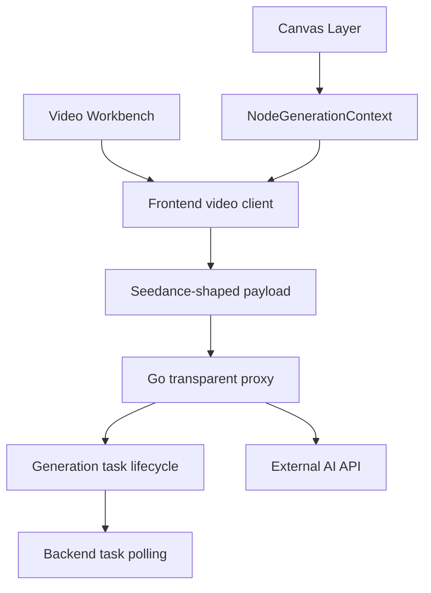
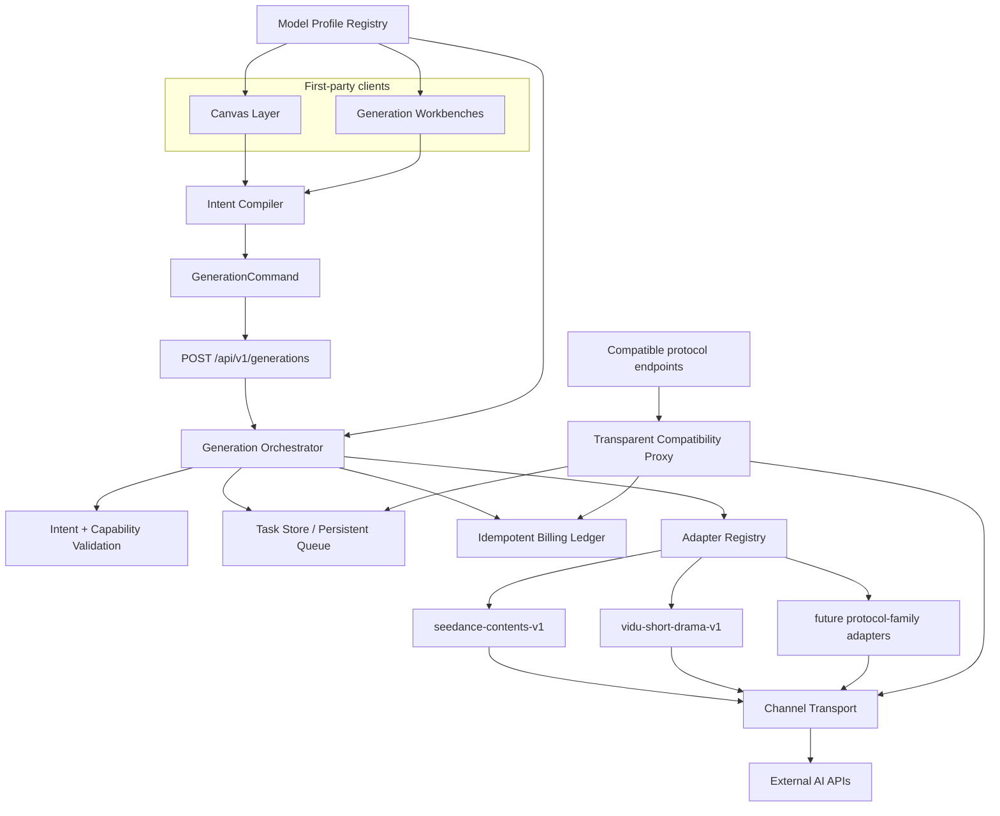

# 统一生成平台架构

> 状态：**Accepted**
> 生效日期：2026-07-14
> 适用范围：Canvas、图片工作台、视频工作台、音频与文本生成，以及平台托管的异步生成任务
> 首轮迁移范围：Canvas 视频生成；以 Seedance 普通视频和 Vidu Drama 为首批协议族

## 1. 文档目的

本文是 infinite-canvas 接入异构 AI 生成模型的长期架构基线。它规定 Canvas、生成任务、模型能力和外部协议之间的 seam，避免每接入一个模型就在页面、设置面板和请求客户端中增加供应商分支。

本文同时记录：

- 当前架构中可保留的能力与主要差距；
- 目标模块及其 Interface；
- 第一方生成命令、模型能力、任务状态、Adapter 和结果模型；
- OpenAI-compatible/xvan.ai 兼容入口的共存方式；
- 从现有链路渐进迁移的阶段、风险和验收门槛。

本文是约束性基线。文中的 **MUST**、**MUST NOT**、**SHOULD** 和 **MAY** 分别表示必须、禁止、建议和可选。若实现需要改变关键 seam、业务词汇或责任归属，必须先更新本文。

## 2. 背景

当前 Canvas 已能从节点图收集提示词和图片、视频、音频引用，但视频请求仍由前端直接构造近似供应商协议的 payload。以当前 Seedance 链路为例，前端会生成 `content`、`ratio`、`resolution`、`duration`、`generate_audio` 和 `watermark` 等字段。

Vidu Drama 使用相同的任务创建路径，但要求不同的业务语义和字段：

- `script_name`；
- `content[].text` 中的短剧脚本；
- 必填 `assets[]`；
- 每个资产具有 `character`、`scene` 或 `tool` 角色；
- 自动时长使用 `0`，而当前 Seedance 智能时长使用 `-1`；
- 供应商专属 `action: short-play`。

如果继续在前端请求函数中按模型名增加分支，Canvas、视频工作台、设置 UI、参数验证、状态解析和后端任务同步会逐步重复供应商知识。第三、第四个异构协议接入后，修改将跨越多个调用方，缺乏 locality。

相关接口说明见 [Vidu Drama API](../xvanai/vidu-drama-api.md)。

## 3. 架构决策摘要

1. 平台采用**后端中心的类型化业务意图、模型能力档案、协议族 Adapter 和统一任务编排**。
2. 第一方 Canvas 和工作台使用新的 `POST /api/v1/generations`；现有 `/api/v1/contents/generations/tasks` 继续作为外部兼容入口。
3. 复杂输入使用带判别字段的 `GenerationIntent`；简单标量设置由 Model Profile 声明并校验。
4. Model Profile 由后端作为单一来源：能力模板随代码版本发布，模型、渠道、价格与模板的绑定存储在配置数据中。
5. Adapter 按**协议族**划分并集中在 Go 后端，例如 `seedance-contents-v1` 和 `vidu-short-drama-v1`。
6. 第一方媒体输入只引用平台 `fileId`；后端校验所有权并转换为上游需要的 URL 或 data URI。
7. 演进现有 `generation_tasks`，复用任务历史、计费、所有权、审计和状态同步，不建立第二套任务体系。
8. 第一方命令强制幂等，任务使用 `queued/running/succeeded/failed/cancelled` 五态。
9. 数据库任务表作为第一阶段的持久队列；worker 使用原子 claim 和租约，进程重启后可恢复。
10. Vidu Drama 是独立的 `video.short-drama` 意图，而不是普通视频的可选参数集合。
11. 兼容入口与第一方入口共享任务生命周期基础设施，但不强制把供应商 payload 转成第一方意图。
12. 迁移按 Canvas 视频、视频工作台、其他生成类型的顺序渐进完成。

## 4. 当前架构评估

### 4.1 当前实际调用链



当前 Generation Task Layer 统一了任务运行生命周期，但它接收到的已经是接近供应商格式的请求，而不是平台统一业务模型。

### 4.2 已满足且应保留的能力

| 领域 | 当前能力 | 评价 |
|---|---|---|
| Canvas 项目 | 节点、连接、视口和会话统一保存在项目中 | 满足目标；图关系不应被拍平成供应商请求 |
| 生成上下文 | 从连接图派生 prompt 和图片/视频/音频引用 | 是统一业务意图编译器的良好起点 |
| 配置节点 | 支持按节点引用资源，而非复制资源内容 | 优于简单表单式生成入口，应保留 |
| 节点级覆盖 | 模型、比例、时长、质量等可保存在节点 metadata | 可迁移为 Profile 驱动的标准 settings |
| 任务元数据 | 已有任务类型、来源、模型、状态、积分、上游任务 ID 和错误 | 应演进而非重建 |
| 异步生命周期 | 已有轮询、取消、所有权和终态同步 | 应纳入 Orchestrator |
| 计费 | 已有预扣、退款和完成时调整 | 应集中到统一账本 |
| 审计 | 已保存请求、响应和原始错误，并有 TTL 清理 | 应升级为双层脱敏审计 |
| 渠道路由 | 后端可选择渠道并统一处理 URL 与鉴权 | 可作为 Adapter 的底层依赖 |
| 透明转发 | 请求 body 不经过 DTO 白名单，可兼容供应商扩展字段 | 应保留给外部兼容入口 |

主要现状位置：

- Canvas 输入编译：[canvas-node-generation.ts](../../web/src/pages/canvas/components/canvas-node-generation.ts)
- Canvas 节点模型：[types.ts](../../web/src/pages/canvas/types.ts)
- 前端视频请求构造：[video.ts](../../web/src/services/api/video.ts)
- 模型与渠道前端配置：[use-config-store.ts](../../web/src/stores/use-config-store.ts)
- 后端任务模型：[generation_task.go](../../model/generation_task.go)
- 后端透明代理与计费入口：[ai_proxy.go](../../service/ai_proxy.go)
- 后端异步同步：[task_sync.go](../../service/task_sync.go)
- 后端模型渠道配置：[setting.go](../../model/setting.go)

### 4.3 当前缺失和责任错位

| 目标能力 | 当前情况 | 后果 |
|---|---|---|
| 类型化 Generation Intent | 只有媒体级 `NodeGenerationContext` | 无法表达角色资产、首尾帧、蒙版等业务语义 |
| Model Capability Layer | 只有 image/video/text/audio 分类和模型列表 | UI、校验和 payload 构造依赖模型名或硬编码 |
| 明确的 Adapter seam | 请求构造在前端，URL/鉴权和部分状态同步在后端 | 同一协议变化可能修改前后端多个位置 |
| 第一方生成入口 | 平台内部使用兼容协议路径 | Canvas 必须理解供应商字段 |
| 后端权威验证 | 后端主要读取 model 并透传原 body | 无法统一校验输入角色、数量、值域和组合 |
| 平台媒体引用 | 前端可能提交 URL、data URI 或临时对象 URL | 权限、体积和异步 URL 生命周期难统一保证 |
| 稳定模型身份 | 模型值可能是上游名称或带渠道编码 | Canvas 与渠道拓扑耦合，模型重命名困难 |
| 路由快照 | 任务主要保存 model 和 upstreamTaskId | 运行中配置变化可能影响轮询和结果处理 |
| 持久执行队列 | 任务提交和轮询依赖请求流程或进程内调度 | 重启恢复能力不足 |
| 归一结果与错误 | 历史 DTO 和前端按媒体类型提取字段 | 新结果形态和供应商错误会持续扩大调用方逻辑 |

### 4.4 Vidu Drama 当前适配结论

当前 Canvas 能收集多张连接图片，但这些图片只进入普通视频的 `content[].image_url`，请求不包含 Vidu Drama 必填的 `assets` 和 `script_name`，也没有 `character/scene/tool` 角色。因此当前画布视频请求**不能完整适配 Vidu Drama**。

后端代理会原样转发 JSON body，不会过滤 `assets`、`script_name` 或 `action`。因此短期问题不在传输，而在 Canvas 到供应商 payload 之间缺少业务意图、能力验证和协议 Adapter。

## 5. 目标架构



### 5.1 调用顺序

第一方生成 MUST 遵循以下顺序：

1. 客户端获取公开 Model Profile 投影；
2. Canvas 或工作台把用户输入编译成 `GenerationCommand`；
3. 后端验证认证、`clientRequestId` 和命令版本；
4. 后端解析稳定的 `modelProfileId`；
5. 使用同一 Profile 验证 Intent、媒体所有权和 settings；
6. 计算命令摘要并执行幂等检查；
7. 事务内创建任务、审计摘要和预扣账本记录；
8. 返回本地 `taskId` 和 `queued`；
9. worker claim 任务并根据路由快照选择 Adapter；
10. Adapter 构造和提交供应商请求；
11. Orchestrator 通过 callback 和补偿轮询推进状态；
12. Adapter 归一化结果、错误与实际消耗；
13. Orchestrator 保存平台结果、完成最终结算并追加审计事件。

### 5.2 责任分配

| 模块 | MUST 负责 | MUST NOT 负责 |
|---|---|---|
| Canvas Layer | 节点图、资源选择、复杂输入编辑、意图编译、任务结果展示 | 供应商 URL、鉴权、字段名、状态码和 credits 提取 |
| Intent Compiler | 将 Canvas/工作台状态转换为类型化意图 | 发送 HTTP 或构造供应商 payload |
| Model Profile Registry | 模型身份、支持的意图、输入约束、标量 settings、Adapter 绑定 | 保存 API Key 或执行网络请求 |
| Generation Orchestrator | 权威验证、幂等、任务、队列、计费、路由、生命周期和归一结果 | 解析每个供应商的私有字段 |
| Protocol-family Adapter | 请求构造、媒体转换需求、鉴权/路径、创建、查询、回调、取消、状态和结果映射 | 修改用户余额、决定 UI 或读取 Canvas 图结构 |
| Channel Transport | Base URL、密钥、HTTP 发送和通用传输观测 | 推断业务意图 |
| Compatibility Proxy | 接受并透明转发既有供应商/兼容协议 | 强迫未知供应商扩展字段进入第一方业务模型 |

## 6. 统一业务模型

### 6.1 GenerationCommand

以下 TypeScript 仅描述跨层 JSON Interface；后端必须定义等价的权威校验模型。

```ts
type GenerationCommand = {
    commandVersion: 1;
    clientRequestId: string;
    modelProfileId: string;
    source: "canvas" | "image_workbench" | "video_workbench" | "audio_workbench" | "text_workbench";
    intent: GenerationIntent;
};
```

约束：

- `clientRequestId` MUST 由客户端为一次用户动作生成，并在网络重试时保持不变；
- 后端 MUST 对 `(userId, clientRequestId)` 建立唯一约束；
- 相同 key 与相同命令摘要 MUST 返回已有任务；
- 相同 key 与不同命令摘要 MUST 返回冲突；
- 客户端 MUST 发送稳定 `modelProfileId`，不得发送 `channelId::upstreamModel`；
- `commandVersion` MUST 用于兼容未来业务命令升级。

### 6.2 GenerationIntent

```ts
type GenerationIntent =
    | TextGenerationIntent
    | ImageGenerationIntent
    | ImageEditIntent
    | VideoGenerationIntent
    | ShortDramaIntent
    | AudioGenerationIntent;
```

业务意图 MUST 使用判别字段。禁止把所有生成类型合并为包含大量可选字段的万能结构。

首轮需要稳定定义的两个视频意图如下。

#### 普通视频

```ts
type VideoGenerationIntent = {
    kind: "video.generate";
    prompt: string;
    references: {
        images: MediaReference[];
        videos: MediaReference[];
        audios: MediaReference[];
    };
    settings: ScalarSettings;
};
```

#### 短剧

```ts
type ShortDramaIntent = {
    kind: "video.short-drama";
    title: string;
    script: string;
    assets: Array<{
        sourceNodeId: string;
        role: "character" | "scene" | "tool";
        name: string;
        description?: string;
        media: MediaReference;
    }>;
    settings: ScalarSettings;
};
```

Vidu Drama 第一版约束：

- `title` 必填，Adapter 映射为 `script_name`；
- `script` 必填，Adapter 映射为 `content[].text`；
- `assets` 必填；
- 每个资产的 `role` 必须显式设置；
- Canvas 目标生成节点以 `sourceNodeId` 保存角色映射；
- 同一图片在不同目标节点可以承担不同角色；
- `CanvasConnection` 只表达拓扑，MUST NOT 保存供应商或意图专属 metadata。

### 6.3 MediaReference

```ts
type MediaReference = {
    fileId: string;
    sourceNodeId?: string;
    name?: string;
};
```

第一方入口：

- MUST 只接受平台文件引用；
- MUST 校验文件属于当前用户或用户有读取权限；
- MUST 在任务提交前保证本地媒体已上传；
- Adapter 根据上游能力选择预签名 URL、代理 URL 或 data URI；
- 任务和长期审计 MUST 保存 `fileId`，不得保存完整 data URI；
- 临时签名 URL MUST 在日志与审计中脱敏。

兼容入口 MAY 按原协议继续接受公开 URL 或 data URI。

### 6.4 ScalarSettings

```ts
type ScalarSettingValue = string | number | boolean;
type ScalarSettings = Record<string, ScalarSettingValue>;
```

`ScalarSettings` 不是任意扩展口：

- 只允许字符串、数字和布尔值；
- MUST NOT 接受数组、对象和 `null`；
- key 必须由选中 Profile 声明；
- 未声明 key MUST 被后端拒绝；
- key 使用平台语义，例如 `aspectRatio`、`durationSeconds`、`resolution`、`quality`；
- Adapter 负责映射成供应商字段和值；
- 会改变节点关系、资源角色或工作流的输入 MUST 成为类型化 Intent 字段，不得塞入 settings。

## 7. Model Profile 与 Capability

### 7.1 稳定身份与绑定

```ts
type ModelProfile = {
    id: string;
    version: number;
    displayName: string;
    adapterKey: string;
    upstreamModel: string;
    intents: GenerationIntent["kind"][];
    capabilities: CapabilityDefinition;
};
```

Profile 的公开投影 MUST 不含渠道密钥和私有连接信息。

模型与能力采用“代码模板 + 数据绑定”：

- 能力模板、约束和 Adapter 兼容关系 MUST 随代码版本发布；
- 数据配置 MAY 绑定 `modelProfileId`、`upstreamModel`、渠道策略、价格和启用状态；
- 管理员 MUST NOT 声明 Adapter 实现不支持的结构化能力；
- 安全的运营覆盖只允许文档明确列出的限制，例如更小的最大资产数；覆盖不得扩大 Adapter 的代码能力。

### 7.2 示例 Profile

```json
{
  "id": "viduq3-drama-oversea",
  "version": 1,
  "displayName": "Vidu Q3 Drama",
  "adapterKey": "vidu-short-drama-v1",
  "upstreamModel": "viduq3-drama-oversea",
  "intents": ["video.short-drama"],
  "capabilities": {
    "assets": {
      "required": true,
      "min": 1,
      "max": 14,
      "roles": ["character", "scene", "tool"]
    },
    "settings": {
      "aspectRatio": {
        "type": "enum",
        "values": ["16:9", "9:16"],
        "default": "9:16"
      },
      "durationSeconds": {
        "type": "duration",
        "min": 8,
        "max": 12,
        "allowAuto": true,
        "default": "auto"
      },
      "resolution": {
        "type": "enum",
        "values": ["1080p"],
        "default": "1080p"
      }
    },
    "cancellation": false,
    "completion": ["poll"]
  }
}
```

### 7.3 Capability 驱动 UI 的限度

Profile SHOULD 自动投影以下简单控件：

- 枚举；
- 有范围的数字；
- 布尔开关；
- 短文本；
- 平台定义的时长、比例和分辨率控件。

以下结构化输入 MUST 使用意图专属编辑器：

- 角色、场景和道具资产；
- 首帧/尾帧；
- 遮罩；
- 时间线；
- 多镜头或分镜；
- 具有跨字段关系的复杂工作流。

系统 MUST NOT 使用通用 JSON Schema 表单替代复杂 Canvas 交互。

### 7.4 三阶段配置校验

Profile、Adapter 和渠道绑定 MUST 在三个阶段校验：

1. 服务启动时扫描全部启用绑定；
2. 管理员保存配置时即时校验；
3. 任务创建时防御性校验。

无效绑定 MUST 被禁用并产生明确告警，不能等用户发起生成后随机失败。

## 8. Protocol-family Adapter

### 8.1 Adapter 粒度

Adapter MUST 按协议族划分，例如：

- `seedance-contents-v1`；
- `vidu-short-drama-v1`；
- `openai-images-v1`；
- `openai-responses-v1`；
- `gemini-generate-content-v1`。

同一协议族的新模型 SHOULD 只新增 Profile 和绑定，不新建 Adapter。破坏性协议变化 MUST 新建主版本，例如 `vidu-short-drama-v2`。

### 8.2 深模块 Interface

以下 Go Interface 是目标形状，具体方法可在实现规划中按现有代码收敛：

```go
type GenerationAdapter interface {
    Create(ctx context.Context, req CreateRequest) (ProviderTaskRef, error)
    Poll(ctx context.Context, task ProviderTaskRef) (NormalizedTaskState, error)
    Cancel(ctx context.Context, task ProviderTaskRef) error
}
```

Adapter Interface 还包括以下不变量：

- `Create` 接收已通过权威验证的类型化意图和冻结路由；
- `Create` 不修改余额；
- `Poll` 和 callback 解析返回相同的 `NormalizedTaskState`；
- `Cancel` 只在 Profile 声明支持时调用；
- 错误必须归一化；
- 原始供应商数据只可进入脱敏 TTL 审计。

具体实现 MUST 隐藏：

- 供应商路径和鉴权；
- payload 字段和值转换；
- 媒体 URL/data URI 选择；
- 创建、查询、回调和取消协议；
- 状态、错误、结果与实际 credits 提取。

Orchestrator MUST NOT 调用 `BuildViduPayload`、`ParseSeedanceState` 等供应商专属 helper；这些只能是 Adapter 内部 seam。

### 8.3 重试规则

- 上游创建默认 MUST NOT 盲重试；
- 只有供应商支持幂等键，或 Adapter 能可靠查询首次提交结果时，创建 MAY 自动重试；
- 查询、回调补偿和结果下载 SHOULD 使用有上限的指数退避；
- 重试策略必须按操作安全性区分，不得用统一 HTTP 重试器包裹全部请求。

### 8.4 取消规则

- Profile 必须声明是否支持真实上游取消；
- 不支持取消的任务不得向用户伪装 `cancelled`；
- “停止前端等待”与“取消上游任务”是不同操作；
- 取消请求与完成通知并发时，最终状态必须根据供应商权威状态和幂等终态规则决定。

## 9. Generation Orchestrator

### 9.1 第一方入口

```http
POST /api/v1/generations
Content-Type: application/json
Authorization: Bearer <token>
```

请求体为 `GenerationCommand`。

后端完成同步验证、幂等检查、本地任务持久化和预扣账本记录后立即响应：

```json
{
  "id": "gen_xxxxx",
  "status": "queued",
  "modelProfileId": "viduq3-drama-oversea",
  "intentKind": "video.short-drama",
  "createdAt": "2026-07-14T12:00:00Z"
}
```

输入无效、模型禁用、媒体无权限或余额不足 MUST 同步失败。上游提交失败发生在后台，并更新任务为 `failed`。

建议的第一方查询 Interface：

```text
POST /api/v1/generations
GET  /api/v1/generations/{id}
POST /api/v1/generations/{id}/cancel
GET  /api/v1/model-profiles
GET  /api/v1/model-profiles/{id}
```

具体响应包裹格式应遵循项目现有第一方接口约定；本文只固定业务语义。

### 9.2 标准状态

第一方任务只暴露：

```text
queued → running → succeeded
                 ↘ failed
queued/running → cancelled（仅真实取消成功）
```

- Adapter 负责把上游状态映射为标准五态；
- `validating`、`submitting`、`polling`、`settling` 等内部阶段可记录为事件或字段，但 MUST NOT 成为所有客户端必须处理的公开状态；
- 历史 DTO MAY 把旧 `pending/success` 映射到新状态，但旧数据库记录不做猜测性回填。

### 9.3 持久队列

第一阶段 MUST 使用数据库任务表作为可靠队列：

- worker 通过原子更新 claim 可执行任务；
- claim 必须有租约和过期时间；
- 进程重启后可重新 claim 过期任务；
- 同一任务同时只能有一个有效执行者；
- 终态写入与计费结算必须幂等。

只有实测出现以下情况时，才 SHOULD 引入 Redis、消息队列或独立任务系统：

- 数据库 claim 争用成为瓶颈；
- 排队延迟无法满足目标；
- 任务吞吐显著影响主数据库；
- 需要跨区域队列或复杂优先级调度。

### 9.4 回调与轮询

- Adapter/Profile 声明 `poll`、`callback` 或两者；
- 支持可信 callback 时 SHOULD 优先使用 callback；
- 后台 MUST 保留低频补偿轮询和超时扫描；
- 回调、轮询和人工恢复可能重复到达，所有终态处理必须幂等；
- callback token 和签名验证属于信任边界，不能简化。

### 9.5 路由快照

任务创建时 MUST 固化：

```text
modelProfileId
modelProfileVersion
adapterKey
channelId
upstreamModel
upstreamTaskId（上游接受后写入）
commandVersion
intentKind
```

API Key 不得复制到任务记录。运行中修改模型绑定或渠道权重不得改变已有任务的查询路径。

### 9.6 计费

Orchestrator MUST 统一维护幂等计费账本：

1. 创建任务时按 Profile 策略预扣；
2. Adapter 只返回归一化实际消耗，不直接修改余额；
3. 终态根据实际消耗结算多退少补；
4. 上游未返回实际消耗时，Profile 必须明确固定价、失败退款或失败计费策略；
5. 重复 callback、poll、worker 恢复或人工操作不得重复结算；
6. 余额变更必须能关联平台 task ID。

### 9.7 轻量审计事件

保留任务当前状态，同时增加 append-only 审计事件，至少记录：

- 任务创建与幂等复用；
- worker claim、租约恢复；
- 上游提交与 task ID；
- 状态变化；
- callback 与补偿 poll；
- 重试；
- 取消；
- 预扣与最终结算；
- 人工恢复或管理操作。

本架构不采用完整事件溯源；当前任务状态仍是查询 Source of Truth。

## 10. 归一结果与错误

### 10.1 GenerationResult

成功结果 MUST 是带判别字段的联合类型，并引用平台文件：

```ts
type GenerationResult =
    | { kind: "text"; text: string }
    | { kind: "images"; files: GeneratedFile[] }
    | { kind: "video"; file: GeneratedFile; thumbnailFileId?: string }
    | { kind: "audio"; file: GeneratedFile }
    | {
          kind: "short-drama";
          file: GeneratedFile;
          thumbnailFileId?: string;
          shots?: Array<{
              index: number;
              durationSeconds?: number;
              fileId?: string;
              status: string;
          }>;
      };

type GeneratedFile = {
    fileId: string;
    mimeType: string;
    bytes?: number;
    width?: number;
    height?: number;
    durationMs?: number;
};
```

- 上游媒体 SHOULD 在任务成功前落入平台对象存储；
- 第一方结果 MUST NOT 依赖易过期的供应商签名 URL；
- 供应商原始 `signed_final_video_url` 等字段不得成为 Canvas Interface；
- 意图专属结果可增加类型化字段，但不得要求调用方解析任意 metadata。

### 10.2 GenerationError

```ts
type GenerationError = {
    code: string;
    message: string;
    retryable: boolean;
    fieldPath?: string;
    resourceId?: string;
};
```

Adapter MUST 把供应商错误映射为稳定的平台分类。推荐的首批分类包括：

```text
INVALID_COMMAND
UNSUPPORTED_INTENT
MODEL_DISABLED
MODEL_CONFIGURATION_INVALID
INVALID_SETTING
MEDIA_NOT_FOUND
MEDIA_FORBIDDEN
MEDIA_UNSUPPORTED
INSUFFICIENT_CREDITS
UPSTREAM_REJECTED
UPSTREAM_RATE_LIMITED
UPSTREAM_UNAVAILABLE
TASK_TIMEOUT
CANCEL_UNSUPPORTED
RESULT_PERSIST_FAILED
INTERNAL_ERROR
```

脱敏后的原始供应商 code/message MAY 存入 TTL 审计，但 Canvas MUST NOT 依赖它们。

## 11. 双层脱敏审计

### 11.1 长期任务记录

长期保留：

- 规范化命令摘要；
- `fileId` 和必要资源身份；
- `intentKind`、Profile、Adapter 和路由快照；
- 标准状态、归一错误和结果；
- 计费结果；
- 审计事件。

### 11.2 TTL 详细记录

沿用 `generation_payloads` 的 TTL 思路保存：

- 脱敏后的上游请求；
- 脱敏后的上游响应；
- 脱敏原始错误；
- 必要的请求/响应头。

MUST 移除或替换：

- Authorization 和 API Key；
- callback secret；
- 完整签名查询参数；
- data URI 正文；
- 不必要的用户隐私字段。

大段脚本和角色描述的保留周期 SHOULD 与 payload TTL 一致；长期记录只保留业务所需摘要或受控字段。

## 12. Seedance 与 Vidu Drama 对照示例

### 12.1 第一方普通视频命令

```json
{
  "commandVersion": 1,
  "clientRequestId": "01J2NORMALVIDEO",
  "modelProfileId": "seedance-1-5-pro",
  "source": "canvas",
  "intent": {
    "kind": "video.generate",
    "prompt": "人物走进雨夜街道",
    "references": {
      "images": [{"fileId": "file_character", "sourceNodeId": "node_image_1", "name": "人物"}],
      "videos": [],
      "audios": []
    },
    "settings": {
      "aspectRatio": "16:9",
      "resolution": "1080p",
      "durationSeconds": 10,
      "generateAudio": true,
      "watermark": false
    }
  }
}
```

`seedance-contents-v1` Adapter 可转换为：

```json
{
  "model": "<profile.upstreamModel>",
  "content": [
    {"type": "text", "text": "人物走进雨夜街道"},
    {"type": "image_url", "image_url": {"url": "<adapter-resolved-url>"}, "role": "reference_image"}
  ],
  "ratio": "16:9",
  "resolution": "1080p",
  "duration": 10,
  "generate_audio": true,
  "watermark": false
}
```

### 12.2 第一方短剧命令

```json
{
  "commandVersion": 1,
  "clientRequestId": "01J2SHORTDRAMA",
  "modelProfileId": "viduq3-drama-oversea",
  "source": "canvas",
  "intent": {
    "kind": "video.short-drama",
    "title": "典当行退婚",
    "script": "人物：林尘、未婚妻。分镜1-1：林尘在典当行擦拭柜台，神情淡然。未婚妻推门进入，将戒指拍在柜台上提出退婚。",
    "assets": [
      {
        "sourceNodeId": "node_linchen",
        "role": "character",
        "name": "林尘",
        "description": "男主角，穿白色衬衫，神情沉稳",
        "media": {"fileId": "file_linchen", "sourceNodeId": "node_linchen", "name": "林尘"}
      },
      {
        "sourceNodeId": "node_shop",
        "role": "scene",
        "name": "典当行",
        "media": {"fileId": "file_shop", "sourceNodeId": "node_shop", "name": "典当行"}
      }
    ],
    "settings": {
      "aspectRatio": "9:16",
      "resolution": "1080p",
      "durationSeconds": "auto"
    }
  }
}
```

`vidu-short-drama-v1` Adapter 可转换为：

```json
{
  "model": "viduq3-drama-oversea",
  "action": "short-play",
  "script_name": "典当行退婚",
  "content": [
    {
      "type": "text",
      "text": "人物：林尘、未婚妻。分镜1-1：林尘在典当行擦拭柜台，神情淡然。未婚妻推门进入，将戒指拍在柜台上提出退婚。"
    }
  ],
  "assets": [
    {
      "id": "01",
      "type": "character",
      "name": "林尘",
      "description": "男主角，穿白色衬衫，神情沉稳",
      "image_uri": "<adapter-resolved-url>"
    },
    {
      "id": "02",
      "type": "scene",
      "name": "典当行",
      "image_uri": "<adapter-resolved-url>"
    }
  ],
  "duration": 0,
  "ratio": "9:16",
  "resolution": "1080p"
}
```

关键点：

- `action`、`script_name`、`image_uri`、资产序号和自动时长 `0` 只属于 Adapter 实现；
- Canvas 保存的是业务标题、脚本、角色和 `fileId`；
- 若未来 Vidu 协议把 `tool` 改名，修改应局限于 Adapter 和 Profile，不应修改 Canvas 调用方；
- 若未来出现第二种短剧协议，可复用 `video.short-drama` 意图并新增协议族 Adapter。

## 13. 兼容入口共存

现有 OpenAI-compatible/xvan.ai 路径 MUST 保留，例如：

```text
POST /api/v1/contents/generations/tasks
GET  /api/v1/contents/generations/tasks/{id}
```

共存原则：

- 兼容入口继续接受原协议 payload 并透明转发；
- 兼容入口复用任务记录、计费、所有权、审计和状态同步基础设施；
- 兼容入口不承诺第一方 Intent 验证和类型化结果；
- 未知供应商扩展字段不得迫使第一方业务模型扩张；
- 平台 Canvas 与工作台完成迁移后 MUST 使用第一方入口，不得继续构造供应商 payload；
- 外部接口行为变更由其独立版本和文档管理。

## 14. 本地直连模式

当前 `channelMode=local` 允许浏览器直接请求用户配置的上游。该路径天然绕过后端 Adapter、任务队列、权威验证、计费、审计和媒体权限。

长期规则：

- 平台托管的新高级意图 MUST 走 remote 第一方入口；
- local 模式 MAY 保留现有基础兼容能力；
- local 模式不承诺支持 `video.short-drama` 等高级结构化意图；
- MUST NOT 为保持 local 与 remote 完全等价而在前后端复制 Adapter；
- 若未来确有完整 BYOK 需求，应单独设计用户本地后端代理，不在浏览器中复制平台编排逻辑。

## 15. 数据模型演进

具体 migration 由实施计划确定，但现有 `generation_tasks` 至少需要表达：

```text
client_request_id       -- 与 user_id 组成唯一约束
command_version
command_hash
intent_kind
model_profile_id
model_profile_version
adapter_key
channel_id
upstream_model
upstream_task_id
status                  -- 标准五态
queue_available_at
worker_lease_owner
worker_lease_expires_at
normalized_result       -- 类型化 JSON，或独立结果表
normalized_error        -- 结构化 JSON，或对应字段
actual_credits
```

设计约束：

- 关键路由和查询字段 SHOULD 使用结构化列，不得全部塞入 `metadata`；
- 大型命令详情、脱敏上游请求/响应继续使用 payload 表和 TTL；
- 新旧任务历史统一读取；
- 旧记录允许新字段为空，不做从原始 requestBody 猜测意图的回填；
- 新任务必须写入命令版本、意图和路由快照。
- 平台 `queued` 只表示等待本地 worker；任务被认领后，供应商 `queued`、`running` 和 `processing` 均归一化为平台 `running`。
- `pending` 仅用于成功结果持久化期间的内部结算，不属于公开第一方五态。

建议新增轻量事件表：

```text
generation_task_events
- id
- task_id
- type
- detail        -- 小型、脱敏文本
- created_at
```

## 16. 迁移计划

### 阶段 0：冻结词汇与合约

复杂度：**中**

- 定义 `GenerationCommand`、首批 Intent、Profile 和归一结果/错误；
- 建立命令版本、状态和错误词汇；
- 为现有 Seedance 与 Vidu 示例建立 Adapter 黄金测试数据。

门槛：同一概念在 Canvas、Go 和文档中使用一致命名。

### 阶段 1：后端基础模块

复杂度：**高**

- 演进 `generation_tasks`；
- 实现 Profile Registry 与公开投影；
- 实现 Adapter Registry；
- 实现数据库持久队列、claim/租约与恢复；
- 抽取并复用现有计费、任务和审计能力；
- 实现第一方创建、查询和取消入口。

门槛：使用 fake Adapter 完成幂等、重启恢复、终态和计费测试。

### 阶段 2：首批协议族 Adapter

复杂度：**高**

- 实现 `seedance-contents-v1`；
- 实现 `vidu-short-drama-v1`；
- 集中媒体解析、状态映射、错误、结果和实际 credits；
- callback 优先并提供补偿 poll。

门槛：黄金测试覆盖精确请求映射和代表性成功/失败响应。

### 阶段 3：Canvas 视频迁移

复杂度：**高**

- Canvas 从 Profile 投影视频设置；
- 普通视频编译 `video.generate`；
- Drama 提供资产角色专用编辑器；
- 目标节点保存 `sourceNodeId → role`；
- 本地媒体先上传并使用 `fileId`；
- loading/result 节点订阅第一方任务状态。

门槛：普通 Seedance 视频行为不回退；Vidu Drama 可从连接图片完整生成 `assets`。

### 阶段 4：视频工作台迁移

复杂度：**中**

- 视频工作台改用同一第一方命令；
- 删除前端重复的供应商 payload 构造；
- 保持历史和来源过滤兼容。

门槛：Canvas 与视频工作台共享相同 Profile、验证、Adapter 和结果语义。

### 阶段 5：其他生成域按收益迁移

复杂度：每个域 **中到高**

- 图片、音频、文本逐步定义 Intent 和协议族 Adapter；
- 只有出现真实第二种变化时才抽取新的通用结构；
- 旧兼容入口持续可用。

门槛：每迁移一个调用方，就删除其前端供应商协议知识；禁止长期双实现。

## 17. 复杂度与主要风险

| 风险 | 等级 | 说明 | 缓解方式 |
|---|---:|---|---|
| 任务与计费并发 | 高 | callback、poll、worker 恢复可能重复结算 | 数据库唯一约束、事务、幂等账本、终态 CAS |
| 创建请求不确定性 | 高 | 上游已创建但响应丢失可能重复生成 | 默认不盲重试；利用上游幂等键或可查询提交结果 |
| 数据库队列恢复 | 高 | 多 worker claim、租约过期和进程重启 | 原子 claim、租约、恢复测试、任务事件 |
| Profile 与 Adapter 漂移 | 高 | UI 宣称支持但 Adapter 不支持 | 代码模板、三阶段校验、绑定禁用 |
| 媒体 URL 生命周期 | 高 | 排队后签名 URL 可能失效 | 保存 fileId，执行时生成供应商引用 |
| 结果持久化失败 | 高 | 上游成功但平台文件保存失败 | 独立错误码、可恢复下载阶段、保留受控上游引用直到 TTL |
| 现有视频回归 | 中高 | Seedance 当前行为较多且测试覆盖有限 | 先把现有行为固化为黄金测试，再迁移 Canvas |
| Capability UI 过度泛化 | 中 | 复杂交互退化为万能表单 | 标量通用、结构化输入专用 |
| 审计泄漏 | 中高 | 签名 URL、data URI 和脚本可能被长期保存 | 双层脱敏、TTL、字段白名单 |
| 新旧历史兼容 | 中 | 旧任务缺少 intent/Profile | 空值兼容，不做猜测性回填 |
| local 模式能力差异 | 中 | 用户误以为本地直连支持全部功能 | UI 明确能力范围，不复制后端 Adapter |
| 架构一次性改造过大 | 高 | 全生成域同时迁移会扩大回归面 | 全域统一设计、视频先行、渐进切换 |

## 18. 验证策略

### 18.1 Profile 合约测试

MUST 验证：

- 每个启用 Profile 引用存在的 Adapter；
- Adapter 支持 Profile 声明的 Intent；
- 默认 settings 符合自身约束；
- 未知 setting 被拒绝；
- 公开投影不含私密渠道信息；
- 管理覆盖不能扩大模板能力。

### 18.2 Adapter 黄金测试

每个 Adapter MUST 使用固定业务意图断言：

- 精确上游路径、请求字段和值转换；
- 媒体引用策略；
- 创建响应和 task ID；
- processing/succeeded/failed/cancelled 状态；
- 结果、错误和实际 credits；
- callback 与 poll 得到相同归一状态。

### 18.3 Orchestrator 测试

使用 fake Adapter 验证：

- 命令验证失败不创建任务、不扣费；
- 相同幂等键返回同一任务；
- 相同键不同命令返回冲突；
- worker claim 不重复执行；
- 租约过期后任务可恢复；
- 创建失败按 Profile 策略结算；
- callback 和 poll 重复终态只结算一次；
- 配置变化不影响运行中任务；
- 不支持取消时返回明确错误；
- 旧任务记录仍可查询。

### 18.4 端到端验收

首轮迁移至少验证：

1. Canvas 普通视频：连接图片并通过 Seedance 成功生成；
2. Canvas Drama：显式配置 character/scene/tool，并在审计中看到正确脱敏映射；
3. 网络超时后使用同一 `clientRequestId` 重试，不产生重复任务或扣费；
4. 服务重启后 queued/running 任务恢复；
5. callback 丢失时补偿轮询完成任务；
6. 结果保存为平台 fileId，供应商签名 URL 过期不影响播放；
7. 现有兼容接口继续接受文档中的 Vidu 原始 payload；
8. 管理员错误绑定 Profile 时，配置被拒绝或禁用并给出明确原因。

## 19. 架构验收准则

迁移后的第一方生成链路必须满足：

- [ ] Canvas 和工作台提交平台业务意图，不构造供应商 payload；
- [ ] 后端是 Profile 和 Capability 的单一来源；
- [ ] 同协议新模型可只通过 Profile/绑定接入；
- [ ] 新协议集中为一个协议族 Adapter；
- [ ] 第一方媒体只使用平台 fileId；
- [ ] 任务强制幂等并可在进程重启后恢复；
- [ ] Adapter 不直接修改余额；
- [ ] 上游状态、错误和结果不泄漏到 Canvas Interface；
- [ ] 运行中任务使用冻结路由快照；
- [ ] 兼容入口行为保持不变并共享生命周期基础设施；
- [ ] 新旧历史均可读取；
- [ ] 审计中无 API Key、完整签名 URL 或 data URI；
- [ ] Seedance 和 Vidu Adapter 均有黄金测试；
- [ ] 复杂输入使用专用 UI，未退化为任意 JSON 表单。

## 20. 禁止事项

以下做法违反本架构：

1. 在 Canvas 页面或工作台中增加 `if (model.includes("provider"))` 并构造供应商字段；
2. 将 `GenerationCommand` 设计成 `params: Record<string, unknown>` 的万能透传对象；
3. 前后端分别维护手工 Capability 表；
4. 每个模型复制一个只有配置差异的 Adapter；
5. 将 API Key、完整 data URI 或完整签名 URL长期写入任务记录；
6. 由 Adapter 直接扣费或退款；
7. 仅用前端按钮防重代替服务端幂等；
8. 在不支持上游取消时伪造 `cancelled`；
9. 为 local 模式复制整套后端 Adapter；
10. 在尚无实测瓶颈时引入 Redis/Kafka 或通用工作流 DAG；
11. 将所有新字段塞进 `metadata`，规避关键数据的结构化建模；
12. 为追求单一路径而强行把未知兼容协议转换为第一方 Intent。

## 21. 非目标

本文不要求当前立即实现：

- 通用工作流 DAG 引擎；
- 动态插件加载或 Adapter 热部署；
- 每个模型独立 Adapter；
- 管理员自由编辑任意嵌套 Capability Schema；
- 全部生成类型一次性迁移；
- 浏览器 local 模式与平台 remote 模式完全等价；
- 完整事件溯源；
- 在没有吞吐证据时引入外部消息队列。

## 22. 新模型接入规则

| 变化类型 | 应修改的位置 |
|---|---|
| 同一协议族的新模型 | 新增 Profile/模型绑定、渠道和价格配置 |
| 已有协议新增简单标量参数 | 更新 Capability 模板和 Adapter 字段映射 |
| 已有协议新增复杂输入语义 | 扩展或新增类型化 Intent，并按需增加专用 UI |
| 新协议支持已有业务意图 | 新增协议族 Adapter 和 Profile |
| 新协议与新业务意图 | 新增 Intent、Profile、Adapter，并按需增加专用 UI |
| 只改变价格或启用状态 | 更新数据绑定，不修改 Canvas 或 Adapter |
| 只改变渠道权重 | 更新路由策略，不改变 Profile 身份 |

判断顺序：

1. 变化是否只是配置？
2. 是否已有协议族 Adapter？
3. 是否已有能准确表达业务目标的 Intent？
4. 新输入是否改变节点关系或业务语义？
5. 只有前述均不满足时，才新增结构或 Adapter。

## 23. 后续文档

本文定义长期 seam 和约束，不承担逐文件施工清单。进入实现前应另建带日期的实施规格，至少包含：

- 数据库 migration；
- Go 模块与 Interface 的实际文件布局；
- 第一方 JSON 合约与错误响应；
- Seedance/Vidu 黄金 fixture；
- Canvas Drama 角色编辑交互；
- 分阶段发布、回滚和数据兼容步骤；
- 可观测性指标和告警阈值。

实施规格不得重新讨论本文已 Accepted 的决策，除非先更新本架构基线。
